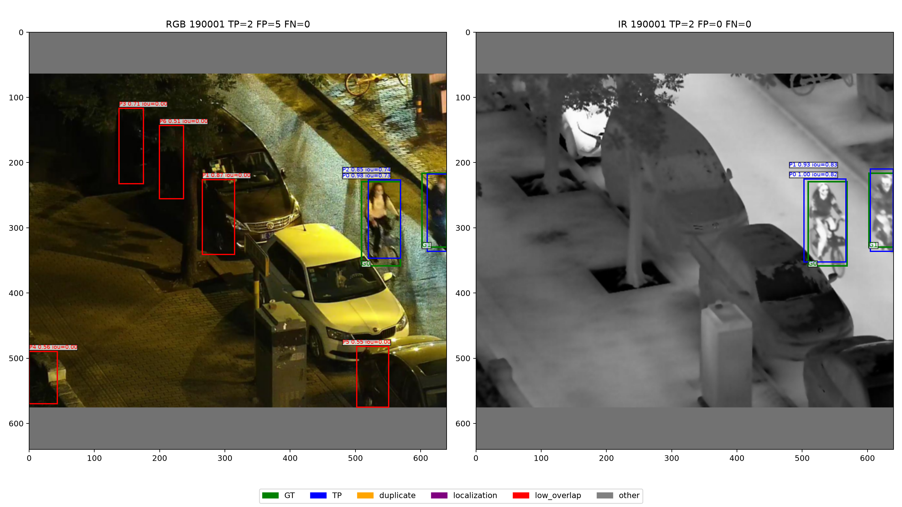
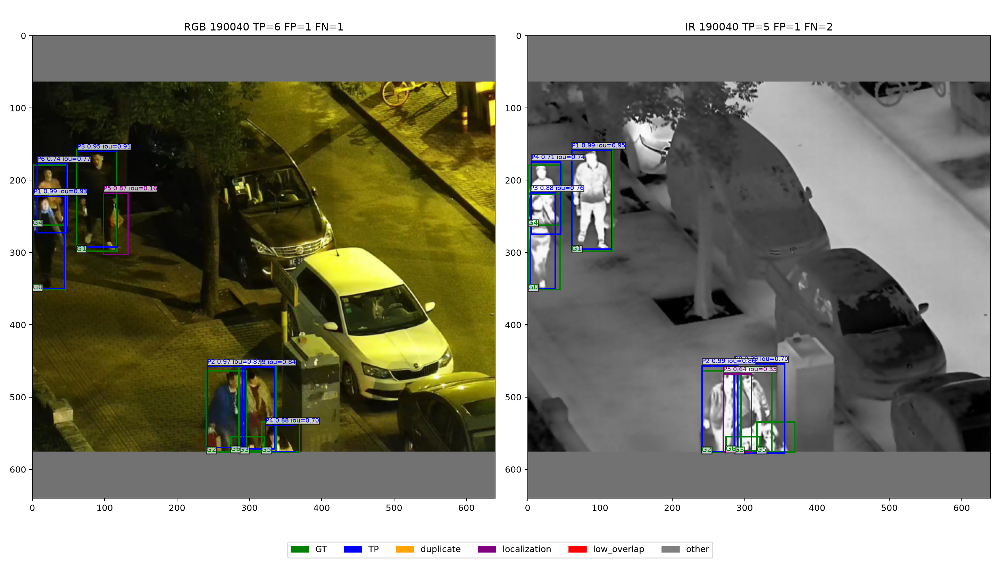
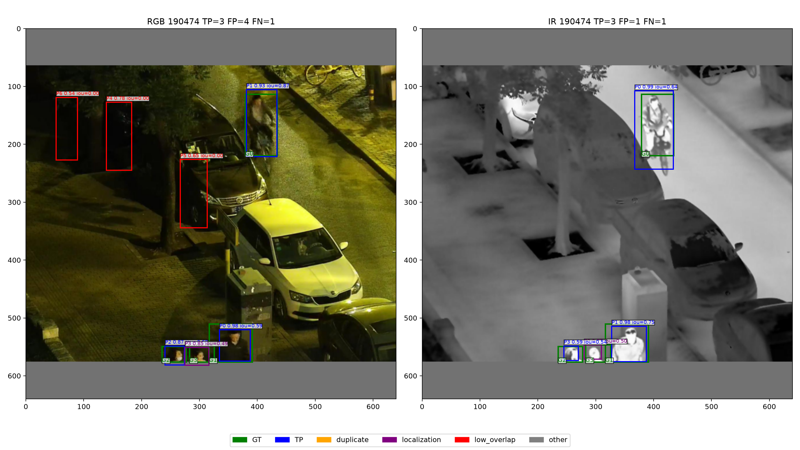
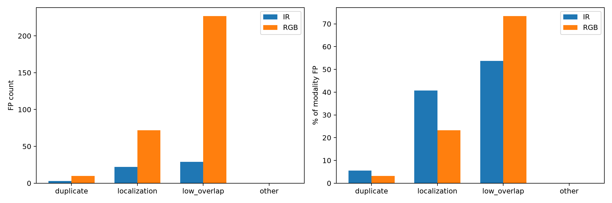
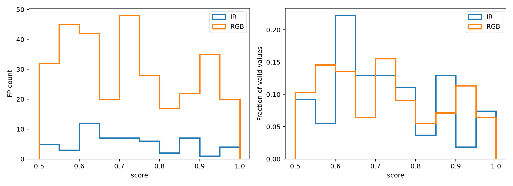
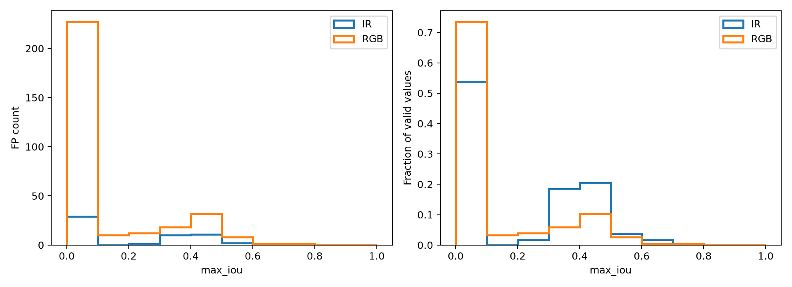

# Day04 Step7：IR/RGB 离线检测错误分析交接

本次仅加载两份已核验SHA256的项目预测缓存，不加载模型/权重，不做前向推理、训练、CUDA或远程操作。全部结果为本次重新计算。

## 环境、命令和缓存结构

```json
{
  "python": "3.14.7 (tags/v3.14.7:823f032, Aug  5 2026, 10:51:32) [MSC v.1944 64 bit (AMD64)]",
  "executable": "D:\\python\\.venv\\Scripts\\python.exe",
  "torch": "2.14.1+cpu",
  "torchvision": "0.29.1+cpu",
  "matplotlib": "3.11.2",
  "platform": "Windows-11-10.0.26200-SP0",
  "device": "cpu",
  "command": "D:\\python\\.venv\\Scripts\\python.exe -B D:\\python\\test\\vision-learning\\week08\\day04\\error_analysis\\analyze_detection_errors.py",
  "caches": {
    "IR": {
      "path": "D:\\python\\test\\vision-learning\\week08\\day03\\outputs\\ir_baseline_run01\\test_predictions.pth",
      "sha256": "79ae89f650520a80ada1996b0cb9c8f2079846ff62b8d07cd29b7d5e4fae3b78",
      "keys": [
        "predictions",
        "truths",
        "stems"
      ],
      "prediction_fields": [
        "boxes",
        "scores",
        "labels"
      ]
    },
    "RGB": {
      "path": "D:\\python\\test\\vision-learning\\week08\\day04\\outputs\\rgb_baseline_retrieved_20261030_213029_fa237fce\\test_predictions.pth",
      "sha256": "82a688699c3b9cddd9f71aa22ad468e7d942e986f35b659c3d4f667ab27a3408",
      "keys": [
        "modality",
        "predictions",
        "truths",
        "stems"
      ],
      "prediction_fields": [
        "boxes",
        "scores",
        "labels"
      ]
    }
  },
  "validation": "all 150 original paired samples have identical transformed GT to both caches; equal image dimensions; no independent image registration audit",
  "matching_source_sha256": "6cf2ce268feb314d937a9476f88e1db53722eb9aa791571efe44af0f07abe73e",
  "cache_sha_unchanged": true
}
```

缓存predictions为每图boxes(float32 N×4)、scores(float32 N)、labels(int64 N)；truths为每图GT xyxy Tensor，stems为同顺序编号。IR无modality键，RGB含visible。CPU加载map_location=cpu、weights_only=False，与历史项目代码一致；仅允许固定路径、加载前验证历史哈希的可信缓存。

## 匹配复核（先执行的停止门槛）

{
  "IR": {
    "TP": 307,
    "FP": 54,
    "FN": 41,
    "GT": 348
  },
  "RGB": {
    "TP": 299,
    "FP": 309,
    "FN": 49,
    "GT": 348
  }
}

直接调用ir_common.match，score≥0.5、IoU≥0.5。每图torch.argsort(descending=True,stable=True)按分数排序；对已匹配GT将IoU置-1，在剩余GT中取最大IoU（并列取最先索引），达到阈值则占用。不是先找全局最佳GT再判断其是否被占用。追踪版本逐图逐事件与原函数完全相等；数据集事件最终稳定按分数排序，不改变计数。所有编号为0起始：prediction_id保持原缓存索引，dataset_image_id为测试集索引，image_id为文件stem。

## 分类规则

只对score≥0.5的FP分类。优先duplicate：与最终已由其他TP匹配的任一GT IoU≥0.5，保存所有关联GT、TP编号及各自IoU；再localization：0.1≤maxIoU<0.5；再low_overlap：maxIoU<0.1，无GT图计入本类且额外no_gt_fp=true、maxIoU=null；其余other并记录原因。每个FP恰好一个主类别。0.1与高分0.9是探索性诊断阈值，不改变历史评估，不调参。低重合不等于已证实背景误识别，定位候选不等于已经人工确认定位错误。

## 分类实际数量与占比

|类型|IR数量|IR占FP%|RGB数量|RGB占FP%|RGB−IR|
|---|---:|---:|---:|---:|---:|
|duplicate|3|5.56|10|3.24|7|
|localization|22|40.74|72|23.30|50|
|low_overlap|29|53.70|227|73.46|198|
|other|0|0.00|0|0.00|0|

## IR 完整统计（分布、空GT、高分、Top10）

```json
{
  "TP": 307,
  "FP": 54,
  "FN": 41,
  "GT": 348,
  "categories": {
    "duplicate": {
      "count": 3,
      "fraction": 0.05555555555555555
    },
    "localization": {
      "count": 22,
      "fraction": 0.4074074074074074
    },
    "low_overlap": {
      "count": 29,
      "fraction": 0.5370370370370371
    },
    "other": {
      "count": 0,
      "fraction": 0.0
    }
  },
  "no_gt_images": 0,
  "no_gt_fp": 0,
  "per_image_fp_distribution": {
    "0": 108,
    "1": 33,
    "2": 6,
    "3": 3
  },
  "score_distribution": {
    "n": 54,
    "min": 0.5014846324920654,
    "max": 0.9960991144180298,
    "mean": 0.7208466872021004,
    "quantiles": {
      "q0": 0.5014846324920654,
      "q25": 0.6334910690784454,
      "q50": 0.69843590259552,
      "q75": 0.802609995007515,
      "q100": 0.9960991144180298
    }
  },
  "max_iou_distribution": {
    "n": 54,
    "min": 0.0,
    "max": 0.628635585308075,
    "mean": 0.1962617023123635,
    "quantiles": {
      "q0": 0.0,
      "q25": 0.0,
      "q50": 0.0,
      "q75": 0.408013753592968,
      "q100": 0.628635585308075
    }
  },
  "high_score_definition": "score >= 0.9 (diagnostic only; no threshold tuning)",
  "high_score_fp": 5,
  "high_score_fp_fraction": 0.09259259259259259,
  "top10": [
    {
      "modality": "IR",
      "image_id": "240176",
      "dataset_image_id": 115,
      "GT": 1,
      "predictions_above_threshold": 4,
      "TP": 1,
      "FP": 3,
      "FN": 0,
      "duplicate": 0,
      "localization": 0,
      "low_overlap": 3,
      "other": 0
    },
    {
      "modality": "IR",
      "image_id": "240425",
      "dataset_image_id": 125,
      "GT": 2,
      "predictions_above_threshold": 5,
      "TP": 2,
      "FP": 3,
      "FN": 0,
      "duplicate": 0,
      "localization": 0,
      "low_overlap": 3,
      "other": 0
    },
    {
      "modality": "IR",
      "image_id": "240450",
      "dataset_image_id": 126,
      "GT": 1,
      "predictions_above_threshold": 4,
      "TP": 1,
      "FP": 3,
      "FN": 0,
      "duplicate": 0,
      "localization": 0,
      "low_overlap": 3,
      "other": 0
    },
    {
      "modality": "IR",
      "image_id": "200198",
      "dataset_image_id": 35,
      "GT": 2,
      "predictions_above_threshold": 4,
      "TP": 2,
      "FP": 2,
      "FN": 0,
      "duplicate": 1,
      "localization": 1,
      "low_overlap": 0,
      "other": 0
    },
    {
      "modality": "IR",
      "image_id": "210312",
      "dataset_image_id": 59,
      "GT": 5,
      "predictions_above_threshold": 5,
      "TP": 3,
      "FP": 2,
      "FN": 2,
      "duplicate": 0,
      "localization": 1,
      "low_overlap": 1,
      "other": 0
    },
    {
      "modality": "IR",
      "image_id": "210395",
      "dataset_image_id": 63,
      "GT": 8,
      "predictions_above_threshold": 7,
      "TP": 5,
      "FP": 2,
      "FN": 3,
      "duplicate": 0,
      "localization": 1,
      "low_overlap": 1,
      "other": 0
    },
    {
      "modality": "IR",
      "image_id": "220248",
      "dataset_image_id": 79,
      "GT": 5,
      "predictions_above_threshold": 6,
      "TP": 4,
      "FP": 2,
      "FN": 1,
      "duplicate": 0,
      "localization": 2,
      "low_overlap": 0,
      "other": 0
    },
    {
      "modality": "IR",
      "image_id": "240251",
      "dataset_image_id": 118,
      "GT": 4,
      "predictions_above_threshold": 5,
      "TP": 3,
      "FP": 2,
      "FN": 1,
      "duplicate": 0,
      "localization": 0,
      "low_overlap": 2,
      "other": 0
    },
    {
      "modality": "IR",
      "image_id": "240275",
      "dataset_image_id": 119,
      "GT": 4,
      "predictions_above_threshold": 5,
      "TP": 3,
      "FP": 2,
      "FN": 1,
      "duplicate": 0,
      "localization": 1,
      "low_overlap": 1,
      "other": 0
    },
    {
      "modality": "IR",
      "image_id": "190040",
      "dataset_image_id": 1,
      "GT": 7,
      "predictions_above_threshold": 6,
      "TP": 5,
      "FP": 1,
      "FN": 2,
      "duplicate": 0,
      "localization": 1,
      "low_overlap": 0,
      "other": 0
    }
  ]
}
```

## RGB 完整统计（分布、空GT、高分、Top10）

```json
{
  "TP": 299,
  "FP": 309,
  "FN": 49,
  "GT": 348,
  "categories": {
    "duplicate": {
      "count": 10,
      "fraction": 0.032362459546925564
    },
    "localization": {
      "count": 72,
      "fraction": 0.23300970873786409
    },
    "low_overlap": {
      "count": 227,
      "fraction": 0.7346278317152104
    },
    "other": {
      "count": 0,
      "fraction": 0.0
    }
  },
  "no_gt_images": 0,
  "no_gt_fp": 0,
  "per_image_fp_distribution": {
    "0": 25,
    "1": 40,
    "2": 34,
    "3": 24,
    "4": 13,
    "5": 9,
    "6": 3,
    "7": 2
  },
  "score_distribution": {
    "n": 309,
    "min": 0.5008555054664612,
    "max": 0.9872423410415649,
    "mean": 0.7250650845299261,
    "quantiles": {
      "q0": 0.5008555054664612,
      "q25": 0.6018357276916504,
      "q50": 0.7174988389015198,
      "q75": 0.8497909903526306,
      "q100": 0.9872423410415649
    }
  },
  "max_iou_distribution": {
    "n": 309,
    "min": 0.0,
    "max": 0.7188484072685242,
    "mean": 0.10254966891687183,
    "quantiles": {
      "q0": 0.0,
      "q25": 0.0,
      "q50": 0.0,
      "q75": 0.1556248664855957,
      "q100": 0.7188484072685242
    }
  },
  "high_score_definition": "score >= 0.9 (diagnostic only; no threshold tuning)",
  "high_score_fp": 55,
  "high_score_fp_fraction": 0.1779935275080906,
  "top10": [
    {
      "modality": "RGB",
      "image_id": "190435",
      "dataset_image_id": 11,
      "GT": 3,
      "predictions_above_threshold": 10,
      "TP": 3,
      "FP": 7,
      "FN": 0,
      "duplicate": 1,
      "localization": 1,
      "low_overlap": 5,
      "other": 0
    },
    {
      "modality": "RGB",
      "image_id": "190593",
      "dataset_image_id": 15,
      "GT": 1,
      "predictions_above_threshold": 8,
      "TP": 1,
      "FP": 7,
      "FN": 0,
      "duplicate": 0,
      "localization": 0,
      "low_overlap": 7,
      "other": 0
    },
    {
      "modality": "RGB",
      "image_id": "190119",
      "dataset_image_id": 3,
      "GT": 2,
      "predictions_above_threshold": 7,
      "TP": 1,
      "FP": 6,
      "FN": 1,
      "duplicate": 0,
      "localization": 1,
      "low_overlap": 5,
      "other": 0
    },
    {
      "modality": "RGB",
      "image_id": "190711",
      "dataset_image_id": 18,
      "GT": 2,
      "predictions_above_threshold": 8,
      "TP": 2,
      "FP": 6,
      "FN": 0,
      "duplicate": 0,
      "localization": 0,
      "low_overlap": 6,
      "other": 0
    },
    {
      "modality": "RGB",
      "image_id": "190751",
      "dataset_image_id": 19,
      "GT": 4,
      "predictions_above_threshold": 10,
      "TP": 4,
      "FP": 6,
      "FN": 0,
      "duplicate": 0,
      "localization": 1,
      "low_overlap": 5,
      "other": 0
    },
    {
      "modality": "RGB",
      "image_id": "190001",
      "dataset_image_id": 0,
      "GT": 2,
      "predictions_above_threshold": 7,
      "TP": 2,
      "FP": 5,
      "FN": 0,
      "duplicate": 0,
      "localization": 0,
      "low_overlap": 5,
      "other": 0
    },
    {
      "modality": "RGB",
      "image_id": "190199",
      "dataset_image_id": 5,
      "GT": 1,
      "predictions_above_threshold": 6,
      "TP": 1,
      "FP": 5,
      "FN": 0,
      "duplicate": 0,
      "localization": 0,
      "low_overlap": 5,
      "other": 0
    },
    {
      "modality": "RGB",
      "image_id": "190395",
      "dataset_image_id": 10,
      "GT": 2,
      "predictions_above_threshold": 7,
      "TP": 2,
      "FP": 5,
      "FN": 0,
      "duplicate": 0,
      "localization": 0,
      "low_overlap": 5,
      "other": 0
    },
    {
      "modality": "RGB",
      "image_id": "190791",
      "dataset_image_id": 20,
      "GT": 2,
      "predictions_above_threshold": 6,
      "TP": 1,
      "FP": 5,
      "FN": 1,
      "duplicate": 0,
      "localization": 0,
      "low_overlap": 5,
      "other": 0
    },
    {
      "modality": "RGB",
      "image_id": "210312",
      "dataset_image_id": 59,
      "GT": 5,
      "predictions_above_threshold": 9,
      "TP": 4,
      "FP": 5,
      "FN": 1,
      "duplicate": 0,
      "localization": 3,
      "low_overlap": 2,
      "other": 0
    }
  ]
}
```

## 两模态对比

绝对增量最大为low_overlap，增加198个。总FP增加255个。占比差异请同时读表，数量差不能替代占比差。

高分(score≥0.9)FP：IR=5 (9.26% of FP); RGB=55 (17.80% of FP)

RGB−IR FP差值Top10：

```json
[
  {
    "image_id": "190435",
    "IR_FP": 0,
    "RGB_FP": 7,
    "delta": 7
  },
  {
    "image_id": "190593",
    "IR_FP": 0,
    "RGB_FP": 7,
    "delta": 7
  },
  {
    "image_id": "190119",
    "IR_FP": 0,
    "RGB_FP": 6,
    "delta": 6
  },
  {
    "image_id": "190711",
    "IR_FP": 0,
    "RGB_FP": 6,
    "delta": 6
  },
  {
    "image_id": "190751",
    "IR_FP": 0,
    "RGB_FP": 6,
    "delta": 6
  },
  {
    "image_id": "190001",
    "IR_FP": 0,
    "RGB_FP": 5,
    "delta": 5
  },
  {
    "image_id": "190199",
    "IR_FP": 0,
    "RGB_FP": 5,
    "delta": 5
  },
  {
    "image_id": "190395",
    "IR_FP": 0,
    "RGB_FP": 5,
    "delta": 5
  },
  {
    "image_id": "190791",
    "IR_FP": 0,
    "RGB_FP": 5,
    "delta": 5
  },
  {
    "image_id": "210415",
    "IR_FP": 0,
    "RGB_FP": 5,
    "delta": 5
  }
]
```

## 三张同编号实际框、分数、IoU和匹配

所有图保持640×640坐标，绿GT/蓝TP/橙duplicate/紫localization/红low_overlap/灰other，图底有图例。原始RGB/IR尺寸及XML由既有Dataset检查，所有150张变换GT逐元素等于两缓存。该检查不能独立证明传感器的每像素物理配准，也未将图像强行重新对齐。

### 190001



IR: GT=2, TP=2, FP=0, FN=0; GT框=[[509.0, 229.0, 568.5, 358.0], [602.0, 216.0, 640.0, 329.5]]

|预测编号|xyxy|score|状态/类型|maxIoU|匹配GT|对所有GT的IoU|重复关联|
|---|---|---|---|---|---|---|---|
|0|[502.5111389160156, 225.03756713867188, 567.203369140625, 352.3962097167969]|0.998153|TP/None|0.822449803352356|0|[0.822449803352356, 0.0]|[]|
|1|[604.6668701171875, 210.0248565673828, 639.444580078125, 336.1893310546875]|0.926683|TP/None|0.830402672290802|1|[0.0, 0.830402672290802]|[]|

RGB: GT=2, TP=2, FP=5, FN=0; GT框=[[509.0, 229.0, 568.5, 358.0], [602.0, 216.0, 640.0, 329.5]]

|预测编号|xyxy|score|状态/类型|maxIoU|匹配GT|对所有GT的IoU|重复关联|
|---|---|---|---|---|---|---|---|
|0|[519.6474609375, 226.7387237548828, 569.3284912109375, 346.6549987792969]|0.976194|TP/None|0.7289173603057861|0|[0.7289173603057861, 0.0]|[]|
|1|[265.26910400390625, 226.08824157714844, 314.7279052734375, 340.7513122558594]|0.872417|FP/low_overlap|0.0|None|[0.0, 0.0]|[]|
|2|[610.1034545898438, 217.60104370117188, 640.0, 336.2505187988281]|0.848621|TP/None|0.7409806251525879|1|[0.0, 0.7409806251525879]|[]|
|3|[137.8181915283203, 116.76850128173828, 175.3512420654297, 232.4923095703125]|0.705328|FP/low_overlap|0.0|None|[0.0, 0.0]|[]|
|4|[0.0, 489.6959228515625, 43.319332122802734, 569.858154296875]|0.564502|FP/low_overlap|0.0|None|[0.0, 0.0]|[]|
|5|[501.7998046875, 481.93853759765625, 550.8394775390625, 574.8829956054688]|0.551548|FP/low_overlap|0.0|None|[0.0, 0.0]|[]|
|6|[199.72503662109375, 143.32681274414062, 236.63616943359375, 255.29641723632812]|0.505425|FP/low_overlap|0.0|None|[0.0, 0.0]|[]|

### 190040



IR: GT=7, TP=5, FP=1, FN=2; GT框=[[0.5, 219.0, 45.0, 351.0], [61.0, 157.0, 117.0, 298.0], [240.5, 463.5, 295.0, 576.0], [285.5, 458.0, 337.0, 576.0], [0.5, 179.0, 47.5, 262.0], [316.5, 534.5, 369.0, 576.0], [274.0, 554.5, 321.5, 574.5]]

|预测编号|xyxy|score|状态/类型|maxIoU|匹配GT|对所有GT的IoU|重复关联|
|---|---|---|---|---|---|---|---|
|0|[286.147705078125, 453.9147033691406, 355.19146728515625, 577.47021484375]|0.994311|TP/None|0.6971598863601685|3|[0.0, 0.0, 0.07287249714136124, 0.6971598863601685, 0.0, 0.17637662589550018, 0.08058705180883408]|[]|
|1|[60.983848571777344, 158.6278533935547, 115.67353057861328, 295.39703369140625]|0.992344|TP/None|0.9467530250549316|1|[0.0, 0.9467530250549316, 0.0, 0.0, 0.0, 0.0, 0.0]|[]|
|2|[241.07020568847656, 456.9757385253906, 290.62127685546875, 575.66357421875]|0.990703|TP/None|0.8610730171203613|2|[0.0, 0.0, 0.8610730171203613, 0.05306561663746834, 0.0, 0.0, 0.051152750849723816]|[]|
|3|[3.5933609008789062, 217.70309448242188, 37.93149185180664, 350.2222595214844]|0.881013|TP/None|0.761324942111969|0|[0.761324942111969, 0.0, 0.0, 0.0, 0.2194787710905075, 0.0, 0.0]|[]|
|4|[5.165258407592773, 174.82669067382812, 45.880126953125, 274.6277770996094]|0.710189|TP/None|0.7370325922966003|4|[0.28698137402534485, 0.0, 0.0, 0.0, 0.7370325922966003, 0.0, 0.0]|[]|
|5|[270.43878173828125, 468.3066101074219, 309.181640625, 575.9078979492188]|0.642710|FP/localization|0.34514105319976807|None|[0.0, 0.0, 0.34514105319976807, 0.33103471994400024, 0.0, 0.0, 0.1593678593635559]|[]|

RGB: GT=7, TP=6, FP=1, FN=1; GT框=[[0.5, 219.0, 45.0, 351.0], [61.0, 157.0, 117.0, 298.0], [240.5, 463.5, 295.0, 576.0], [285.5, 458.0, 337.0, 576.0], [0.5, 179.0, 47.5, 262.0], [316.5, 534.5, 369.0, 576.0], [274.0, 554.5, 321.5, 574.5]]

|预测编号|xyxy|score|状态/类型|maxIoU|匹配GT|对所有GT的IoU|重复关联|
|---|---|---|---|---|---|---|---|
|0|[290.2418212890625, 458.45025634765625, 335.05902099609375, 571.9555053710938]|0.988010|TP/None|0.8370885848999023|3|[0.0, 0.0, 0.04821918159723282, 0.8370885848999023, 0.0, 0.10579513758420944, 0.09936105459928513]|[]|
|1|[1.9430198669433594, 222.21609497070312, 44.655696868896484, 349.9064025878906]|0.987435|TP/None|0.9284976124763489|0|[0.9284976124763489, 0.0, 0.0, 0.0, 0.2219618558883667, 0.0, 0.0]|[]|
|2|[241.8795928955078, 458.01629638671875, 294.38037109375, 569.6388549804688]|0.973560|TP/None|0.8680858612060547|2|[0.0, 0.0, 0.8680858612060547, 0.0905579924583435, 0.0, 0.0, 0.04745433107018471]|[]|
|3|[62.152122497558594, 160.14822387695312, 117.32038116455078, 292.4337463378906]|0.947440|TP/None|0.9139872789382935|1|[0.0, 0.9139872789382935, 0.0, 0.0, 0.0, 0.0, 0.0]|[]|
|4|[322.2955627441406, 539.180419921875, 363.9986267089844, 575.7020263671875]|0.875587|TP/None|0.6990535259246826|5|[0.0, 0.0, 0.0, 0.07603386044502258, 0.0, 0.6990535259246826, 0.0]|[]|
|5|[98.42172241210938, 218.0201873779297, 132.65467834472656, 303.1589050292969]|0.874872|FP/localization|0.15935024619102478|None|[0.0, 0.15935024619102478, 0.0, 0.0, 0.0, 0.0, 0.0]|[]|
|6|[6.646602630615234, 177.34194946289062, 47.508705139160156, 272.89239501953125]|0.744037|TP/None|0.7681019306182861|4|[0.2680378258228302, 0.0, 0.0, 0.0, 0.7681019306182861, 0.0, 0.0]|[]|

### 190474



IR: GT=4, TP=3, FP=1, FN=1; GT框=[[379.0, 113.5, 434.5, 219.5], [316.5, 510.5, 391.0, 576.0], [235.0, 549.0, 277.0, 576.0], [282.5, 546.5, 325.5, 576.0]]

|预测编号|xyxy|score|状态/类型|maxIoU|匹配GT|对所有GT的IoU|重复关联|
|---|---|---|---|---|---|---|---|
|0|[367.3040771484375, 107.60350036621094, 434.049072265625, 243.0786590576172]|0.992171|TP/None|0.6419301629066467|0|[0.6419301629066467, 0.0, 0.0, 0.0]|[]|
|1|[327.6356201171875, 514.4183349609375, 387.5609130859375, 575.793701171875]|0.984732|TP/None|0.7537142038345337|1|[0.0, 0.7537142038345337, 0.0, 0.0]|[]|
|2|[280.0149230957031, 546.8567504882812, 309.9089050292969, 571.0498657226562]|0.766865|FP/localization|0.49909377098083496|None|[0.0, 0.0, 0.0, 0.49909377098083496]|[]|
|3|[245.0580596923828, 548.4805908203125, 269.9546813964844, 573.810546875]|0.590456|TP/None|0.5385663509368896|2|[0.0, 0.0, 0.5385663509368896, 0.0]|[]|

RGB: GT=4, TP=3, FP=4, FN=1; GT框=[[379.0, 113.5, 434.5, 219.5], [316.5, 510.5, 391.0, 576.0], [235.0, 549.0, 277.0, 576.0], [282.5, 546.5, 325.5, 576.0]]

|预测编号|xyxy|score|状态/类型|maxIoU|匹配GT|对所有GT的IoU|重复关联|
|---|---|---|---|---|---|---|---|
|0|[334.6191711425781, 520.422607421875, 387.7234802246094, 574.61328125]|0.976850|TP/None|0.5897347927093506|1|[0.0, 0.5897347927093506, 0.0, 0.0]|[]|
|1|[381.1042175292969, 105.61016845703125, 433.7245178222656, 221.55020141601562]|0.926439|TP/None|0.8707010746002197|0|[0.8707010746002197, 0.0, 0.0, 0.0]|[]|
|2|[240.61959838867188, 548.5467529296875, 274.0792541503906, 581.2108154296875]|0.870609|TP/None|0.6825830936431885|2|[0.0, 0.0, 0.6825830936431885, 0.0]|[]|
|3|[274.78692626953125, 551.2303466796875, 316.032958984375, 582.0274658203125]|0.847468|FP/localization|0.48625433444976807|None|[0.0, 0.0, 0.023331953212618828, 0.48625433444976807]|[]|
|4|[138.92108154296875, 127.36546325683594, 183.01611328125, 244.67579650878906]|0.775838|FP/low_overlap|0.0|None|[0.0, 0.0, 0.0, 0.0]|[]|
|5|[266.7847900390625, 226.38909912109375, 313.54132080078125, 344.20208740234375]|0.648475|FP/low_overlap|0.0|None|[0.0, 0.0, 0.0, 0.0]|[]|
|6|[52.43132019042969, 118.90513610839844, 89.06529235839844, 226.9325714111328]|0.536886|FP/low_overlap|0.0|None|[0.0, 0.0, 0.0, 0.0]|[]|

## 输出、可支持结论与限制

results中两份error_summary、两份matching_details(JSON包含每图全部缓存预测，含低于阈值框)、per_image_errors.csv、per_prediction_errors.csv（列表字段为JSON）、fp_comparison.csv、paired_fp_difference.csv、3张统计图、3张双模态对照图及详细样例JSON。所有FP分类和每图计数均守恒，缓存运行前后SHA一致。







可支持：固定测试集、阈值与匹配下的几何错误组成、分数分布和同图差异；额外FP属于哪种候选可量化。不能支持：自动证明背景根因、判断所有低重合框都是误识别（可能漏标）、证明模态融合有效、跨数据集或多seed普遍优劣。图像中的暗区、遮挡和车辆纹理可作为进一步人工检查假设，不能用几何分类代替逐框审核。未根据测试结果调整任何模型阈值或参数。

给ChatGPT：先解释原始一对一贪心匹配和GT占用，再沿190001逐框核对为什么是FP，区分IoU不足与重复候选；结合数量和比例讨论差异，再看分数≥0.9的错误。只提出可验证假设，不把启发式类别说成已证实根因。不主动进入融合训练或Day05。


## 完成后独立核对与解读补充（2026-11-02）

本次脚本实际退出码0，完整终端记录为run.log。额外核查CSV含300张模态-图像记录，所有FP记录逐条满足主分类条件，两模态分类总数守恒；6张PNG均完整解码，已目视检查类型图及三张同编号对照图。原缓存SHA前后一致，没有改写历史结果。

RGB相对IR新增的255个FP中，低重合增加198个，占增量77.65%；定位候选增加50个，占19.61%；重复候选增加7个，占2.75%。低重合在各自FP中的占比也从53.70%上升至73.46%，提高19.76个百分点；这既是最大绝对增量，也是最大占比差异。重复候选绝对数虽然增加，占比却从5.56%降到3.24%，不能说RGB误检“主要由重复框导致”。

高分FP(score≥0.9)在IR为5/54=9.26%，RGB为55/309=17.80%；数量和各自FP中的比例均更高。这些分母是FP总数，不是所有预测框数，不能将其误读成高分预测的错误率或概率校准结论。FP平均分数IR=0.72085、RGB=0.72507，平均值相近也不能否定高分尾部差异。

190001：RGB五个FP均为低重合（maxIoU=0），IR无FP；190040：两者各1个定位候选FP，且RGB漏检1个、IR漏检2个，说明并非每张图IR都更好；190474：RGB为1个定位候选+3个低重合FP，IR为1个定位候选FP。图中暗区/车辆附近的额外框值得逐框人工审核，仍需排除漏标，不能仅据这些图证明成因。

190435与190593最值得进一步查看：RGB各7个FP，而IR同图均0个FP。当前固定三张对照图之外的全部原始框和IoU，已在matching_details和CSV保存；未为了挑案例执行新推理。

图注IoU保留两位小数，显示0.50也可能是原值略低于0.5的FP；判定使用完整float32数值，精确值在本报告逐框表和JSON/CSV内，绝不按图注四舍五入值重新匹配。密集行人的文字标签可能相互遮挡，可放大高分辨率原图并参照表格读取。

150张测试图均含GT，因此no_gt_images=0、no_gt_fp=0。脚本实现了空GT分支，但本次真实测试集中没有此类图像，不能宣称该分支已由本次真实空GT样本验证。逐帧可能存在连续场景，统计以图/框为单位，不把相邻帧当独立统计实验，不做显著性结论。
