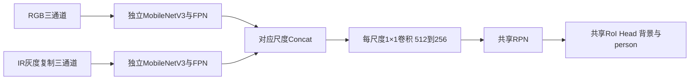

# Week08 Day05：RGB+IR 双分支特征融合正式交接

日期：2026-11-02。GPU冒烟、完整10轮、验证选模、一次最终测试、缓存错误分析与出图均成功；后台SUCCEEDED、退出码0。本地取回并严格核验通过。最佳第6轮。融合减少了固定阈值误检、显著减少低重合候选，但mAP50:95低于IR，不能报告为全面提升。

## 架构与已验证尺度



当前版本真实输出：0和1各为[1,256,20,20]，pool为[1,256,10,10]；不能称作常规P2/P3/P4/P5。共享RPN保留官方3组Anchor设置，RoI读取真实存在的0和1。每尺度融合层[0.5I,0.5I]零bias初始化，相当于初始特征平均，后续可训练。双分支权重初值相同但存储独立，不共享后续更新；冻结范围沿用COCO构造器。参数逐项来源和requires_grad见model_metadata.json。

RGB和IR是同一image_id下的paired字典，两路共享Letterbox和翻转。仅为一次共享几何transform内部打包6通道，在Backbone前拆成两个3通道分支；不是最早DAY05_PLAN.md中的六通道早期卷积。旧方案保留作历史草案，以本报告和fusion_model.py为准。原图1280×1024缩为640×512、上下各64；内部min/max=640。两路使用各自重复的ImageNet三通道mean/std。

## 实际三模型结果

|指标|IR|RGB|RGB+IR|
|---|---:|---:|---:|
|precision|0.850416|0.491776|0.889855|
|recall|0.882184|0.859195|0.882184|
|AP50|0.898907|0.800126|0.903234|
|mAP50_95|0.471626|0.368304|0.439998|
|TP|307|299|307|
|FP|54|309|38|
|FN|41|49|41|

最佳Epoch：IR=9，RGB=4，融合=6；融合最佳val P=0.874074、R=0.850962、AP50=0.893905、mAP50:95=0.435167。选模始终使用val mAP50:95，不用test选轮次或调整阈值。

融合相对IR：FP由54降至38（减少29.63%），Precision提高3.944个百分点，Recall相同；AP50提高0.433个百分点，mAP50:95下降3.163个百分点。

## 错误组成与同编号案例

|主分类|IR 数量（占FP）|RGB 数量（占FP）|融合 数量（占FP）|
|---|---:|---:|---:|
|duplicate|3 (5.56%)|10 (3.24%)|9 (23.68%)|
|localization|22 (40.74%)|72 (23.30%)|24 (63.16%)|
|low_overlap|29 (53.70%)|227 (73.46%)|5 (13.16%)|
|other|0 (0.00%)|0 (0.00%)|0 (0.00%)|

相对IR，融合low_overlap减少24个，duplicate增加6个，localization增加2个，合计FP净减少16个。不能把低重合直接称为背景误识别的已证实根因，也不能声称所有错误类型都改善。duplicate/localization的占比同时受低重合数量大幅减少影响。

|图片|IR TP/FP/FN|RGB TP/FP/FN|融合 TP/FP/FN|融合FP类别|
|---|---|---|---|---|
|190001|2/0/0|2/5/0|2/0/0|{}|
|190040|5/1/2|6/1/1|6/0/1|{}|
|190435|3/0/0|3/7/0|3/0/0|{}|
|190474|3/1/1|3/4/1|4/0/0|{}|
|190593|1/0/0|1/7/0|1/0/0|{}|

五组同编号对照已保存；已目视检查190001、190040、190474及两条曲线，全部16张PNG（9案例+5组对照+2曲线）完整解码通过。成功、漏检、误检各3张，无缺额。GT已匹配绿色、FN对应GT青色、TP蓝色、重复橙色、定位紫色、低重合红色、其他灰色，有图例。标签在密集区域可能重叠，精确坐标/分数/IoU以fusion_error_details.json为准。

### Recall相同并不代表找到同一批人

额外离线核对在score≥0.5/IoU≥0.5下的最终匹配GT：IR和融合共同检出295个，仅IR检出12个，仅融合检出12个。因此两者TP都为307，但不能说融合逐个保留了IR所有正确检测。

### 为什么AP50略高而mAP下降

为避免仅凭平均指标猜原因，本地额外从同一缓存用原match和101点协议复算每个IoU阈值的AP，未运行模型。结果如下：

|IoU|IR AP|RGB AP|融合 AP|
|---|---:|---:|---:|
|0.50|0.898907|0.800126|0.903234|
|0.55|0.859924|0.758244|0.879389|
|0.60|0.819160|0.678588|0.815797|
|0.65|0.749617|0.583220|0.702480|
|0.70|0.618681|0.441545|0.511789|
|0.75|0.432512|0.259918|0.338772|
|0.80|0.250335|0.127476|0.191050|
|0.85|0.076802|0.032237|0.051236|
|0.90|0.009875|0.001553|0.005762|
|0.95|0.000450|0.000132|0.000471|

融合在IoU=.50、.55略高，但在.65～.90明显低于IR，尤其AP75为0.3388，而IR为0.4325。这说明本次融合在更严格匹配下的综合检测表现较弱；AP也受预测分数排序影响，不能把差异唯一归因为框回归。没有进一步实验来证明物理或优化根因。


## 时间、容量、显存与模型大小

|项目|IR|RGB|融合|
|---|---:|---:|---:|

|参数总数|18,930,229|18,930,229|23,739,157|
|可训练参数|18,871,333|18,871,333|23,621,365|
|逐轮训练+验证秒|1324.373885|1341.709314|1603.586719|
|逐轮最大allocated bytes|393544192|395375104|546796032|
|逐轮最大reserved bytes|499122176|486539264|660602880|
|best checkpoint bytes|151529396|151536180|190083098|
|last checkpoint bytes|151529588|151537332|190083866|

融合逐轮最大allocated=521.465MiB，reserved=630.000MiB；冒烟allocated=523.820MiB，reserved=592.000MiB。PyTorch分配器峰值不等于整卡总占用。

后台开始14:24:08.509、结束14:52:25.458，墙钟约28分16.95秒；Python脚本记录1692.585473秒（约28分12.59秒）；逐轮训练+验证1603.586719秒（约26分43.59秒）。逐轮时间不包括随后保存和最终test/出图，单次计时不是稳定性能基准。checkpoint包含优化器和RNG，其大小不等于纯模型权重大小。参数量为同版本模型构造器计算值，历史训练参数范围与记录对应；GPU模型各参数来源见元数据。

## 真实本地核验与文件位置

本地结果：[fusion_concat_run01](D:/python/test/vision-learning/week08/day05/outputs/fusion_concat_run01)。服务器原目录：`D:\vision-learning-server\week08\day05\outputs\fusion_concat_run01`。取回best/last、测试缓存、全部CSV/JSON/log/Markdown/PNG；10份逐轮权重仍留在服务器，未删除或覆盖。

已实际执行以下本地命令，退出码0：

```powershell
& D:\python\.venv\Scripts\python.exe -B .\week08\day05\review_fusion_results.py --output .\week08\day05\outputs\fusion_concat_run01 --job .\week08\day05\checks\remote_status_20261102_162348_ff747e70\fusion_concat_run01_20261102_142408_3a904cd8
```

通过项目：best=6和last=10严格加载，权重有限；checkpoint历史、10轮CSV和验证JSON一致；测试best SHA与test_started一致；150图/348 GT缓存复算指标一致；三模型GT/stem一致、指标和FP类别复算一致；融合每个预测的trace与保存JSON完全一致；全部案例类别与真实匹配一致；SUCCEEDED/exit0一致，无failure记录；204项本地历史文件哈希保持，服务器报告实际存在198项并验证一致，缺失的本地历史产物有单独清单。

核验期间没有训练、模型forward、GPU或远程操作。只在CPU构造模型、strict加载、计算缓存匹配和哈希。断点恢复保存逻辑存在，本地模型state和冻结标记恢复通过，但没有实测训练中断后的optimizer/RNG恢复，不宣称完整续训已验证。

核验JSON：[review.json](D:/python/test/vision-learning/week08/day05/checks/final_review_1793608106351600200/review.json)；本地下载产物SHA清单：[artifact_sha256.json](D:/python/test/vision-learning/week08/day05/checks/final_review_1793608106351600200/artifact_sha256.json)；完整核验终端：[final_review_console.log](D:/python/test/vision-learning/week08/day05/checks/final_review_console.log)；原始训练终端：[console_1793600650832274700.log](D:/python/test/vision-learning/week08/day05/outputs/fusion_concat_run01/console_1793600650832274700.log)。本地哈希与逻辑一致性不等于对全部服务器产物另做远程SHA逐文件对照。

best.pth SHA256：`9f7bbdbb374861e3f8e191b3e03dff6f64502beee30b4dc754458ebce49f963a`。

last.pth SHA256：`106451b3eb027be4ff958daa6f6cdfa3682e8d9d4716a5cf6dd76d773025d7bc`。

## 实际问题与处理

服务器免密SSH认证拒绝，因此由用户在本地CMD自行输入密码完成部署/启动及取回，未记录密码或修改认证。PowerShell CLIXML进度和powercfg中文乱码未阻止检查或启动；没有为了乱码更改服务器系统设置。WMI监控PID1916、启动器记录Python PID2156；最终实际Python进程记录PID2940，未另外核实进程树，不将PID变化解释成训练重启。用户退出启动SSH后，独立取回日志看到冒烟通过并推进至600/700，后又确认完整10轮和成功退出。

未发生已记录的OOM、NaN/Inf或重试调参；无需改尺寸、AMP、冻结分支或梯度检查点。CPU结构检查中真实官方权重缺失，经用户明确许可才下载78MB官方权重。正式GPU训练使用服务器原COCO缓存，未从IR/RGB微调checkpoint初始化。

## 科研结论与学习建议

在本子集、单seed和固定设置下，融合降低FP和low_overlap、保持总体Recall，但重复与定位候选增加，mAP50:95不如IR。不同容量/计算量/优化难度未控制，不能声称完全公平或差异仅来自模态互补。已有测试错误分析用于提出研究方向，因此后续同测试集结果是探索性对照，不是全新独立盲测。不能推广所有场景，也不能据此证明复杂融合模块有效。

给ChatGPT：先理解双分支真实尺度和平均初始化，再解释四项Loss、val第6轮选模、FP构成变化、相同Recall但不同GT集合、AP50与AP75/mAP的差别，以及容量/显存成本。之后可讨论多seed、参数量控制、几何对齐或融合位置等消融设计，仅列建议，本次不执行。

当前停止在Day05正式交接。没有启动第二轮训练、CBAM/Add/Transformer或其他调参。未获Day05自动关机授权，也未发送关机命令；服务器电源状态应由用户确认。

## 服务器原始自动报告：配置、GPU冒烟、10轮完整表与复现命令

以下来自本次实际运行的原始报告。原件保留在结果目录，不做覆盖。报告末尾关于“取回核验尚待完成”的文字是服务器生成时状态，本次已由上文核验更新。所有训练命令仅供以后获准在新目录复现；当前实验已完成，请勿重跑test。

# Day05 双分支特征融合真实训练交接

仅在10轮、选模、一次test及缓存分析成功后生成；进程最终退出码另见exit_status_*.json。

架构：RGB MobileNetV3+FPN 与独立IR MobileNetV3+FPN → 对应实际尺度Concat+1×1Conv → 共享RPN/RoI。两个分支来自相同官方COCO权重，检测头兼容部分复用，最终person预测头新初始化。融合卷积初始化为[0.5I,0.5I]、bias=0；不读取旧IR/RGB微调权重。

输入为明确的paired字典；仅在共享几何transform时内部临时打包，进入双分支前拆分；不做六通道卷积。两份ImageNet mean/std，各路IR复制三通道，640 Letterbox，train同步flip=.5，val/test=0。

```json
{
  "modality": "fusion_concat",
  "epochs": 10,
  "batch_size": 1,
  "num_workers": 0,
  "seed": 42,
  "lr": 0.001,
  "momentum": 0.9,
  "weight_decay": 0.0005,
  "input_size": 640,
  "amp": false,
  "scheduler": null,
  "torch": "2.14.1+cu126",
  "torchvision": "0.29.1+cu126",
  "python": "3.14.6 (tags/v3.14.6:c63aec6, Jun 10 2026, 10:26:10) [MSC v.1944 64 bit (AMD64)]",
  "device": "cuda:0",
  "gpu": "NVIDIA GeForce RTX 3060 Laptop GPU",
  "manifest_sha256": "8bfefe942c968a7bba05d694e5c6d25548f29d4be35e5f91874ffaa274ecd4eb",
  "weights_sha256": "907ea3f91ff92242bc1baea8049276a3e76bca48ce7560bd268cc029f37977b5",
  "architecture": "independent RGB FPN + IR FPN -> concat/1x1 -> shared RPN/RoI",
  "command": "D:\\cv-server-env\\Scripts\\python.exe -B D:\\vision-learning-server\\week08\\day05\\train_fusion.py --data-root D:\\vision-learning-server\\data\\LLVIP_1000 --output D:\\vision-learning-server\\week08\\day05\\outputs\\fusion_concat_run01 --device cuda:0 --keep-awake"
}
```

实际结构、参数来源与冻结状态详见model_metadata.json；参数量与可训练参数量：(23739157, 23621365)

```json
{
  "feature_shapes": {
    "0": [
      1,
      256,
      20,
      20
    ],
    "1": [
      1,
      256,
      20,
      20
    ],
    "pool": [
      1,
      256,
      10,
      10
    ]
  },
  "roi_keys": [
    "0",
    "1"
  ],
  "anchor_sizes": [
    [
      32,
      64,
      128,
      256,
      512
    ],
    [
      32,
      64,
      128,
      256,
      512
    ],
    [
      32,
      64,
      128,
      256,
      512
    ]
  ],
  "anchor_ratios": [
    [
      0.5,
      1.0,
      2.0
    ],
    [
      0.5,
      1.0,
      2.0
    ],
    [
      0.5,
      1.0,
      2.0
    ]
  ],
  "out_channels": 256,
  "fusion_initialization": "[0.5 I, 0.5 I], zero bias",
  "pretrained_loaded": true,
  "source": "official COCO only"
}
```

GPU冒烟（正/空样本四项Loss、更新、评估forward、完整state恢复）：
```json
{
  "samples": [
    {
      "stem": "010001",
      "total_loss": 1.4615275859832764,
      "loss_classifier": 0.8858948349952698,
      "loss_box_reg": 0.5566082000732422,
      "loss_objectness": 0.00792636163532734,
      "loss_rpn_box_reg": 0.011098267510533333
    },
    {
      "stem": "100030",
      "total_loss": 0.8781349658966064,
      "loss_classifier": 0.8002586364746094,
      "loss_box_reg": 0.0,
      "loss_objectness": 0.07787633687257767,
      "loss_rpn_box_reg": 0.0
    }
  ],
  "eval_forward_finite": true,
  "branch_shapes": {
    "0": {
      "rgb": [
        1,
        256,
        20,
        20
      ],
      "infrared": [
        1,
        256,
        20,
        20
      ],
      "fused": [
        1,
        256,
        20,
        20
      ]
    },
    "1": {
      "rgb": [
        1,
        256,
        20,
        20
      ],
      "infrared": [
        1,
        256,
        20,
        20
      ],
      "fused": [
        1,
        256,
        20,
        20
      ]
    },
    "pool": {
      "rgb": [
        1,
        256,
        10,
        10
      ],
      "infrared": [
        1,
        256,
        10,
        10
      ],
      "fused": [
        1,
        256,
        10,
        10
      ]
    }
  },
  "peak_allocated": 549265408,
  "peak_reserved": 620756992,
  "all_state_restored_exactly": true
}
```

|Epoch|total|classifier|box|objectness|rpn_box|lr|val P|val R|val AP50|val mAP|秒|peak allocated|peak reserved|
|---|---|---|---|---|---|---|---|---|---|---|---|---|
|1|0.6468153352396829|0.21625318966805934|0.41102918738166666|0.013067319610896187|0.006465635598838812|0.001|0.6838842975206612|0.7956730769230769|0.8162064730970483|0.37121907900246826|158.47551900000008|546796032|660602880|
|2|0.7197216352042077|0.22690627734243338|0.4809070268166917|0.006650466085266089|0.005257865578028681|0.001|0.740343347639485|0.8293269230769231|0.8478215744967649|0.390588452797589|152.3600948000003|543138816|660602880|
|3|0.7237105721980334|0.22264385554340801|0.4906060655148966|0.005591778917805641|0.004868873391252627|0.001|0.8989071038251366|0.7908653846153846|0.8443383708958655|0.40641118098151796|155.81331739999996|529452544|660602880|
|4|0.7269927167147398|0.21489866269087152|0.5024137342029384|0.0051651568714961675|0.0045151642693807455|0.001|0.721881390593047|0.8485576923076923|0.8525493334104411|0.39660790688286984|158.7554656000002|546795008|660602880|
|5|0.7015930201445839|0.2086759125441313|0.4840225593479616|0.004564942596802471|0.004329603321259908|0.001|0.8973684210526316|0.8197115384615384|0.8741016031130061|0.427610195717482|159.69009449999976|533422080|660602880|
|6|0.6715399862559779|0.19905733845861895|0.46403746069009816|0.004408320633145714|0.004036867456151023|0.001|0.8740740740740741|0.8509615384615384|0.8939053659414109|0.4351669866328862|161.61319040000035|531664896|660602880|
|7|0.6731727330298496|0.20069580496870912|0.464353021266205|0.004131660157379104|0.003992249261413495|0.001|0.8059360730593608|0.8485576923076923|0.8716926650315547|0.42399110257730904|164.79927550000002|535826432|660602880|
|8|0.6650060027608249|0.18830372524148387|0.46871142010603634|0.0041804128782002535|0.0038104442629628464|0.001|0.825|0.8725961538461539|0.8808693546360022|0.4320666020786429|164.06060990000014|524228608|660602880|
|9|0.6429638484061746|0.1812946654238892|0.45416091401662145|0.003866023844581962|0.0036422456403150654|0.001|0.8116279069767441|0.8389423076923077|0.8578130480583925|0.42349815692513443|163.91745189999983|531665920|660602880|
|10|0.6427182112523587|0.1790747069969049|0.45630030166357755|0.0037618613649881027|0.003581341898077101|0.001|0.7315573770491803|0.8581730769230769|0.8566058059945981|0.4253292569082195|164.1016998|527259648|660602880|

最佳Epoch=6，依据val mAP50:95，不用test选模；best/last大小(bytes)={'best.pth': 190083098, 'last.pth': 190083866}

三模型实测对照与四类FP（历史结果重新由可信缓存复核）：
```json
{
  "IR": {
    "metrics": {
      "precision": 0.850415512465374,
      "recall": 0.882183908045977,
      "AP50": 0.8989071207511944,
      "mAP50_95": 0.4716263012372224,
      "TP": 307,
      "FP": 54,
      "FN": 41,
      "score_threshold": 0.5,
      "protocol": "single_person_101pt_all_area_max100_no_ignore; not official COCO API"
    },
    "fp_categories": {
      "duplicate": {
        "count": 3,
        "fraction": 0.05555555555555555
      },
      "localization": {
        "count": 22,
        "fraction": 0.4074074074074074
      },
      "low_overlap": {
        "count": 29,
        "fraction": 0.5370370370370371
      },
      "other": {
        "count": 0,
        "fraction": 0.0
      }
    },
    "experiment": {
      "best_epoch": 9,
      "test": {
        "precision": 0.850415512465374,
        "recall": 0.882183908045977,
        "AP50": 0.8989071207511944,
        "mAP50_95": 0.4716263012372224,
        "TP": 307,
        "FP": 54,
        "FN": 41,
        "score_threshold": 0.5,
        "protocol": "single_person_101pt_all_area_max100_no_ignore; not official COCO API"
      }
    },
    "model_size_bytes": {
      "best.pth": 151529396,
      "last.pth": 151529588
    },
    "parameter_counts": {
      "total_parameters": 18930229,
      "trainable_parameters": 18871333,
      "source": "current official COCO baseline constructor with 2-class head; no fine-tuned model inference"
    }
  },
  "RGB": {
    "metrics": {
      "precision": 0.4917763157894737,
      "recall": 0.8591954022988506,
      "AP50": 0.8001258873790847,
      "mAP50_95": 0.36830385695197043,
      "TP": 299,
      "FP": 309,
      "FN": 49,
      "score_threshold": 0.5,
      "protocol": "single_person_101pt_all_area_max100_no_ignore; not official COCO API"
    },
    "fp_categories": {
      "duplicate": {
        "count": 10,
        "fraction": 0.032362459546925564
      },
      "localization": {
        "count": 72,
        "fraction": 0.23300970873786409
      },
      "low_overlap": {
        "count": 227,
        "fraction": 0.7346278317152104
      },
      "other": {
        "count": 0,
        "fraction": 0.0
      }
    },
    "experiment": {
      "modality": "visible",
      "epochs": 10,
      "best_epoch": 4,
      "test": {
        "precision": 0.4917763157894737,
        "recall": 0.8591954022988506,
        "AP50": 0.8001258873790847,
        "mAP50_95": 0.36830385695197043,
        "TP": 299,
        "FP": 309,
        "FN": 49,
        "score_threshold": 0.5,
        "protocol": "single_person_101pt_all_area_max100_no_ignore; not official COCO API"
      },
      "timing": {
        "epoch_seconds_sum": 1341.7093137999618,
        "run_seconds_before_report": 1403.191015400007,
        "max_epoch_peak_allocated_bytes": 395375104,
        "max_epoch_peak_reserved_bytes": 486539264
      }
    },
    "model_size_bytes": {
      "best.pth": 151536180,
      "last.pth": 151537332
    },
    "parameter_counts": {
      "total_parameters": 18930229,
      "trainable_parameters": 18871333,
      "source": "current official COCO baseline constructor with 2-class head; no fine-tuned model inference"
    }
  },
  "Fusion": {
    "metrics": {
      "precision": 0.8898550724637682,
      "recall": 0.882183908045977,
      "AP50": 0.9032342060788215,
      "mAP50_95": 0.439998157680316,
      "TP": 307,
      "FP": 38,
      "FN": 41,
      "score_threshold": 0.5,
      "protocol": "single_person_101pt_all_area_max100_no_ignore; not official COCO API"
    },
    "fp_categories": {
      "duplicate": {
        "count": 9,
        "fraction": 0.23684210526315788
      },
      "localization": {
        "count": 24,
        "fraction": 0.631578947368421
      },
      "low_overlap": {
        "count": 5,
        "fraction": 0.13157894736842105
      },
      "other": {
        "count": 0,
        "fraction": 0.0
      }
    },
    "best_epoch": 6,
    "total_parameters": 23739157,
    "trainable_parameters": 23621365,
    "epoch_seconds_sum": 1603.5867188000007,
    "peak_allocated_bytes": 546796032,
    "peak_reserved_bytes": 660602880,
    "checkpoint_bytes": {
      "best.pth": 190083098,
      "last.pth": 190083866
    }
  }
}
```

单person 101点自定义AP，IoU=.50:.05:.95；P/R为score≥.5、IoU≥.5，稳定排序、先排除已用GT再最大IoU；不是完整官方COCO API。错误分类复用Day04 trace；low_overlap不证明背景根因。

训练+验证秒数=1603.5867188000007；最大allocated=546796032；最大reserved=660602880

对照历史配置/最佳轮数/耗时见references/IR、RGB的config和completed；模型大小见各参考best/last.metadata.json。历史参数量未存时不编造，应通过独立结构计数补充。


案例不足3张时记录shortfall，不制造案例；对照图为5组，见prediction_examples/comparison_*.png。

同数据、训练超参数与评估协议的探索性对照；容量与计算量不同，不能把差异全部归因于融合。不根据test改参。单seed，测试已用于研究启发，不是全新盲测。续训保存optimizer/RNG/history，但未经中断恢复实测不能声称已验证。

当前服务器结果目录：D:\vision-learning-server\week08\day05\outputs\fusion_concat_run01。本地取回与完整性核验尚待完成，原始结果不覆盖。请ChatGPT依次解释双分支/尺度检查、平均初始化、四项Loss、最佳轮次和三模型FP组成，再讨论可验证假设；不自动追加其他融合或注意力实验。

## 补充：可直接复现的入口和代码说明

原配置：700/150/150、1991/416/348框，train flip=.5、val/test=0，batch1/workers0/seed42/640，SGD(.001,.9,.0005)，CPU线程2，无AMP/scheduler。官方COCO权重地址`https://download.pytorch.org/models/fasterrcnn_mobilenet_v3_large_320_fpn-907ea3f9.pth`，完整SHA在config.json。

训练复现必须用新的空目录，例如：

```cmd
D:\cv-server-env\Scripts\python.exe -u -B D:\vision-learning-server\week08\day05\train_fusion.py --data-root D:\vision-learning-server\data\LLVIP_1000 --output D:\vision-learning-server\week08\day05\outputs\fusion_concat_reproduction_01 --device cuda:0 --keep-awake
```

独立val：

```cmd
D:\cv-server-env\Scripts\python.exe -B D:\vision-learning-server\week08\day05\evaluate_fusion.py --checkpoint D:\vision-learning-server\week08\day05\outputs\fusion_concat_run01\best.pth --data-root D:\vision-learning-server\data\LLVIP_1000 --output D:\vision-learning-server\week08\day05\outputs\fusion_concat_run01\val_review.json
```

`predict_fusion.render_and_report`在完整训练后只读test缓存生成案例和三模型对照；现有图片/报告路径采用独占创建，不向已完成run再次调用。离线逐框追踪在`error_trace.trace`，原匹配/AP直接来自Day03，不重写另一套评估规则。新增收尾代码review_fusion_results.py负责CPU核验；download_results.ps1负责只取回产物。README与旧准备版已归档，zip训练包保留原样；本地package_manifest仅刷新最终文档哈希，所有训练运行代码未修改。
