# 本次核心实测结论（2026-11-02）

主分析和独立核查均退出码0。三模型历史指标逐值复现。以下为本次缓存复算结果，不是将历史参考抄作新结果。

|定位质量指标|IR|融合|
|---|---:|---:|
|固定匹配TP数量|307|307|
|TP匹配IoU均值|0.775366|0.752748|
|TP匹配IoU中位数|0.795051|0.755725|
|原TP中IoU≥0.75数量|193|164|
|IoU=0.75重新匹配TP数量|193|165|
|AP75（全部缓存分数）|0.432512|0.338772|
|score≥0.9预测数|275|272|
|其中TP / FP|270 / 5|267 / 5|
|高分预测中FP比例|1.8182%|1.8382%|
|高分TP平均IoU|0.785234|0.762794|
|高分TP中IoU≥0.75比例|66.2963%|56.9288%|

**问题1：为何AP50略高而AP75更低？** 本次融合在0.5门槛检出数量相同且FP较少，但更严格门槛下TP更少（0.75重匹配165 vs 193），同GT子集和高分TP也显示更低的几何重合质量。这些一致观察支持“在本实验下精细定位表现下降”的诊断；AP还受所有分数排序等因素影响，不证明定位是唯一原因。特别注意：融合原TP中≥.75为164，重新匹配后为165，说明提高IoU门槛可改变GT分配，不能只筛旧TP代替重新匹配。

**问题2：高置信度框更准确吗？** 当前结果不支持融合高分TP定位优于IR：均值更低，≥.75比例低约9.37个百分点。两者高分FP均为5个，但分母分别275和272；IR高分FP为定位候选4+低重合1，融合为定位候选5。高分FP少和高分TP框精确是不同问题，比例也不是概率校准误差。

**问题3：相同GT谁更准？** 独立复现共同295、仅IR12、仅融合12、共同漏检29。共同GT中IR更高172（58.31%）、融合更高123（41.69%），近似相等0（容差1e-6）。Fusion−IR的IoU差均值−0.019944、中位数−0.010741，Q25=−0.070611、Q75=0.044620。平均IoU差是绝对IoU差，不写成“准确率下降1.99%”。

**问题4：哪些案例最值得看？** `210001/G0`：IR IoU=0.847367，融合=0.500583，融合分数却为0.988680。图中融合框下边界明显比GT短，几何上仅刚通过0.5，因此同时是高分低IoU和0.5边界案例。图中出现明亮区域，但不能据此证明它导致了框偏差。相反案例`220153/G3`：IR=0.594209、融合=0.767537。`210105/G2`为0.75附近案例；仅IR案例`190277/G4`，仅融合案例`190040/G5`。所有GT索引为0起始，选例规则和精确框见JSON，不用少数例子代替总体统计。

## 运行与可视化核查

7张统计图和8类案例图已保存，均有全图/局部放大。初版局部放大图存在轴外文字影响布局的问题，已修正为clip_on=True，并在独立results/visual_review/case_examples保存8张清晰版本，原图保留不覆盖。本报告链接使用清晰版本。已目视检查两张统计图、IR优势与融合优势案例；所有23张PNG（含初版8张）解码检查通过。

第二条实际核查命令：

```powershell
& D:\python\.venv\Scripts\python.exe -B .\week08\day05\localization_analysis\review_localization.py
```

原主分析命令及环境见下文，完整输出见run.log、review.log。review脚本同样只读可信缓存，复核295行差值、高分分母、全部预测匹配明细、图像完整性和缓存SHA；不会运行模型。本次不修改任何历史模型、缓存、指标或阈值。


# Day05 Step8：IR与融合离线定位质量分析交接

本次已实际运行CPU离线分析，无模型构造/forward、训练、CUDA或网络。原始缓存前后SHA一致。历史指标复算门槛通过；只分析已有预测，不改变模型、best或部署阈值。

## 环境、命令、可信缓存

```json
{
  "python": "3.14.7 (tags/v3.14.7:823f032, Aug  5 2026, 10:51:32) [MSC v.1944 64 bit (AMD64)]",
  "executable": "D:\\python\\.venv\\Scripts\\python.exe",
  "torch": "2.14.1+cpu",
  "torchvision": "0.29.1+cpu",
  "matplotlib": "3.11.2",
  "numpy": "2.5.3",
  "device": "CPU",
  "command": "D:\\python\\.venv\\Scripts\\python.exe -B D:\\python\\test\\vision-learning\\week08\\day05\\localization_analysis\\analyze_localization.py",
  "cache_paths": {
    "IR": "D:\\python\\test\\vision-learning\\week08\\day03\\outputs\\ir_baseline_run01\\test_predictions.pth",
    "RGB": "D:\\python\\test\\vision-learning\\week08\\day04\\outputs\\rgb_baseline_retrieved_20261030_213029_fa237fce\\test_predictions.pth",
    "Fusion": "D:\\python\\test\\vision-learning\\week08\\day05\\outputs\\fusion_concat_run01\\test_predictions.pth"
  },
  "cache_SHA256": {
    "IR": "79ae89f650520a80ada1996b0cb9c8f2079846ff62b8d07cd29b7d5e4fae3b78",
    "RGB": "82a688699c3b9cddd9f71aa22ad468e7d942e986f35b659c3d4f667ab27a3408",
    "Fusion": "e287aba98964c6683904f56400bdec763dbc976367a54d127661ee44811c9f3f"
  },
  "cache_unchanged": true,
  "matching_source_SHA256": "6cf2ce268feb314d937a9476f88e1db53722eb9aa791571efe44af0f07abe73e",
  "trace_source_SHA256": "955b128371ae31d30792479760b6afd32f3a381fdbe97921b56a9fe0c34e63c6",
  "no_model_forward": true,
  "no_network": true
}
```

加载前分别对照Day04保护清单、RGB artifact清单、Day05最终核验清单SHA；仅固定可信项目文件使用torch.load(map_location=cpu,weights_only=False)。predictions为逐图boxes/scores/labels Tensor，truths为GT xyxy Tensor，stems为编号；150图348GT，三缓存顺序及GT完全相等。

## 匹配与AP复算

稳定降序分数排序，已占用GT IoU置-1，再选剩余最大IoU；每GT最多匹配一次。直接使用ir_common.match/metrics及已核对逐事件一致的error_trace.trace。AP按所有缓存预测分数，不筛到score≥.5。不同IoU重新匹配，101点插值表达式与metrics相同，并断言AP50及十阈值均值逐值相等。该自定义协议不是完整官方COCO API。

```json
{
  "IR": {
    "precision": 0.850415512465374,
    "recall": 0.882183908045977,
    "AP50": 0.8989071207511944,
    "mAP50_95": 0.4716263012372224,
    "TP": 307,
    "FP": 54,
    "FN": 41,
    "score_threshold": 0.5,
    "protocol": "single_person_101pt_all_area_max100_no_ignore; not official COCO API",
    "AP75": 0.4325117356065814
  },
  "RGB": {
    "precision": 0.4917763157894737,
    "recall": 0.8591954022988506,
    "AP50": 0.8001258873790847,
    "mAP50_95": 0.36830385695197043,
    "TP": 299,
    "FP": 309,
    "FN": 49,
    "score_threshold": 0.5,
    "protocol": "single_person_101pt_all_area_max100_no_ignore; not official COCO API",
    "AP75": 0.2599176587185362
  },
  "Fusion": {
    "precision": 0.8898550724637682,
    "recall": 0.882183908045977,
    "AP50": 0.9032342060788215,
    "mAP50_95": 0.439998157680316,
    "TP": 307,
    "FP": 38,
    "FN": 41,
    "score_threshold": 0.5,
    "protocol": "single_person_101pt_all_area_max100_no_ignore; not official COCO API",
    "AP75": 0.338772049646727
  }
}
```

## TP IoU统计（原始score≥.5、IoU≥.5 TP）

标准差采用总体ddof=0。阈值计数只筛原匹配TP，不等于提高阈值后重新匹配，也不等于AP75。

```json
[
  {
    "model": "IR",
    "n": 307,
    "mean": 0.7753660321623961,
    "median": 0.7950511574745178,
    "std_population": 0.10122321198492712,
    "min": 0.5006380677223206,
    "max": 0.9617929458618164,
    "q25": 0.7117917239665985,
    "q50": 0.7950511574745178,
    "q75": 0.84925577044487,
    "count_ge_0.60": 285,
    "count_ge_0.70": 240,
    "count_ge_0.75": 193,
    "count_ge_0.80": 143,
    "count_ge_0.90": 26
  },
  {
    "model": "RGB",
    "n": 299,
    "mean": 0.7375987471146727,
    "median": 0.7418720126152039,
    "std_population": 0.10056473645010644,
    "min": 0.5056247711181641,
    "max": 0.9777212738990784,
    "q25": 0.6648053824901581,
    "q50": 0.7418720126152039,
    "q75": 0.8094157874584198,
    "count_ge_0.60": 266,
    "count_ge_0.70": 196,
    "count_ge_0.75": 140,
    "count_ge_0.80": 93,
    "count_ge_0.90": 10
  },
  {
    "model": "Fusion",
    "n": 307,
    "mean": 0.7527478702293545,
    "median": 0.7557251453399658,
    "std_population": 0.09857015970689147,
    "min": 0.5005833506584167,
    "max": 0.9579907059669495,
    "q25": 0.6814213395118713,
    "q50": 0.7557251453399658,
    "q75": 0.8305753767490387,
    "count_ge_0.60": 283,
    "count_ge_0.70": 212,
    "count_ge_0.75": 164,
    "count_ge_0.80": 112,
    "count_ge_0.90": 15
  }
]
```

## 不同IoU重新匹配及AP

完整30行TP/FP/FN见matching_by_iou.csv，AP见ap_by_iou.csv。

|IoU|IR TP|Fusion TP|IR AP|Fusion AP|差值|
|---|---:|---:|---:|---:|---:|
|0.50|307|307|0.898907|0.903234|+0.004327|
|0.55|295|301|0.859924|0.879389|+0.019465|
|0.60|286|284|0.819160|0.815797|-0.003363|
|0.65|270|257|0.749617|0.702480|-0.047137|
|0.70|240|213|0.618681|0.511789|-0.106893|
|0.75|193|165|0.432512|0.338772|-0.093740|
|0.80|143|113|0.250335|0.191050|-0.059285|
|0.85|77|52|0.076802|0.051236|-0.025565|
|0.90|26|15|0.009875|0.005762|-0.004113|
|0.95|2|2|0.000450|0.000471|+0.000021|

## 高置信度分析

score≥.9仅在原score≥.5匹配标签完成后筛选，没有重新匹配。FP比例分母为所有高分预测；高分TP IoU≥.75比例分母为高分TP；FP maxIoU不等于有效匹配IoU。

```json
[
  {
    "model": "IR",
    "all_high": 275,
    "high_TP": 270,
    "high_FP": 5,
    "FP_fraction_of_all_high": 0.01818181818181818,
    "high_TP_IoU_ge75": 179,
    "high_TP_IoU_ge75_fraction": 0.662962962962963,
    "high_TP_n": 270,
    "high_TP_mean": 0.7852335470694083,
    "high_TP_median": 0.7998605668544769,
    "high_TP_std_population": 0.09470608980816157,
    "high_TP_min": 0.5163165926933289,
    "high_TP_max": 0.9617929458618164,
    "high_TP_q25": 0.7239776849746704,
    "high_TP_q50": 0.7998605668544769,
    "high_TP_q75": 0.8556375950574875,
    "high_FP_maxIoU_n": 5,
    "high_FP_maxIoU_mean": 0.34626944065093995,
    "high_FP_maxIoU_median": 0.4291481077671051,
    "high_FP_maxIoU_std_population": 0.18149057718103903,
    "high_FP_maxIoU_min": 0.0,
    "high_FP_maxIoU_max": 0.4954378306865692,
    "high_FP_maxIoU_q25": 0.33574867248535156,
    "high_FP_maxIoU_q50": 0.4291481077671051,
    "high_FP_maxIoU_q75": 0.47101259231567383,
    "high_FP_duplicate": 0,
    "high_FP_localization": 4,
    "high_FP_low_overlap": 1,
    "high_FP_other": 0
  },
  {
    "model": "RGB",
    "all_high": 300,
    "high_TP": 245,
    "high_FP": 55,
    "FP_fraction_of_all_high": 0.18333333333333332,
    "high_TP_IoU_ge75": 129,
    "high_TP_IoU_ge75_fraction": 0.5265306122448979,
    "high_TP_n": 245,
    "high_TP_mean": 0.7513263390988719,
    "high_TP_median": 0.762480616569519,
    "high_TP_std_population": 0.09863751704494243,
    "high_TP_min": 0.5056247711181641,
    "high_TP_max": 0.9777212738990784,
    "high_TP_q25": 0.6892049908638,
    "high_TP_q50": 0.762480616569519,
    "high_TP_q75": 0.8241528272628784,
    "high_FP_maxIoU_n": 55,
    "high_FP_maxIoU_mean": 0.1088346313346516,
    "high_FP_maxIoU_median": 0.0,
    "high_FP_maxIoU_std_population": 0.18478439862989682,
    "high_FP_maxIoU_min": 0.0,
    "high_FP_maxIoU_max": 0.4991379380226135,
    "high_FP_maxIoU_q25": 0.0,
    "high_FP_maxIoU_q50": 0.0,
    "high_FP_maxIoU_q75": 0.24144113063812256,
    "high_FP_duplicate": 0,
    "high_FP_localization": 15,
    "high_FP_low_overlap": 40,
    "high_FP_other": 0
  },
  {
    "model": "Fusion",
    "all_high": 272,
    "high_TP": 267,
    "high_FP": 5,
    "FP_fraction_of_all_high": 0.01838235294117647,
    "high_TP_IoU_ge75": 152,
    "high_TP_IoU_ge75_fraction": 0.5692883895131086,
    "high_TP_n": 267,
    "high_TP_mean": 0.7627938075012035,
    "high_TP_median": 0.7744002342224121,
    "high_TP_std_population": 0.09625237934696944,
    "high_TP_min": 0.5005833506584167,
    "high_TP_max": 0.9579907059669495,
    "high_TP_q25": 0.6940700113773346,
    "high_TP_q50": 0.7744002342224121,
    "high_TP_q75": 0.8347714245319366,
    "high_FP_maxIoU_n": 5,
    "high_FP_maxIoU_mean": 0.4200356245040894,
    "high_FP_maxIoU_median": 0.465776652097702,
    "high_FP_maxIoU_std_population": 0.08079381559893088,
    "high_FP_maxIoU_min": 0.2841753661632538,
    "high_FP_maxIoU_max": 0.49788543581962585,
    "high_FP_maxIoU_q25": 0.3716171979904175,
    "high_FP_maxIoU_q50": 0.465776652097702,
    "high_FP_maxIoU_q75": 0.48072347044944763,
    "high_FP_duplicate": 0,
    "high_FP_localization": 5,
    "high_FP_low_overlap": 0,
    "high_FP_other": 0
  }
]
```

Pearson样本仅是各模态原固定匹配TP，受TP条件筛选及场景相关性影响，不代表概率校准误差，也不能推断因果。

```json
{
  "IR": {
    "n": 307,
    "definition": "Pearson over original fixed-match TP only; not calibration or causation",
    "pearson": 0.2620867697381287
  },
  "RGB": {
    "n": 299,
    "definition": "Pearson over original fixed-match TP only; not calibration or causation",
    "pearson": 0.3320758078760253
  },
  "Fusion": {
    "n": 307,
    "definition": "Pearson over original fixed-match TP only; not calibration or causation",
    "pearson": 0.3026759270819321
  }
}
```

## 相同GT配对比较

delta=Fusion−IR，abs(delta)≤1e-6视为近似相等。完整295行含框坐标和分数见paired_gt_iou_comparison.csv。差异最大Top10按绝对差排序。

```json
{
  "common": 295,
  "only_IR": 12,
  "only_Fusion": 12,
  "neither": 29,
  "approx_equal_tolerance": 1e-06,
  "Fusion_better": 123,
  "IR_better": 172,
  "approximately_equal": 0,
  "delta_statistics": {
    "n": 295,
    "mean": -0.019943522598783847,
    "median": -0.01074141263961792,
    "std_population": 0.09279883043210889,
    "min": -0.34678328037261963,
    "max": 0.17332851886749268,
    "q25": -0.07061117887496948,
    "q50": -0.01074141263961792,
    "q75": 0.044619858264923096
  },
  "top10_absolute_difference": [
    {
      "image_id": "210001",
      "gt_index": 0,
      "IR_prediction": 0,
      "Fusion_prediction": 0,
      "IR_box": "[7.313121795654297, 289.0950927734375, 81.64889526367188, 434.06866455078125]",
      "Fusion_box": "[12.898412704467773, 291.25946044921875, 74.13939666748047, 382.72235107421875]",
      "IR_score": 0.9842560887336731,
      "Fusion_score": 0.9886801242828369,
      "IR_IoU": 0.8473666310310364,
      "Fusion_IoU": 0.5005833506584167,
      "delta": -0.34678328037261963
    },
    {
      "image_id": "220134",
      "gt_index": 0,
      "IR_prediction": 1,
      "Fusion_prediction": 1,
      "IR_box": "[51.48347473144531, 331.3194274902344, 92.13345336914062, 466.7432556152344]",
      "Fusion_box": "[57.032806396484375, 336.9376220703125, 102.99429321289062, 490.22796630859375]",
      "IR_score": 0.7975678443908691,
      "Fusion_score": 0.9079002737998962,
      "IR_IoU": 0.837807834148407,
      "Fusion_IoU": 0.5063057541847229,
      "delta": -0.3315020799636841
    },
    {
      "image_id": "190672",
      "gt_index": 3,
      "IR_prediction": 3,
      "Fusion_prediction": 3,
      "IR_box": "[404.1228942871094, 68.28530883789062, 455.4402770996094, 165.7097930908203]",
      "Fusion_box": "[395.0327453613281, 64.01102447509766, 446.1450500488281, 174.01611328125]",
      "IR_score": 0.9903112649917603,
      "Fusion_score": 0.9627910852432251,
      "IR_IoU": 0.9126008152961731,
      "Fusion_IoU": 0.6293851733207703,
      "delta": -0.28321564197540283
    },
    {
      "image_id": "240251",
      "gt_index": 1,
      "IR_prediction": 1,
      "Fusion_prediction": 1,
      "IR_box": "[299.6512756347656, 520.1921997070312, 348.7435607910156, 574.5971069335938]",
      "Fusion_box": "[306.32562255859375, 523.0684204101562, 338.79986572265625, 569.4133911132812]",
      "IR_score": 0.9881539940834045,
      "Fusion_score": 0.9913903474807739,
      "IR_IoU": 0.8853912353515625,
      "Fusion_IoU": 0.6049714684486389,
      "delta": -0.2804197669029236
    },
    {
      "image_id": "230257",
      "gt_index": 1,
      "IR_prediction": 1,
      "Fusion_prediction": 1,
      "IR_box": "[546.3135986328125, 440.56219482421875, 622.6513671875, 562.8260498046875]",
      "Fusion_box": "[550.4570922851562, 449.01300048828125, 602.3026733398438, 557.1049194335938]",
      "IR_score": 0.9257698655128479,
      "Fusion_score": 0.8430112600326538,
      "IR_IoU": 0.8461157083511353,
      "Fusion_IoU": 0.5793836712837219,
      "delta": -0.26673203706741333
    },
    {
      "image_id": "230304",
      "gt_index": 0,
      "IR_prediction": 0,
      "Fusion_prediction": 0,
      "IR_box": "[431.8568115234375, 108.2005615234375, 514.9306640625, 232.935546875]",
      "Fusion_box": "[439.7328796386719, 112.59414672851562, 499.1505432128906, 205.88812255859375]",
      "IR_score": 0.9938445091247559,
      "Fusion_score": 0.8866687417030334,
      "IR_IoU": 0.8195945620536804,
      "Fusion_IoU": 0.587339460849762,
      "delta": -0.23225510120391846
    },
    {
      "image_id": "200122",
      "gt_index": 2,
      "IR_prediction": 2,
      "Fusion_prediction": 0,
      "IR_box": "[106.56146240234375, 473.51483154296875, 180.37930297851562, 574.3447875976562]",
      "Fusion_box": "[108.8609848022461, 478.3804931640625, 166.56634521484375, 570.491455078125]",
      "IR_score": 0.9793596267700195,
      "Fusion_score": 0.9830744862556458,
      "IR_IoU": 0.7576779127120972,
      "Fusion_IoU": 0.5410796999931335,
      "delta": -0.21659821271896362
    },
    {
      "image_id": "230467",
      "gt_index": 0,
      "IR_prediction": 1,
      "Fusion_prediction": 1,
      "IR_box": "[561.7633056640625, 248.86424255371094, 630.574951171875, 373.4644775390625]",
      "Fusion_box": "[568.41357421875, 248.09054565429688, 621.4573974609375, 359.8945007324219]",
      "IR_score": 0.9504739046096802,
      "Fusion_score": 0.771467387676239,
      "IR_IoU": 0.7723770141601562,
      "Fusion_IoU": 0.5714513659477234,
      "delta": -0.20092564821243286
    },
    {
      "image_id": "200152",
      "gt_index": 1,
      "IR_prediction": 1,
      "Fusion_prediction": 1,
      "IR_box": "[310.94049072265625, 172.77584838867188, 365.11962890625, 339.3172302246094]",
      "Fusion_box": "[319.381591796875, 172.13345336914062, 367.34918212890625, 332.6949462890625]",
      "IR_score": 0.980492889881134,
      "Fusion_score": 0.9291340708732605,
      "IR_IoU": 0.905369758605957,
      "Fusion_IoU": 0.7085000276565552,
      "delta": -0.19686973094940186
    },
    {
      "image_id": "230420",
      "gt_index": 0,
      "IR_prediction": 0,
      "Fusion_prediction": 0,
      "IR_box": "[104.5469970703125, 496.7203674316406, 159.54156494140625, 575.7506103515625]",
      "Fusion_box": "[109.34060668945312, 499.2494201660156, 153.76104736328125, 573.1249389648438]",
      "IR_score": 0.9881662130355835,
      "Fusion_score": 0.9337462186813354,
      "IR_IoU": 0.7994543313980103,
      "Fusion_IoU": 0.6036205291748047,
      "delta": -0.19583380222320557
    }
  ]
}
```

## 真实案例与选择规则

IR优势/融合优势选共同GT中差值两端；高分低IoU选score≥.9的TP中最接近.5者；边界选TP中最接近.5/.75者（不改阈值）；独有检出按编号和GT索引最先者；另含190474。所有选择保留全局统计，不掩盖整体不足。边界案例仅展示TP侧最近值，不能声称覆盖边界两侧。不同类别可能同图，独有检出另一模型可能存在FP或低分框，不意味着完全没有任何预测。

上排640全图，下排同坐标局部放大；融合结果画在RGB底图，IR结果画在IR底图。颜色图例区分TP/FP/FN，图下精确分数及针对焦点GT的IoU。标记P编号以减少遮挡，完整逐框信息见details.json。既有Dataset验证原RGB/IR/XML尺寸和变换GT，未强行对齐或独立验证像素配准。

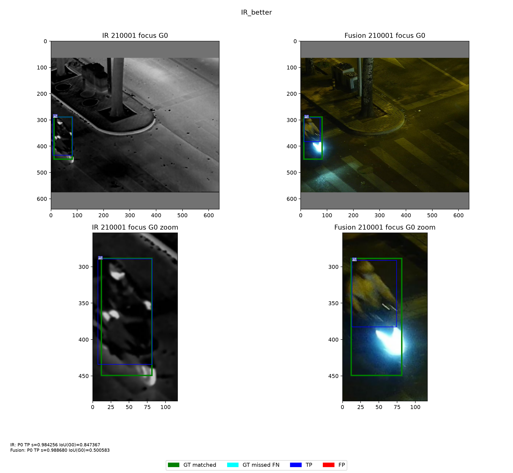

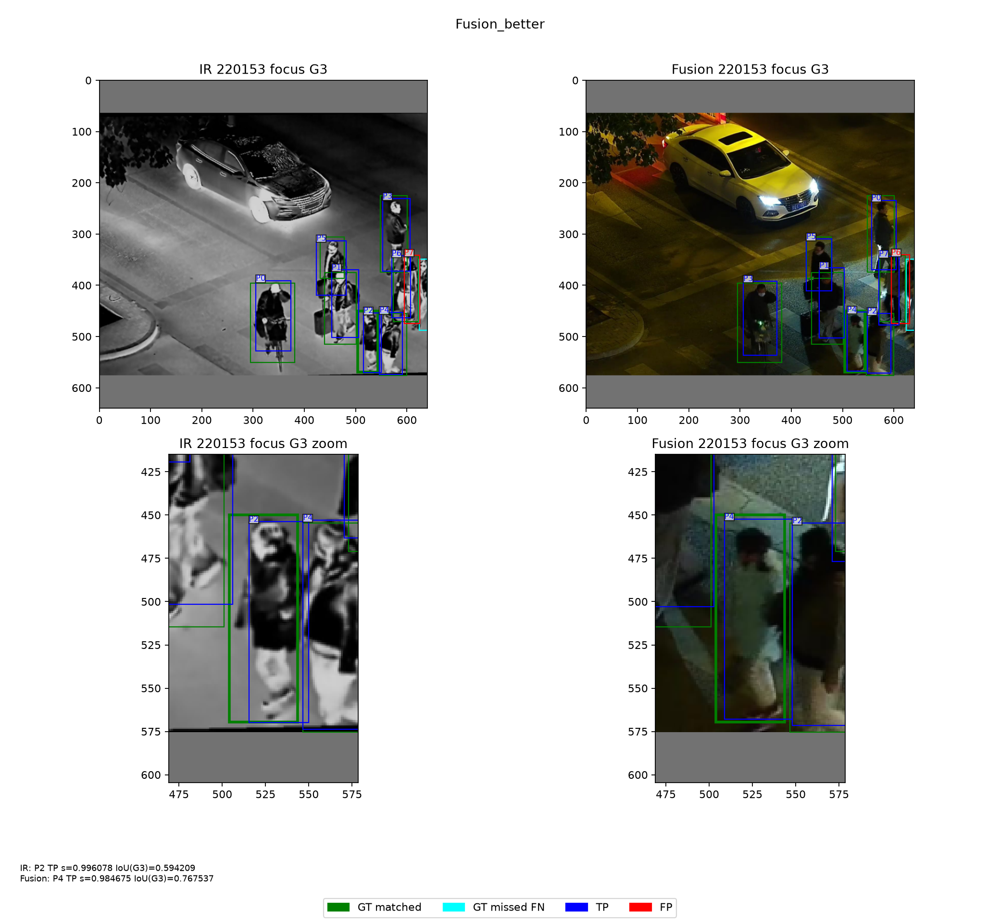


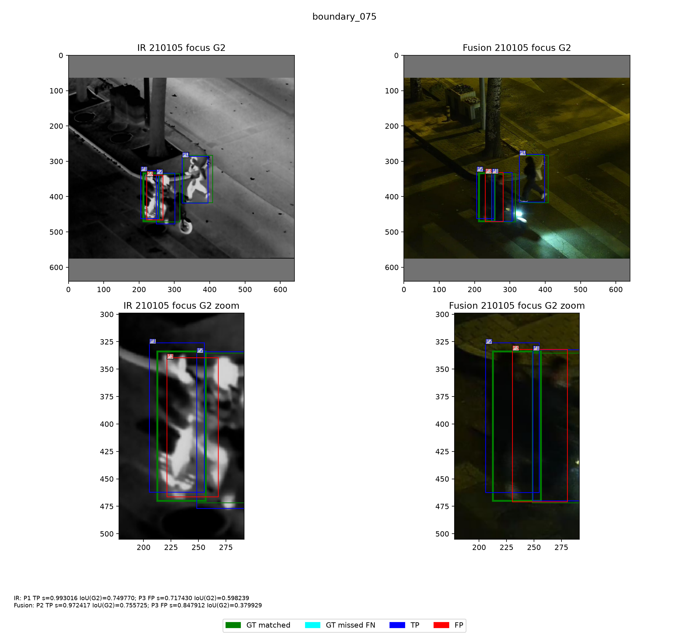

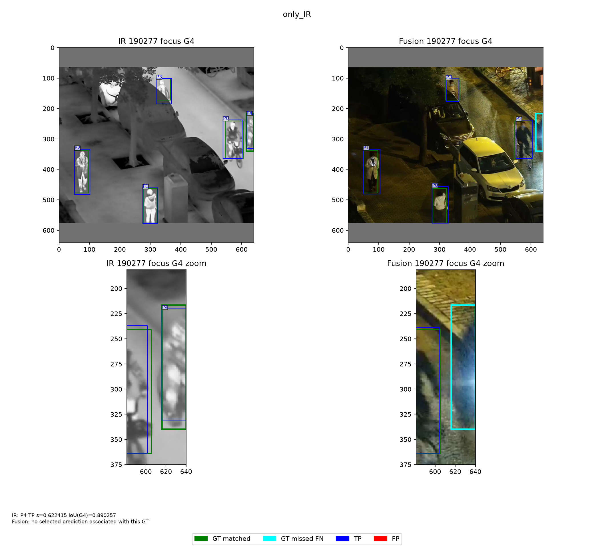

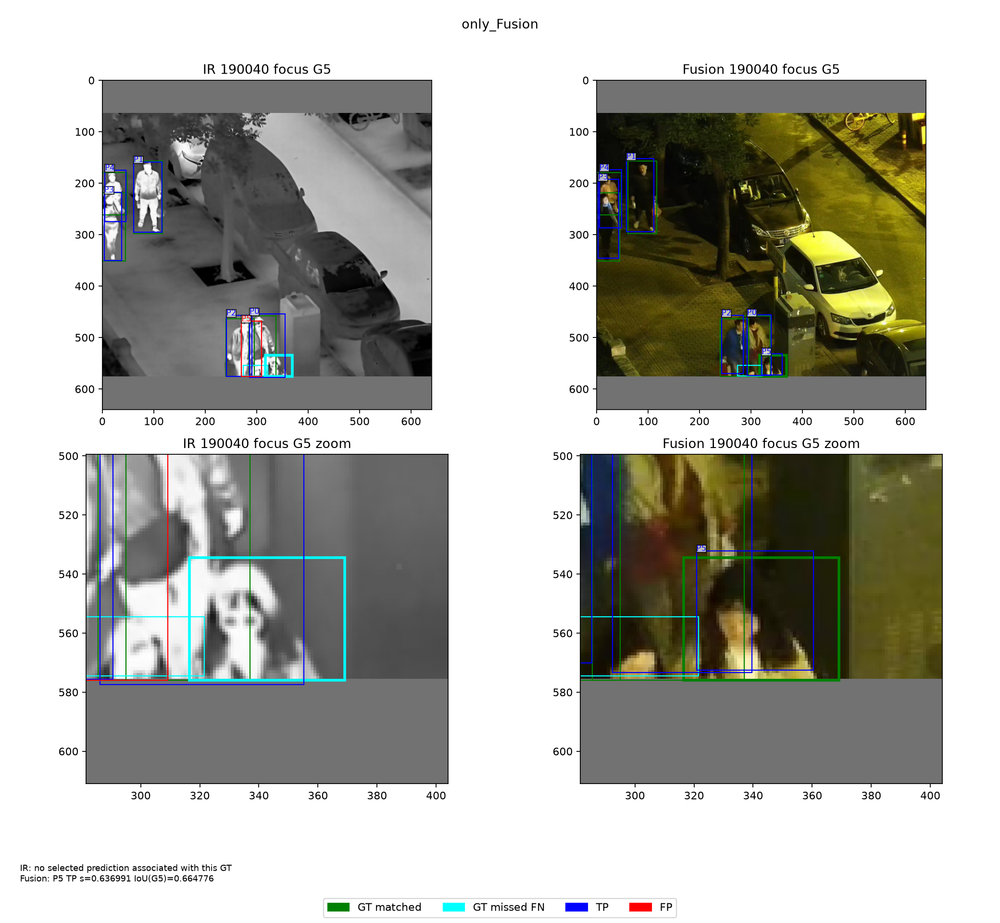

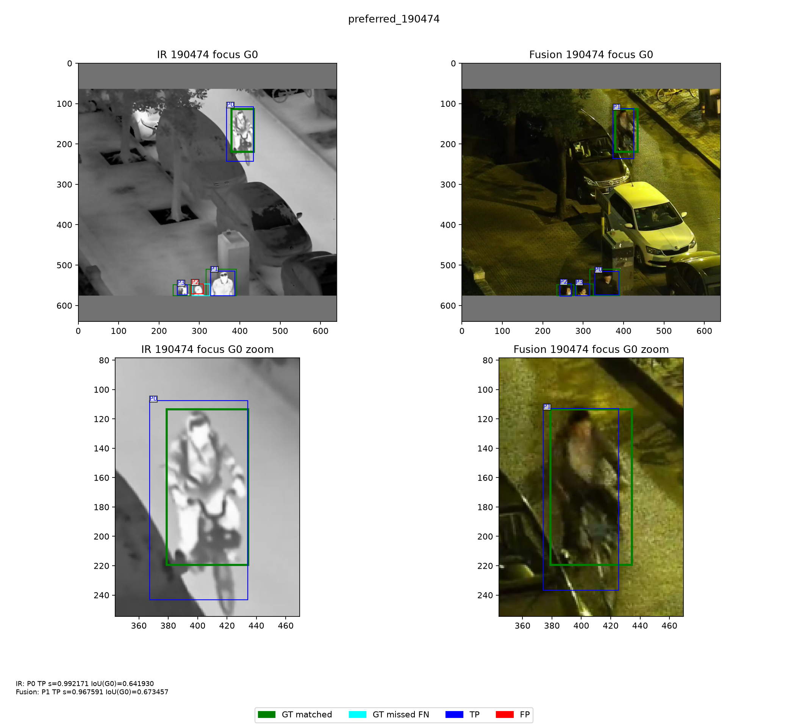

## 四个问题的证据化回答

1. AP50稍高、AP75下降：全阈值表直接显示严格匹配表现下降；结合TP分布和同GT差值进一步区分位置质量。这些是缓存层面的观察，AP同时受分数排序/重复/漏检影响，不能仅据TP均值解释全部AP变化，不能确定是配准、融合权重或优化过程造成。

2. 高分不保证高IoU：请比较高分TP均值、中位数及≥.75比例，并看高分FP。不能仅凭融合高分FP少就说高分框定位更准；高分分数并非IoU预测，分母已在表中明确。

3. 共同GT谁更高：以paired_summary中IR_better/Fusion_better及delta均值为准；这是295个共同TP子集，不能涵盖24个独有检出或29个共同漏检。

4. 真实定位不足：IR_better图直接展示相同GT两框的差异，high_score_low_iou和阈值边界图说明高分或刚过0.5并不意味着精定位。图中几何不匹配不能直接证明背景误识别或漏标。

## 输出与后续学习

7张统计图、8张案例图、各CSV/JSON及终端run.log均独立保存。诊断阈值.9和近似相等1e-6不是部署调参。单seed与连续场景样本不独立，未进行显著性检验。下一步先学习IoU匹配、AP与固定阈值统计、相同GT配对的优势及子集偏差；可能的配准误差、回归优化、融合竞争均仅是假设，需另行授权设计验证。本次停止，不追加训练。

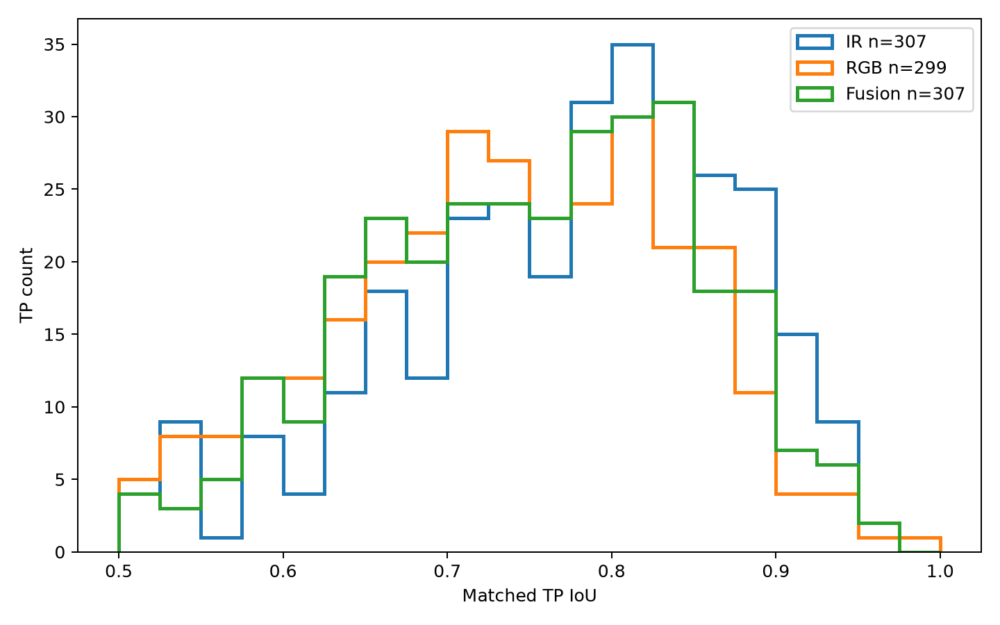

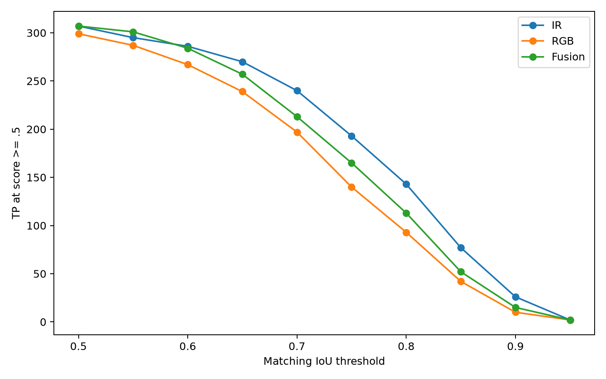

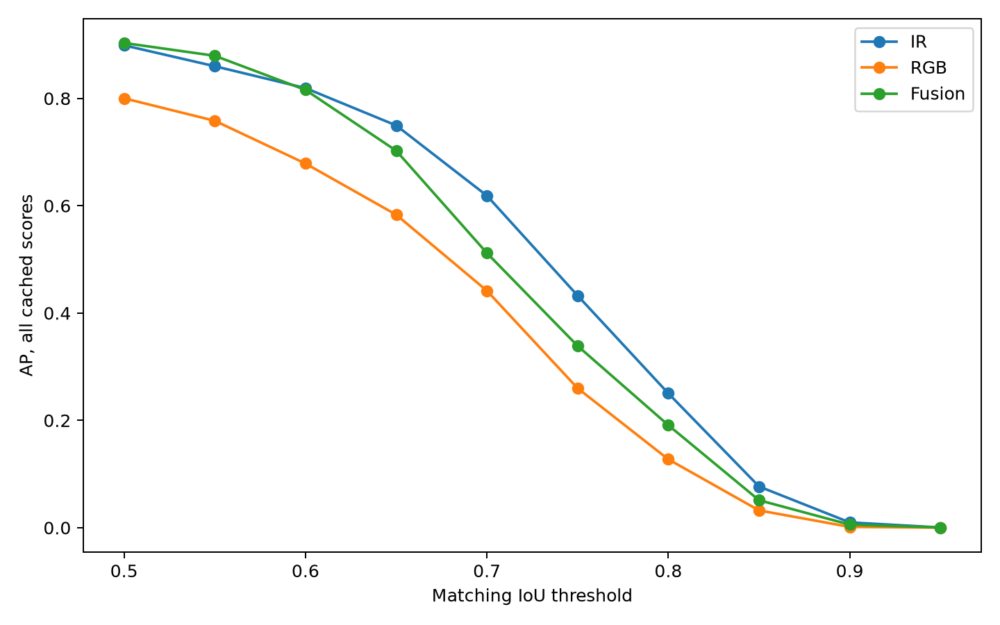

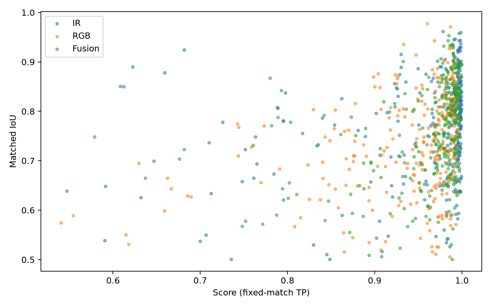

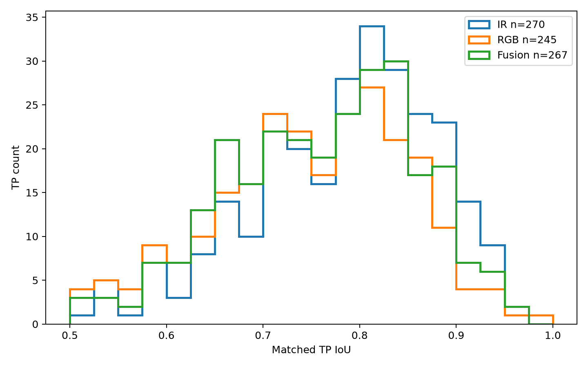

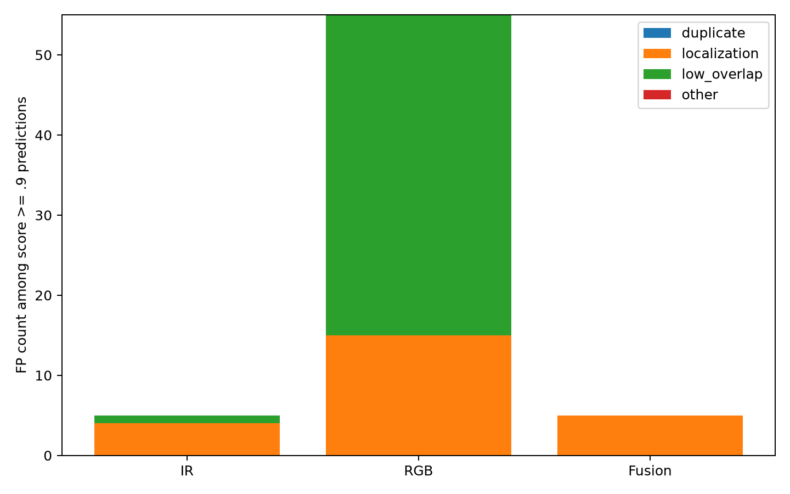

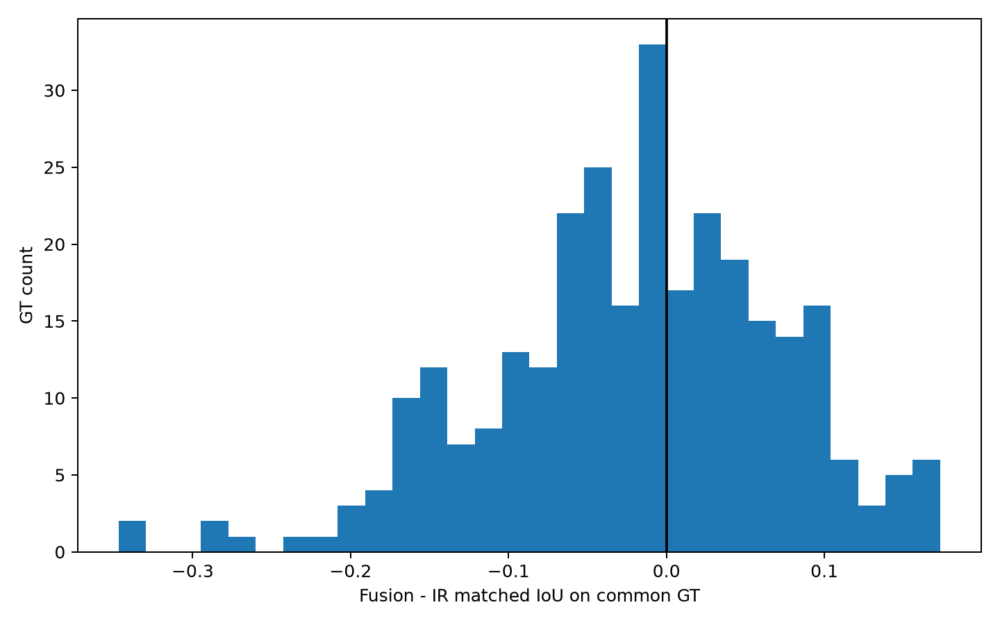