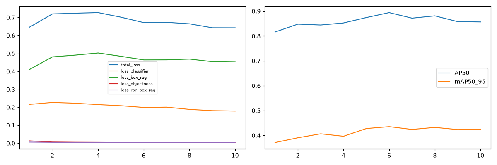
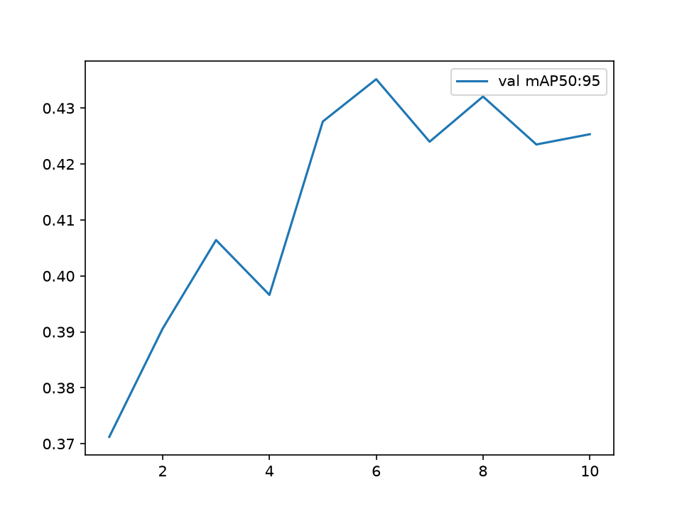

# Day05 双分支特征融合真实训练交接

仅在10轮、选模、一次test及缓存分析成功后生成；进程最终退出码另见exit_status_*.json。

架构：RGB MobileNetV3+FPN 与独立IR MobileNetV3+FPN → 对应实际尺度Concat+1×1Conv → 共享RPN/RoI。两个分支来自相同官方COCO权重，检测头兼容部分复用，最终person预测头新初始化。融合卷积初始化为[0.5I,0.5I]、bias=0；不读取旧IR/RGB微调权重。

输入为明确的paired字典；仅在共享几何transform时内部临时打包，进入双分支前拆分；不做六通道卷积。两份ImageNet mean/std，各路IR复制三通道，640 Letterbox，train同步flip=.5，val/test=0。

```json
{
  "modality": "fusion_concat",
  "epochs": 10,
  "batch_size": 1,
  "num_workers": 0,
  "seed": 42,
  "lr": 0.001,
  "momentum": 0.9,
  "weight_decay": 0.0005,
  "input_size": 640,
  "amp": false,
  "scheduler": null,
  "torch": "2.14.1+cu126",
  "torchvision": "0.29.1+cu126",
  "python": "3.14.6 (tags/v3.14.6:c63aec6, Jun 10 2026, 10:26:10) [MSC v.1944 64 bit (AMD64)]",
  "device": "cuda:0",
  "gpu": "NVIDIA GeForce RTX 3060 Laptop GPU",
  "manifest_sha256": "8bfefe942c968a7bba05d694e5c6d25548f29d4be35e5f91874ffaa274ecd4eb",
  "weights_sha256": "907ea3f91ff92242bc1baea8049276a3e76bca48ce7560bd268cc029f37977b5",
  "architecture": "independent RGB FPN + IR FPN -> concat/1x1 -> shared RPN/RoI",
  "command": "D:\\cv-server-env\\Scripts\\python.exe -B D:\\vision-learning-server\\week08\\day05\\train_fusion.py --data-root D:\\vision-learning-server\\data\\LLVIP_1000 --output D:\\vision-learning-server\\week08\\day05\\outputs\\fusion_concat_run01 --device cuda:0 --keep-awake"
}
```

实际结构、参数来源与冻结状态详见model_metadata.json；参数量与可训练参数量：(23739157, 23621365)

```json
{
  "feature_shapes": {
    "0": [
      1,
      256,
      20,
      20
    ],
    "1": [
      1,
      256,
      20,
      20
    ],
    "pool": [
      1,
      256,
      10,
      10
    ]
  },
  "roi_keys": [
    "0",
    "1"
  ],
  "anchor_sizes": [
    [
      32,
      64,
      128,
      256,
      512
    ],
    [
      32,
      64,
      128,
      256,
      512
    ],
    [
      32,
      64,
      128,
      256,
      512
    ]
  ],
  "anchor_ratios": [
    [
      0.5,
      1.0,
      2.0
    ],
    [
      0.5,
      1.0,
      2.0
    ],
    [
      0.5,
      1.0,
      2.0
    ]
  ],
  "out_channels": 256,
  "fusion_initialization": "[0.5 I, 0.5 I], zero bias",
  "pretrained_loaded": true,
  "source": "official COCO only"
}
```

GPU冒烟（正/空样本四项Loss、更新、评估forward、完整state恢复）：
```json
{
  "samples": [
    {
      "stem": "010001",
      "total_loss": 1.4615275859832764,
      "loss_classifier": 0.8858948349952698,
      "loss_box_reg": 0.5566082000732422,
      "loss_objectness": 0.00792636163532734,
      "loss_rpn_box_reg": 0.011098267510533333
    },
    {
      "stem": "100030",
      "total_loss": 0.8781349658966064,
      "loss_classifier": 0.8002586364746094,
      "loss_box_reg": 0.0,
      "loss_objectness": 0.07787633687257767,
      "loss_rpn_box_reg": 0.0
    }
  ],
  "eval_forward_finite": true,
  "branch_shapes": {
    "0": {
      "rgb": [
        1,
        256,
        20,
        20
      ],
      "infrared": [
        1,
        256,
        20,
        20
      ],
      "fused": [
        1,
        256,
        20,
        20
      ]
    },
    "1": {
      "rgb": [
        1,
        256,
        20,
        20
      ],
      "infrared": [
        1,
        256,
        20,
        20
      ],
      "fused": [
        1,
        256,
        20,
        20
      ]
    },
    "pool": {
      "rgb": [
        1,
        256,
        10,
        10
      ],
      "infrared": [
        1,
        256,
        10,
        10
      ],
      "fused": [
        1,
        256,
        10,
        10
      ]
    }
  },
  "peak_allocated": 549265408,
  "peak_reserved": 620756992,
  "all_state_restored_exactly": true
}
```

|Epoch|total|classifier|box|objectness|rpn_box|lr|val P|val R|val AP50|val mAP|秒|peak allocated|peak reserved|
|---|---|---|---|---|---|---|---|---|---|---|---|---|
|1|0.6468153352396829|0.21625318966805934|0.41102918738166666|0.013067319610896187|0.006465635598838812|0.001|0.6838842975206612|0.7956730769230769|0.8162064730970483|0.37121907900246826|158.47551900000008|546796032|660602880|
|2|0.7197216352042077|0.22690627734243338|0.4809070268166917|0.006650466085266089|0.005257865578028681|0.001|0.740343347639485|0.8293269230769231|0.8478215744967649|0.390588452797589|152.3600948000003|543138816|660602880|
|3|0.7237105721980334|0.22264385554340801|0.4906060655148966|0.005591778917805641|0.004868873391252627|0.001|0.8989071038251366|0.7908653846153846|0.8443383708958655|0.40641118098151796|155.81331739999996|529452544|660602880|
|4|0.7269927167147398|0.21489866269087152|0.5024137342029384|0.0051651568714961675|0.0045151642693807455|0.001|0.721881390593047|0.8485576923076923|0.8525493334104411|0.39660790688286984|158.7554656000002|546795008|660602880|
|5|0.7015930201445839|0.2086759125441313|0.4840225593479616|0.004564942596802471|0.004329603321259908|0.001|0.8973684210526316|0.8197115384615384|0.8741016031130061|0.427610195717482|159.69009449999976|533422080|660602880|
|6|0.6715399862559779|0.19905733845861895|0.46403746069009816|0.004408320633145714|0.004036867456151023|0.001|0.8740740740740741|0.8509615384615384|0.8939053659414109|0.4351669866328862|161.61319040000035|531664896|660602880|
|7|0.6731727330298496|0.20069580496870912|0.464353021266205|0.004131660157379104|0.003992249261413495|0.001|0.8059360730593608|0.8485576923076923|0.8716926650315547|0.42399110257730904|164.79927550000002|535826432|660602880|
|8|0.6650060027608249|0.18830372524148387|0.46871142010603634|0.0041804128782002535|0.0038104442629628464|0.001|0.825|0.8725961538461539|0.8808693546360022|0.4320666020786429|164.06060990000014|524228608|660602880|
|9|0.6429638484061746|0.1812946654238892|0.45416091401662145|0.003866023844581962|0.0036422456403150654|0.001|0.8116279069767441|0.8389423076923077|0.8578130480583925|0.42349815692513443|163.91745189999983|531665920|660602880|
|10|0.6427182112523587|0.1790747069969049|0.45630030166357755|0.0037618613649881027|0.003581341898077101|0.001|0.7315573770491803|0.8581730769230769|0.8566058059945981|0.4253292569082195|164.1016998|527259648|660602880|

最佳Epoch=6，依据val mAP50:95，不用test选模；best/last大小(bytes)={'best.pth': 190083098, 'last.pth': 190083866}

三模型实测对照与四类FP（历史结果重新由可信缓存复核）：
```json
{
  "IR": {
    "metrics": {
      "precision": 0.850415512465374,
      "recall": 0.882183908045977,
      "AP50": 0.8989071207511944,
      "mAP50_95": 0.4716263012372224,
      "TP": 307,
      "FP": 54,
      "FN": 41,
      "score_threshold": 0.5,
      "protocol": "single_person_101pt_all_area_max100_no_ignore; not official COCO API"
    },
    "fp_categories": {
      "duplicate": {
        "count": 3,
        "fraction": 0.05555555555555555
      },
      "localization": {
        "count": 22,
        "fraction": 0.4074074074074074
      },
      "low_overlap": {
        "count": 29,
        "fraction": 0.5370370370370371
      },
      "other": {
        "count": 0,
        "fraction": 0.0
      }
    },
    "experiment": {
      "best_epoch": 9,
      "test": {
        "precision": 0.850415512465374,
        "recall": 0.882183908045977,
        "AP50": 0.8989071207511944,
        "mAP50_95": 0.4716263012372224,
        "TP": 307,
        "FP": 54,
        "FN": 41,
        "score_threshold": 0.5,
        "protocol": "single_person_101pt_all_area_max100_no_ignore; not official COCO API"
      }
    },
    "model_size_bytes": {
      "best.pth": 151529396,
      "last.pth": 151529588
    },
    "parameter_counts": {
      "total_parameters": 18930229,
      "trainable_parameters": 18871333,
      "source": "current official COCO baseline constructor with 2-class head; no fine-tuned model inference"
    }
  },
  "RGB": {
    "metrics": {
      "precision": 0.4917763157894737,
      "recall": 0.8591954022988506,
      "AP50": 0.8001258873790847,
      "mAP50_95": 0.36830385695197043,
      "TP": 299,
      "FP": 309,
      "FN": 49,
      "score_threshold": 0.5,
      "protocol": "single_person_101pt_all_area_max100_no_ignore; not official COCO API"
    },
    "fp_categories": {
      "duplicate": {
        "count": 10,
        "fraction": 0.032362459546925564
      },
      "localization": {
        "count": 72,
        "fraction": 0.23300970873786409
      },
      "low_overlap": {
        "count": 227,
        "fraction": 0.7346278317152104
      },
      "other": {
        "count": 0,
        "fraction": 0.0
      }
    },
    "experiment": {
      "modality": "visible",
      "epochs": 10,
      "best_epoch": 4,
      "test": {
        "precision": 0.4917763157894737,
        "recall": 0.8591954022988506,
        "AP50": 0.8001258873790847,
        "mAP50_95": 0.36830385695197043,
        "TP": 299,
        "FP": 309,
        "FN": 49,
        "score_threshold": 0.5,
        "protocol": "single_person_101pt_all_area_max100_no_ignore; not official COCO API"
      },
      "timing": {
        "epoch_seconds_sum": 1341.7093137999618,
        "run_seconds_before_report": 1403.191015400007,
        "max_epoch_peak_allocated_bytes": 395375104,
        "max_epoch_peak_reserved_bytes": 486539264
      }
    },
    "model_size_bytes": {
      "best.pth": 151536180,
      "last.pth": 151537332
    },
    "parameter_counts": {
      "total_parameters": 18930229,
      "trainable_parameters": 18871333,
      "source": "current official COCO baseline constructor with 2-class head; no fine-tuned model inference"
    }
  },
  "Fusion": {
    "metrics": {
      "precision": 0.8898550724637682,
      "recall": 0.882183908045977,
      "AP50": 0.9032342060788215,
      "mAP50_95": 0.439998157680316,
      "TP": 307,
      "FP": 38,
      "FN": 41,
      "score_threshold": 0.5,
      "protocol": "single_person_101pt_all_area_max100_no_ignore; not official COCO API"
    },
    "fp_categories": {
      "duplicate": {
        "count": 9,
        "fraction": 0.23684210526315788
      },
      "localization": {
        "count": 24,
        "fraction": 0.631578947368421
      },
      "low_overlap": {
        "count": 5,
        "fraction": 0.13157894736842105
      },
      "other": {
        "count": 0,
        "fraction": 0.0
      }
    },
    "best_epoch": 6,
    "total_parameters": 23739157,
    "trainable_parameters": 23621365,
    "epoch_seconds_sum": 1603.5867188000007,
    "peak_allocated_bytes": 546796032,
    "peak_reserved_bytes": 660602880,
    "checkpoint_bytes": {
      "best.pth": 190083098,
      "last.pth": 190083866
    }
  }
}
```

单person 101点自定义AP，IoU=.50:.05:.95；P/R为score≥.5、IoU≥.5，稳定排序、先排除已用GT再最大IoU；不是完整官方COCO API。错误分类复用Day04 trace；low_overlap不证明背景根因。

训练+验证秒数=1603.5867188000007；最大allocated=546796032；最大reserved=660602880

对照历史配置/最佳轮数/耗时见references/IR、RGB的config和completed；模型大小见各参考best/last.metadata.json。历史参数量未存时不编造，应通过独立结构计数补充。





案例不足3张时记录shortfall，不制造案例；对照图为5组，见prediction_examples/comparison_*.png。

同数据、训练超参数与评估协议的探索性对照；容量与计算量不同，不能把差异全部归因于融合。不根据test改参。单seed，测试已用于研究启发，不是全新盲测。续训保存optimizer/RNG/history，但未经中断恢复实测不能声称已验证。

当前服务器结果目录：D:\vision-learning-server\week08\day05\outputs\fusion_concat_run01。本地取回与完整性核验尚待完成，原始结果不覆盖。请ChatGPT依次解释双分支/尺度检查、平均初始化、四项Loss、最佳轮次和三模型FP组成，再讨论可验证假设；不自动追加其他融合或注意力实验。