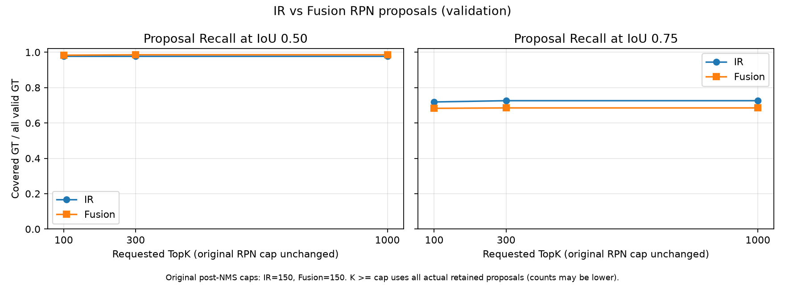
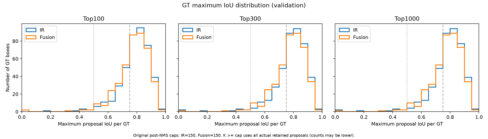

# Week09 Day01：RPN Proposal Recall 诊断

状态：全验证集诊断完成。

## 实验边界

仅使用原 validation split；未读取 test 图像，未训练、未创建优化器、未更新模型权重。完整原模型 eval forward 中，通过临时只读 hook 捕获 transform 后 GT 与 RPN 后处理候选框；最终 RoI 检测结果未用于本次指标。

候选框和 GT 均为同次内部 transform 后的 xyxy 像素坐标，并实际检查640×640尺寸及GT坐标不变。原 RPN 后处理已按 objectness 降序返回，TopK直接切片；保留原 pre/post NMS、score threshold、anchor、特征键与RoI配置。

全局 Recall = 达到阈值的 GT 总数 / 全部有效 GT 总数；不是逐图 Recall 的平均。空GT图记入图片/候选统计，其逐图Recall为空，不进入GT分母。无候选时每个GT最大IoU为0。

## 真实运行

- 范围：full_validation；每模型 150 图、416 个GT。
- 开始时间：2026-11-05T05:37:40.112528+00:00；固定种子：42。
- 设备：cuda:0；GPU：NVIDIA GeForce RTX 3060 Laptop GPU。
- Python：3.14.6 (tags/v3.14.6:c63aec6, Jun 10 2026, 10:26:10) [MSC v.1944 64 bit (AMD64)]；Torch：2.14.1+cu126；TorchVision：0.29.1+cu126。
- 真实命令：

```text
D:\cv-server-env\Scripts\python.exe -B D:\vision-learning-server\week09\day01\rpn_diagnostic.py --device cuda:0 --seed 42 --threads 2 --output D:\vision-learning-server\week09\day01\outputs\val_rpn_run01
```

## 观测结果

|模型|TopK|有效候选范围|Recall@0.50|Recall@0.75|平均最大IoU|候选不足K的图数|
|---|---:|---|---:|---:|---:|---:|
|IR|100|13–100|0.978365|0.718750|0.784562|92|
|IR|300|13–150|0.978365|0.725962|0.786114|150|
|IR|1000|13–150|0.978365|0.725962|0.786114|150|
|Fusion|100|17–100|0.983173|0.682692|0.776859|75|
|Fusion|300|17–150|0.985577|0.685096|0.778792|150|
|Fusion|1000|17–150|0.985577|0.685096|0.778792|150|

差值定义为 Fusion − IR；完整命中数、分母、分位数、直方图及逐图差异见JSON/CSV。

|TopK|Recall@0.50差值|Recall@0.75差值|平均最大IoU差值|
|---:|---:|---:|---:|
|100|+0.004808|-0.036058|-0.007703|
|300|+0.007212|-0.040865|-0.007322|
|1000|+0.007212|-0.040865|-0.007322|





## 原配置与完整性

- IR checkpoint：`D:\vision-learning-server\week08\day03\outputs\ir_baseline_run01\best.pth`；epoch=9；SHA256=`9cafdba85453a29ea4d0b25b491617515832faf602690de916eadfcfc9c7cfa2`，前后文件校验一致。
- IR eval pre/post NMS top-N=150/150，score=0.05，NMS IoU=0.7；空GT图片=0，零候选图片=0。
- IR 持久state前后SHA256一致；原RPN/transform配置未改变。RoI实际特征键：`['0', '1', '2', '3']`。
- Fusion checkpoint：`D:\vision-learning-server\week08\day05\outputs\fusion_concat_run01\best.pth`；epoch=6；SHA256=`9f7bbdbb374861e3f8e191b3e03dff6f64502beee30b4dc754458ebce49f963a`，前后文件校验一致。
- Fusion eval pre/post NMS top-N=150/150，score=0.05，NMS IoU=0.7；空GT图片=0，零候选图片=0。
- Fusion 持久state前后SHA256一致；原RPN/transform配置未改变。RoI实际特征键：`['0', '1']`。

本次实际post-NMS上限：IR=150，Fusion=150。当请求TopK达到或超过对应模型上限时，使用全部实际保留候选（实际数还可能更少），不代表曾生成1000个后处理候选。相同指标可能来自同一候选集合。

所有检查的项目源码、TorchVision内部实现及manifest的SHA256、选择样本顺序和环境信息均保存在 `rpn_metrics.json`。未读取服务器以外的历史测试缓存作为本次推断输入。

## 解释与 Week09 Day02 建议

真实观测：Fusion在三个请求TopK下的IoU=0.75候选覆盖率均低于IR。合理假设：差异可能在RPN阶段已经出现；本次未检验统计显著性，也不能据此证明其造成最终AP75下降。
Day02具体建议：固定本次best权重与validation，先从逐GT表筛选IR覆盖但Fusion未覆盖（IoU=0.75）的目标，按场景、目标面积和最佳IoU差值排序，画出相同图上的GT及两模型原RPN候选，检查分支特征、RPN回归与候选排序的具体失败模式。

仍需验证的机制：RPN候选排序、RoI分类/回归、最终score排序和NMS各自对定位质量的影响。本次是两个best checkpoint的描述性配对诊断，无重训练、干预或显著性检验，不能作因果证明。

RPN Proposal Recall不等于最终检测Recall，也不是AP75。既有最终AP75来自test，而本次RPN来自validation；两者集合不同，不能直接把数值差异作一一对应归因。

运行是否全部完成，以 `rpn_metrics.json` 中 `run.status=completed` 和日志 `COMPLETED` 为准。
