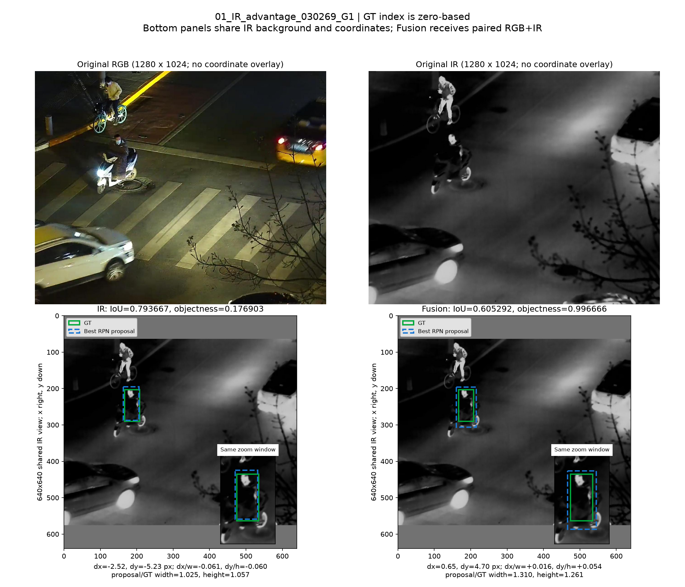
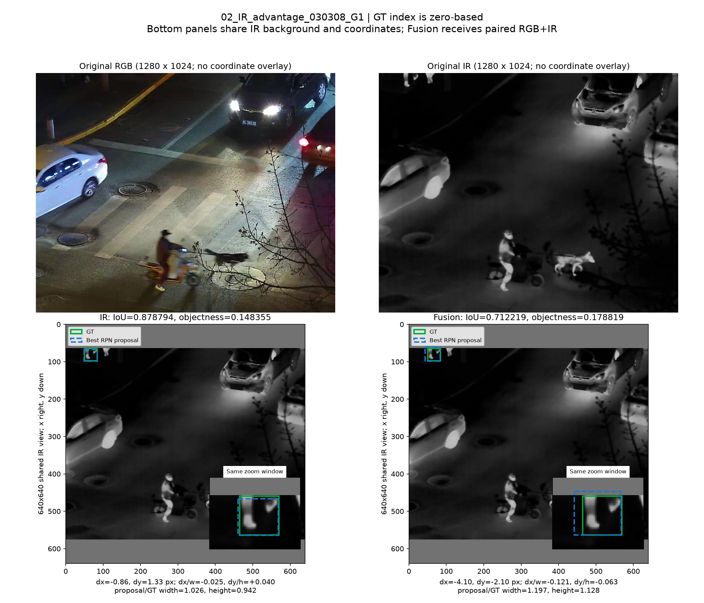
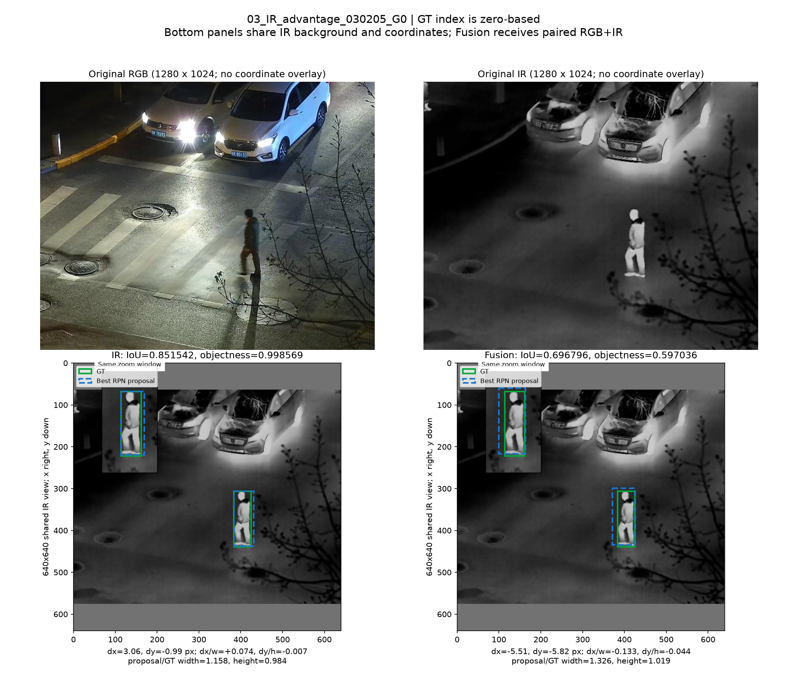
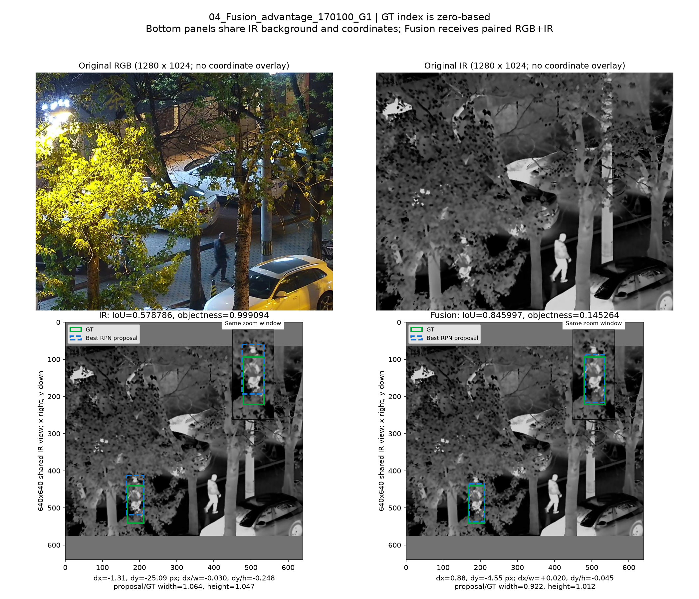
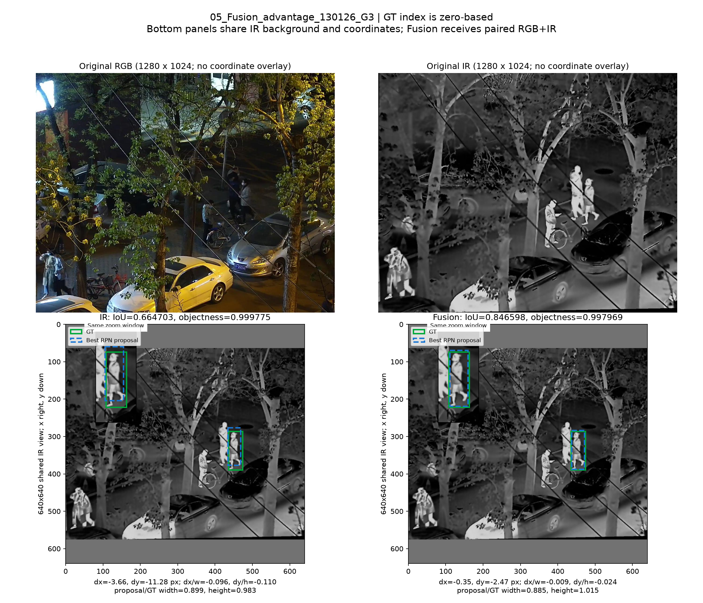
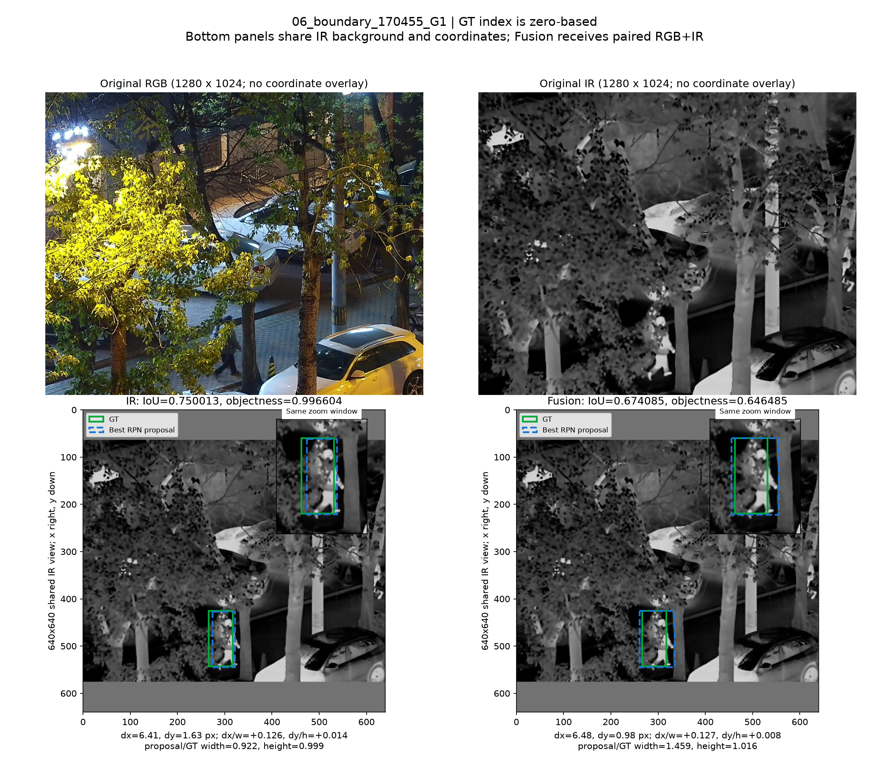

# Week09 Day02：RPN Proposal 定位误差可视化

只读推理完成：仅选中validation图片，未训练、未改结构/权重/原RPN预算，未运行test。

## 选择规则与坐标

按Day01逐GT表的stem+0起始gt_index配对，采用全部实际候选（max_iou_top300=top1000）。IR优势优先场景03再按差值；Fusion优势按差值；临界案例排除前面已选GT，优先跨阈值，再按任一侧距离0.75的最小值排序，平局按stem/gt_index。
dx=Proposal中心x−GT中心x，正值向右；dy=Proposal中心y−GT中心y，正值向下。归一化分别除以GT宽/高；宽高比例=Proposal/GT。全部测量和底部叠框都在原Letterbox及模型transform后的640×640坐标，不将原图坐标混入。
两张底图相同且放大区域相同；Fusion仍输入RGB+IR。绿色实线GT、蓝色虚线最佳RPN候选。顶部原始RGB/IR仅作场景参考，不叠加640框。

## 真实命令

~~~text
D:\cv-server-env\Scripts\python.exe -B D:\vision-learning-server\week09\day02\visualize_proposals.py --device cuda:0 --seed 42 --threads 2 --output D:\vision-learning-server\week09\day02\outputs\proposal_visualization_run01
~~~

## 每个案例

### 01_IR_advantage_030269_G1

选择原因：IR>=0.75>Fusion; scene03 first, then descending IR-Fusion IoU。场景03。

|模型|Day01 IoU|本次IoU|objectness|最佳框xyxy|分数排名/候选总数|
|---|---:|---:|---:|---|---|
|IR|0.793667018|0.793667018|0.176903009|[163.464096, 195.282715, 205.988846, 287.749756]|30/57|
|Fusion|0.605291903|0.605291903|0.996665895|[160.723663, 196.25853, 215.076019, 306.634094]|3/105|

GT xyxy=[166.5, 203.0, 208.0, 290.5]。

|模型|dx|dy|dx/GT宽|dy/GT高|宽比例|高比例|上边误差|下边误差|
|---|---:|---:|---:|---:|---:|---:|---:|---:|
|IR|-2.523529|-5.233765|-0.060808|-0.059814|+1.024693|+1.056766|-7.717285|-2.750244|
|Fusion|+0.649841|+4.696312|+0.015659|+0.053672|+1.309695|+1.261435|-6.741470|+16.134094|

IR数值观察：候选中心向左2.524px、向上5.234px；宽为GT的1.025倍，高为1.057倍。上/下边界相对GT误差分别为-7.717/-2.750px（正值向下）。

Fusion数值观察：候选中心向右0.650px、向下4.696px；宽为GT的1.310倍，高为1.261倍。上/下边界相对GT误差分别为-6.741/+16.134px（正值向下）。

### 02_IR_advantage_030308_G1

选择原因：IR>=0.75>Fusion; scene03 first, then descending IR-Fusion IoU。场景03。

|模型|Day01 IoU|本次IoU|objectness|最佳框xyxy|分数排名/候选总数|
|---|---:|---:|---:|---|---|
|IR|0.878793776|0.878793776|0.148354620|[49.192108, 66.806946, 84.083038, 98.350891]|26/58|
|Fusion|0.712219298|0.712219298|0.178818986|[43.039501, 60.2519, 83.751404, 98.052574]|36/105|

GT xyxy=[50.5, 64.5, 84.5, 98.0]。

|模型|dx|dy|dx/GT宽|dy/GT高|宽比例|高比例|上边误差|下边误差|
|---|---:|---:|---:|---:|---:|---:|---:|---:|
|IR|-0.862427|+1.328918|-0.025365|+0.039669|+1.026204|+0.941610|+2.306946|+0.350891|
|Fusion|-4.104548|-2.097763|-0.120722|-0.062620|+1.197409|+1.128378|-4.248100|+0.052574|

IR数值观察：候选中心向左0.862px、向下1.329px；宽为GT的1.026倍，高为0.942倍。上/下边界相对GT误差分别为+2.307/+0.351px（正值向下）。

Fusion数值观察：候选中心向左4.105px、向上2.098px；宽为GT的1.197倍，高为1.128倍。上/下边界相对GT误差分别为-4.248/+0.053px（正值向下）。

### 03_IR_advantage_030205_G0

选择原因：IR>=0.75>Fusion; scene03 first, then descending IR-Fusion IoU。场景03。

|模型|Day01 IoU|本次IoU|objectness|最佳框xyxy|分数排名/候选总数|
|---|---:|---:|---:|---|---|
|IR|0.851542413|0.851542413|0.998569250|[383.28241, 306.590332, 431.32782, 436.924316]|1/31|
|Fusion|0.696796298|0.696796298|0.597035766|[371.226837, 299.399841, 426.258881, 434.45929]|11/43|

GT xyxy=[383.5, 306.5, 425.0, 439.0]。

|模型|dx|dy|dx/GT宽|dy/GT高|宽比例|高比例|上边误差|下边误差|
|---|---:|---:|---:|---:|---:|---:|---:|---:|
|IR|+3.055115|-0.992676|+0.073617|-0.007492|+1.157721|+0.983653|+0.090332|-2.075684|
|Fusion|-5.507141|-5.820435|-0.132702|-0.043928|+1.326073|+1.019317|-7.100159|-4.540710|

IR数值观察：候选中心向右3.055px、向上0.993px；宽为GT的1.158倍，高为0.984倍。上/下边界相对GT误差分别为+0.090/-2.076px（正值向下）。

Fusion数值观察：候选中心向左5.507px、向上5.820px；宽为GT的1.326倍，高为1.019倍。上/下边界相对GT误差分别为-7.100/-4.541px（正值向下）。

### 04_Fusion_advantage_170100_G1

选择原因：Fusion>=0.75>IR; descending Fusion-IR IoU。场景17。

|模型|Day01 IoU|本次IoU|objectness|最佳框xyxy|分数排名/候选总数|
|---|---:|---:|---:|---|---|
|IR|0.578785658|0.578785658|0.999094367|[164.777603, 413.053833, 211.601273, 518.769409]|1/67|
|Fusion|0.845996797|0.845996797|0.145264372|[170.099991, 435.344849, 210.65538, 537.564331]|19/57|

GT xyxy=[167.5, 440.5, 211.5, 541.5]。

|模型|dx|dy|dx/GT宽|dy/GT高|宽比例|高比例|上边误差|下边误差|
|---|---:|---:|---:|---:|---:|---:|---:|---:|
|IR|-1.310562|-25.088379|-0.029786|-0.248400|+1.064174|+1.046689|-27.446167|-22.730591|
|Fusion|+0.877686|-4.545410|+0.019947|-0.045004|+0.921713|+1.012074|-5.155151|-3.935669|

IR数值观察：候选中心向左1.311px、向上25.088px；宽为GT的1.064倍，高为1.047倍。上/下边界相对GT误差分别为-27.446/-22.731px（正值向下）。

Fusion数值观察：候选中心向右0.878px、向上4.545px；宽为GT的0.922倍，高为1.012倍。上/下边界相对GT误差分别为-5.155/-3.936px（正值向下）。

### 05_Fusion_advantage_130126_G3

选择原因：Fusion>=0.75>IR; descending Fusion-IR IoU。场景13。

|模型|Day01 IoU|本次IoU|objectness|最佳框xyxy|分数排名/候选总数|
|---|---:|---:|---:|---|---|
|IR|0.664702535|0.664702535|0.999775231|[434.25647, 276.569824, 468.432068, 377.363647]|1/150|
|Fusion|0.846598208|0.846598208|0.997969091|[437.833832, 283.73526, 471.461639, 387.822662]|8/150|

GT xyxy=[436.0, 287.0, 474.0, 389.5]。

|模型|dx|dy|dx/GT宽|dy/GT高|宽比例|高比例|上边误差|下边误差|
|---|---:|---:|---:|---:|---:|---:|---:|---:|
|IR|-3.655731|-11.283264|-0.096203|-0.110081|+0.899358|+0.983354|-10.430176|-12.136353|
|Fusion|-0.352264|-2.471039|-0.009270|-0.024108|+0.884942|+1.015487|-3.264740|-1.677338|

IR数值观察：候选中心向左3.656px、向上11.283px；宽为GT的0.899倍，高为0.983倍。上/下边界相对GT误差分别为-10.430/-12.136px（正值向下）。

Fusion数值观察：候选中心向左0.352px、向上2.471px；宽为GT的0.885倍，高为1.015倍。上/下边界相对GT误差分别为-3.265/-1.677px（正值向下）。

### 06_boundary_170455_G1

选择原因：unused GT; one side in [0.70,0.80]; crossing first, then min distance to 0.75。场景17。

|模型|Day01 IoU|本次IoU|objectness|最佳框xyxy|分数排名/候选总数|
|---|---:|---:|---:|---|---|
|IR|0.750012934|0.750012934|0.996604443|[274.387024, 427.206909, 321.433899, 544.552124]|1/92|
|Fusion|0.674085140|0.674085140|0.646484852|[260.770538, 425.520813, 335.187653, 544.944824]|13/104|

GT xyxy=[266.0, 425.5, 317.0, 543.0]。

|模型|dx|dy|dx/GT宽|dy/GT高|宽比例|高比例|上边误差|下边误差|
|---|---:|---:|---:|---:|---:|---:|---:|---:|
|IR|+6.410461|+1.629517|+0.125695|+0.013868|+0.922488|+0.998683|+1.706909|+1.552124|
|Fusion|+6.479095|+0.982819|+0.127041|+0.008364|+1.459159|+1.016375|+0.020813|+1.944824|

IR数值观察：候选中心向右6.410px、向下1.630px；宽为GT的0.922倍，高为0.999倍。上/下边界相对GT误差分别为+1.707/+1.552px（正值向下）。

Fusion数值观察：候选中心向右6.479px、向下0.983px；宽为GT的1.459倍，高为1.016倍。上/下边界相对GT误差分别为+0.021/+1.945px（正值向下）。

## 重复偏差与Day03建议

本次6个GT按优势差值与阈值主动选取，并非随机样本，不能用此处符号计数估计整个验证集的偏差比例。
- IR：本次6例中候选偏窄2例、偏矮4例、中心向下2例；仅为选中样本描述。
- Fusion：本次6例中候选偏窄2例、偏矮0例、中心向下2例；仅为选中样本描述。

临界案例应结合精确IoU与像素误差阅读：0.75是覆盖判定阈值，不代表几何质量在阈值两侧突然发生机制变化。
objectness是RPN原filter_proposals返回的sigmoid分数，不是最终person分类置信度，也不是IoU概率；最佳框按IoU最大选取，分数排名仅作解释。
Day03优先保持融合结构和原权重，追踪这些固定val案例从解码框、逐层pre-NMS筛选、score过滤、NMS到最终post预算的去留与IoU变化；再结合RPN框回归前后变化定位问题。当前证据不足以直接修改融合模块。
本次只能描述RPN输出的几何差异，不能区分特征、框回归和筛选机制的因果贡献，也不能据此解释全部历史test AP75差异。

## 完整性与输出

filter_proposals临时包装调用原方法并原样返回，捕获其后处理boxes和对应scores；与RPN forward实际返回框逐位核对。finally移除hooks并恢复实例原始方法查找状态。各模型持久state和checkpoint前后SHA一致，配置与Day01一致。
全部后处理框及分数另存rpn_proposals.json，最佳框在proposal_details.csv，几何量在geometry_analysis.csv；没有使用最终RoI框。
环境、输入文件前后校验、实际命令和各模型配置见run_metadata.json，完成状态与退出码见execution_status.json，逐图过程见run.log。
