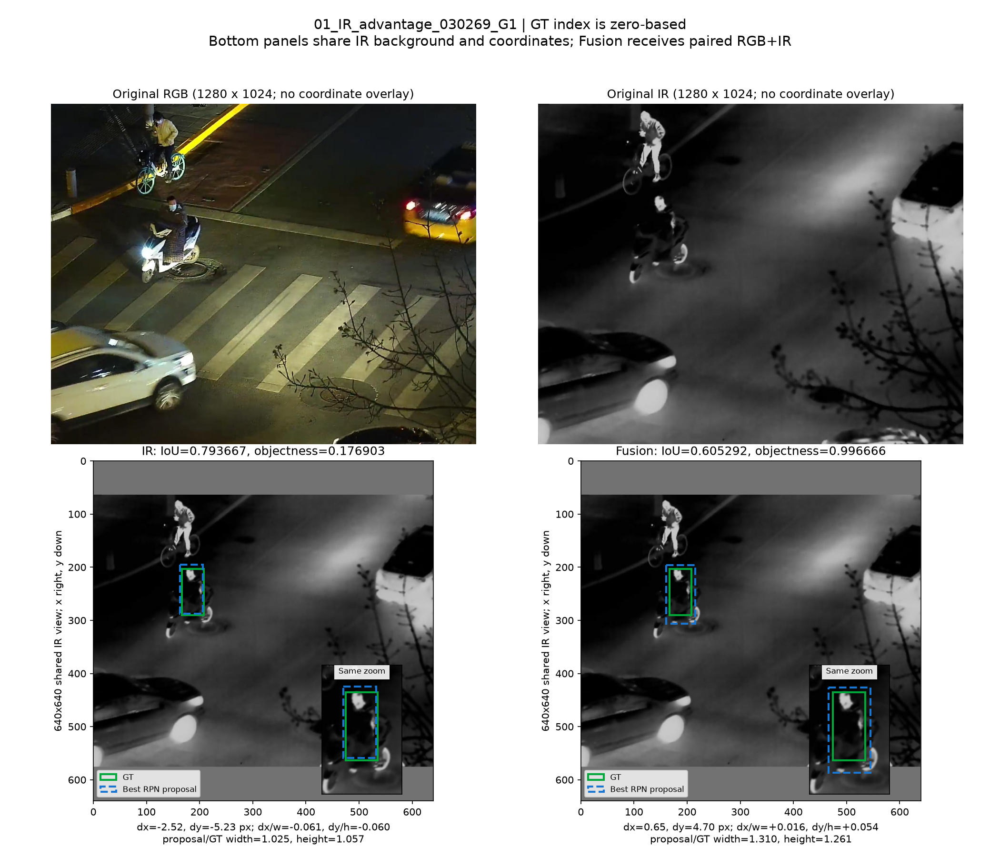
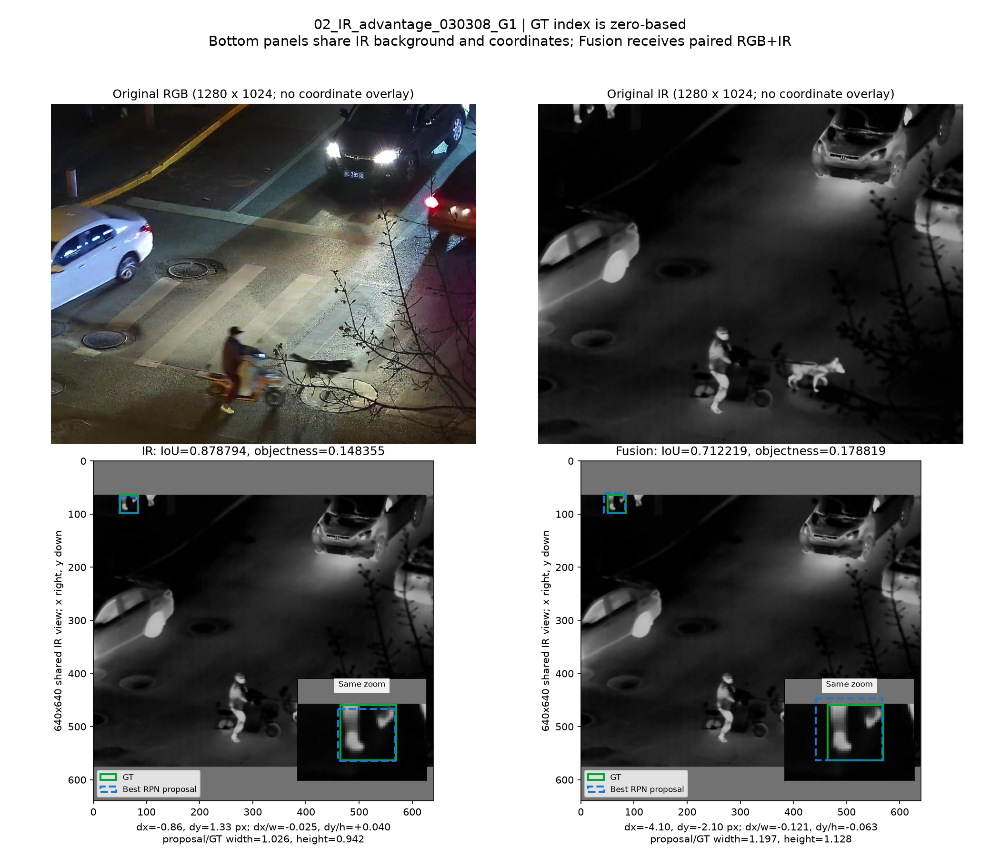
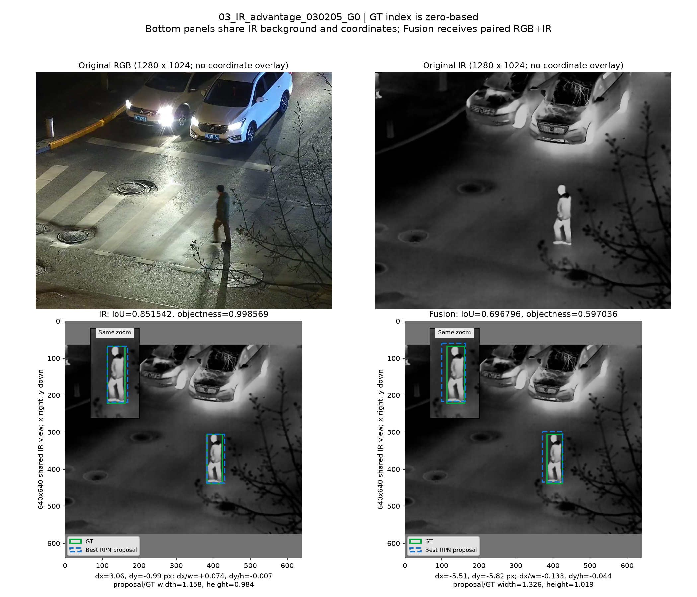
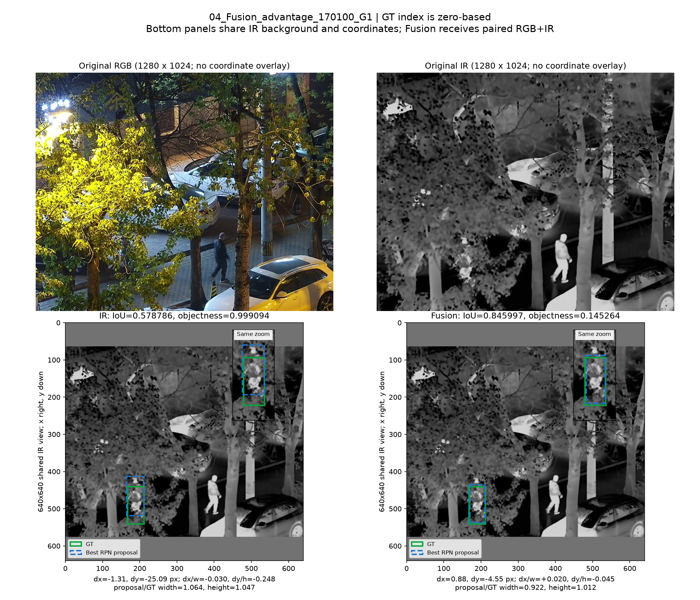
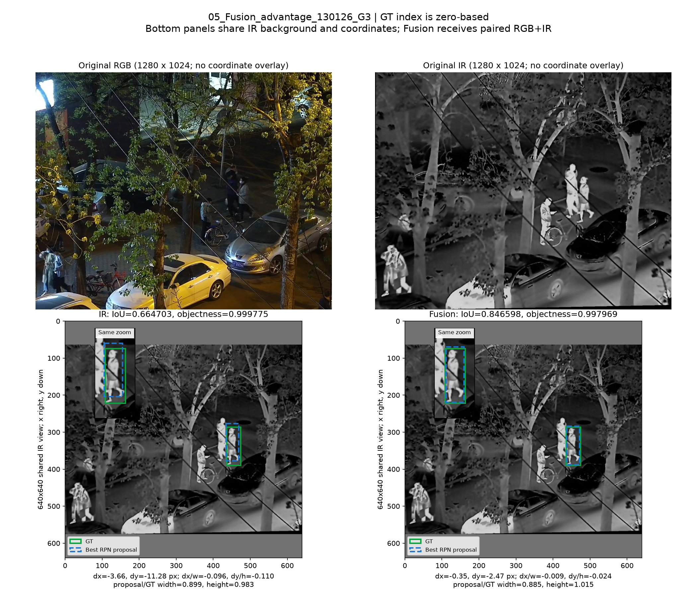
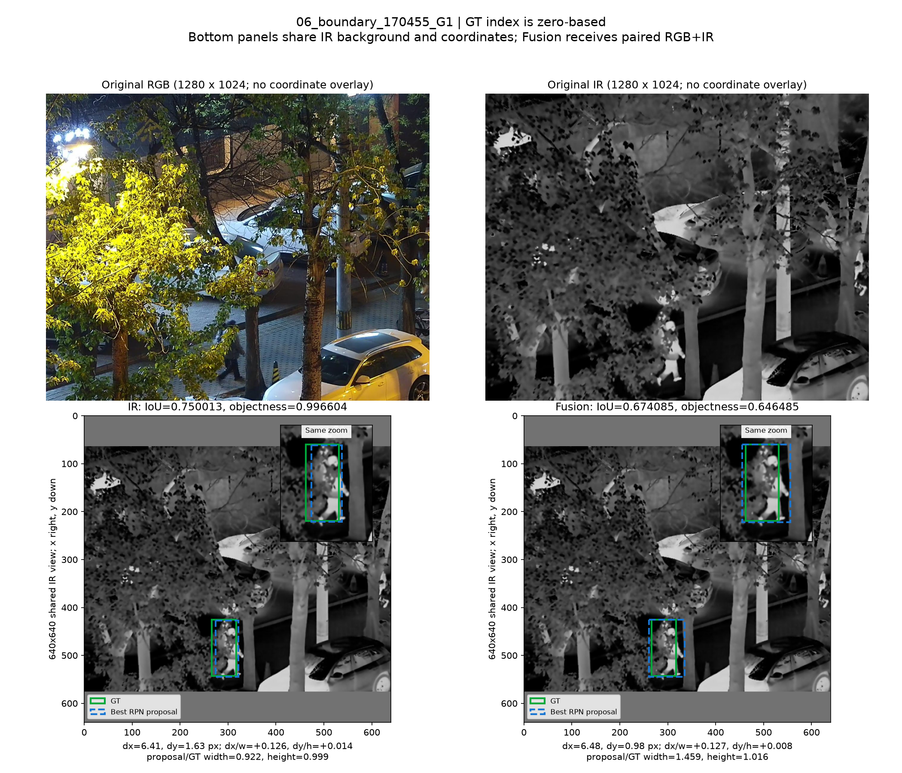

# Week09 Day02：逐图审阅与最终结果说明

状态：六张验证图片已在RTX3060上分别完成IR/Fusion只读前向，进程退出码0；六张最终图已逐张打开检查。未训练、未运行test、未改原RPN预算或任何历史权重。

## 运行与复核证据

真实GPU命令：

~~~powershell
D:\cv-server-env\Scripts\python.exe -B D:\vision-learning-server\week09\day02\visualize_proposals.py --device cuda:0 --seed 42 --threads 2 --output D:\vision-learning-server\week09\day02\outputs\proposal_visualization_run01
~~~

原始GPU输出保留在本目录。初版部分图例和放大标签拥挤，随后仅用保存的CSV在本地重绘到visual_review，模型没有再次前向。当前脚本多了该重绘入口，服务器运行时源版本SHA仍保存在run_metadata.json，不将两版源文件混作同一哈希。
本次原始结果包SHA256：5b254dcfb6b898428439a4805b67b8753a189fc9611d55863e6206e85e9bb481；下载后15项原始文件逐一SHA256核验通过。
独立使用Python float64从全部原RPN候选重算最大IoU，最大误差1.2630032719673778e-07；最佳索引、对应分数、几何量通过；12项本次IoU与Day01完全一致。38个本地历史文件校验未变，服务器也记录了原输入和模型state前后校验。
证据：[GPU运行日志](run.log)、[退出状态](execution_status.json)、[独立复核日志](independent_verification.log)、[完整环境与校验](run_metadata.json)、[仅重绘记录](visual_review/render_metadata.json)。

## 六个案例

坐标均为同次原Letterbox/模型transform后的640×640像素xyxy。dx正值向右，dy正值向下。绿色实线GT、蓝色虚线最大IoU的原后处理候选。原始RGB/IR在上方作参考，下方两格使用相同红外底图及相同放大区域；Fusion仍输入RGB+IR。

### 01_IR_advantage_030269_G1

场景03；gt_index从0开始。选择原因：IR>=0.75>Fusion; scene03 first, then descending IR-Fusion IoU。
GT xyxy=[166.5, 203.0, 208.0, 290.5]。

|模型|最大IoU|objectness|最佳proposal xyxy|分数排名/候选数|
|---|---:|---:|---|---|
|IR|0.793667018|0.176903009|[163.464096, 195.282715, 205.988846, 287.749756]|30/57|
|Fusion|0.605291903|0.996665895|[160.723663, 196.25853, 215.076019, 306.634094]|3/105|

|模型|GT中心|Proposal中心|dx,dy(px)|dx/GT宽,dy/GT高|GT宽高|Proposal宽高|宽/高比例|
|---|---|---|---|---|---|---|---|
|IR|(187.250000, 246.750000)|(184.726471, 241.516235)|(-2.523529, -5.233765)|(-0.060808, -0.059814)|(41.500000, 87.500000)|(42.524750, 92.467041)|(1.024693, 1.056766)|
|Fusion|(187.250000, 246.750000)|(187.899841, 251.446312)|(0.649841, 4.696312)|(0.015659, 0.053672)|(41.500000, 87.500000)|(54.352356, 110.375565)|(1.309695, 1.261435)|

放大图中Fusion框在四周扩张，尤其下边界偏下；宽/高比例为1.310/1.261，IR为1.025/1.057。Fusion的中心偏移不大，但框尺寸明显偏大。Fusion objectness约0.996666、IoU仅0.605292，而IR最佳几何框objectness约0.176903、IoU为0.793667：高objectness不保证高IoU。

### 02_IR_advantage_030308_G1

场景03；gt_index从0开始。选择原因：IR>=0.75>Fusion; scene03 first, then descending IR-Fusion IoU。
GT xyxy=[50.5, 64.5, 84.5, 98.0]。

|模型|最大IoU|objectness|最佳proposal xyxy|分数排名/候选数|
|---|---:|---:|---|---|
|IR|0.878793776|0.148354620|[49.192108, 66.806946, 84.083038, 98.350891]|26/58|
|Fusion|0.712219298|0.178818986|[43.039501, 60.2519, 83.751404, 98.052574]|36/105|

|模型|GT中心|Proposal中心|dx,dy(px)|dx/GT宽,dy/GT高|GT宽高|Proposal宽高|宽/高比例|
|---|---|---|---|---|---|---|---|
|IR|(67.500000, 81.250000)|(66.637573, 82.578918)|(-0.862427, 1.328918)|(-0.025365, 0.039669)|(34.000000, 33.500000)|(34.890930, 31.543945)|(1.026204, 0.941610)|
|Fusion|(67.500000, 81.250000)|(63.395452, 79.152237)|(-4.104548, -2.097763)|(-0.120722, -0.062620)|(34.000000, 33.500000)|(40.711903, 37.800674)|(1.197409, 1.128378)|

目标GT贴近有效图像上边缘，尺寸为34×33.5像素；放大图显示Fusion候选向左、向上多扩了一部分。其中心左移4.105px、宽比例1.197；IR中心左移0.862px、宽比例1.026。不能仅据原图亮区判断它造成了偏差，也不能将该边界GT简单当作完整直立行人。

### 03_IR_advantage_030205_G0

场景03；gt_index从0开始。选择原因：IR>=0.75>Fusion; scene03 first, then descending IR-Fusion IoU。
GT xyxy=[383.5, 306.5, 425.0, 439.0]。

|模型|最大IoU|objectness|最佳proposal xyxy|分数排名/候选数|
|---|---:|---:|---|---|
|IR|0.851542413|0.998569250|[383.28241, 306.590332, 431.32782, 436.924316]|1/31|
|Fusion|0.696796298|0.597035766|[371.226837, 299.399841, 426.258881, 434.45929]|11/43|

|模型|GT中心|Proposal中心|dx,dy(px)|dx/GT宽,dy/GT高|GT宽高|Proposal宽高|宽/高比例|
|---|---|---|---|---|---|---|---|
|IR|(404.250000, 372.750000)|(407.305115, 371.757324)|(3.055115, -0.992676)|(0.073617, -0.007492)|(41.500000, 132.500000)|(48.045410, 130.333984)|(1.157721, 0.983653)|
|Fusion|(404.250000, 372.750000)|(398.742859, 366.929565)|(-5.507141, -5.820435)|(-0.132702, -0.043928)|(41.500000, 132.500000)|(55.032043, 135.059448)|(1.326073, 1.019317)|

两模型的候选在高度方向都比较接近GT，Fusion主要表现为左侧外扩和偏宽：左边界误差约−12.273px，宽比例1.326，中心左移5.507px。IR宽比例1.158，中心右移3.055px，整体重合更高。图中存在车灯亮区，但本次未验证它与误差的因果联系。

### 04_Fusion_advantage_170100_G1

场景17；gt_index从0开始。选择原因：Fusion>=0.75>IR; descending Fusion-IR IoU。
GT xyxy=[167.5, 440.5, 211.5, 541.5]。

|模型|最大IoU|objectness|最佳proposal xyxy|分数排名/候选数|
|---|---:|---:|---|---|
|IR|0.578785658|0.999094367|[164.777603, 413.053833, 211.601273, 518.769409]|1/67|
|Fusion|0.845996797|0.145264372|[170.099991, 435.344849, 210.65538, 537.564331]|19/57|

|模型|GT中心|Proposal中心|dx,dy(px)|dx/GT宽,dy/GT高|GT宽高|Proposal宽高|宽/高比例|
|---|---|---|---|---|---|---|---|
|IR|(189.500000, 491.000000)|(188.189438, 465.911621)|(-1.310562, -25.088379)|(-0.029786, -0.248400)|(44.000000, 101.000000)|(46.823669, 105.715576)|(1.064174, 1.046689)|
|Fusion|(189.500000, 491.000000)|(190.377686, 486.454590)|(0.877686, -4.545410)|(0.019947, -0.045004)|(44.000000, 101.000000)|(40.555389, 102.219482)|(0.921713, 1.012074)|

这是Fusion优势反例。IR框整体明显上移，中心dy=−25.088px，约为GT高度的−24.84%；Fusion为−4.545px，约−4.50%。IR最高分候选objectness约0.999094、IoU仅0.578786；Fusion最大IoU框objectness约0.145264，分数排名19，IoU为0.845997。几何最佳框不能以最高分框替代。

### 05_Fusion_advantage_130126_G3

场景13；gt_index从0开始。选择原因：Fusion>=0.75>IR; descending Fusion-IR IoU。
GT xyxy=[436.0, 287.0, 474.0, 389.5]。

|模型|最大IoU|objectness|最佳proposal xyxy|分数排名/候选数|
|---|---:|---:|---|---|
|IR|0.664702535|0.999775231|[434.25647, 276.569824, 468.432068, 377.363647]|1/150|
|Fusion|0.846598208|0.997969091|[437.833832, 283.73526, 471.461639, 387.822662]|8/150|

|模型|GT中心|Proposal中心|dx,dy(px)|dx/GT宽,dy/GT高|GT宽高|Proposal宽高|宽/高比例|
|---|---|---|---|---|---|---|---|
|IR|(455.000000, 338.250000)|(451.344269, 326.966736)|(-3.655731, -11.283264)|(-0.096203, -0.110081)|(38.000000, 102.500000)|(34.175598, 100.793823)|(0.899358, 0.983354)|
|Fusion|(455.000000, 338.250000)|(454.647736, 335.778961)|(-0.352264, -2.471039)|(-0.009270, -0.024108)|(38.000000, 102.500000)|(33.627808, 104.087402)|(0.884942, 1.015487)|

IR框向上且略向左偏，中心dy=−11.283px，底边相对GT偏上约12.136px；Fusion中心dy=−2.471px、底边偏上约1.677px，垂直贴合更好。Fusion本例也偏窄（宽比例0.885），却因中心和上下边界更准确而取得更高IoU，说明不能只用单一宽比例判断框质量。

### 06_boundary_170455_G1

场景17；gt_index从0开始。选择原因：unused GT; one side in [0.70,0.80]; crossing first, then min distance to 0.75。
GT xyxy=[266.0, 425.5, 317.0, 543.0]。

|模型|最大IoU|objectness|最佳proposal xyxy|分数排名/候选数|
|---|---:|---:|---|---|
|IR|0.750012934|0.996604443|[274.387024, 427.206909, 321.433899, 544.552124]|1/92|
|Fusion|0.674085140|0.646484852|[260.770538, 425.520813, 335.187653, 544.944824]|13/104|

|模型|GT中心|Proposal中心|dx,dy(px)|dx/GT宽,dy/GT高|GT宽高|Proposal宽高|宽/高比例|
|---|---|---|---|---|---|---|---|
|IR|(291.500000, 484.250000)|(297.910461, 485.879517)|(6.410461, 1.629517)|(0.125695, 0.013868)|(51.000000, 117.500000)|(47.046875, 117.345215)|(0.922488, 0.998683)|
|Fusion|(291.500000, 484.250000)|(297.979095, 485.232819)|(6.479095, 0.982819)|(0.127041, 0.008364)|(51.000000, 117.500000)|(74.417114, 119.424011)|(1.459159, 1.016375)|

临界IR IoU为0.750012934，仅高于0.75约1.2934×10⁻⁵；可视上仍存在约6.410px的向右中心偏移。Fusion中心向右偏6.479px，与IR接近，但宽比例1.459，明显宽于GT，IoU降至0.674085。跨过0.75阈值不代表几何误差突然消失。

## 重复现象与机制边界

本次三个场景03的IR优势案例，Fusion最佳候选的宽比例分别约1.310、1.197、1.326，均比GT宽；临界案例为1.459。这里存在可重复的“部分Fusion候选偏宽”现象，但这六例经过优势差值选择，不能据此估计全验证集比例，更不能认定所有Fusion候选都偏宽。
两个Fusion优势反例中，IR候选都明显上移，Fusion的垂直位置更接近GT。Fusion六例高度比例均大于1，但其中四例仅高约1%–2%，不能把符号相同写成同等严重的系统误差。
个别高objectness候选定位较差，而低objectness候选最大IoU更高；这在两模型中都能观察到，不能据此只指责Fusion。分数不等于IoU，也不是最终person分类置信度。

## Day03建议：先查原RPN筛选与框回归

目前不建议直接修改融合模块。优先固定这六张val图片和原权重，记录解码后的候选及逐层pre-NMS、score过滤、NMS、post-NMS各步去留，按GT追踪最佳IoU和分数排名：若高IoU框在筛选前存在却被丢弃，继续检查排序/筛选；若解码前后始终缺乏高IoU框，再检查框回归和融合特征。先保持原预算不变，不用扩大Top-N制造改善。
这些步骤尚未执行。本次是RPN后处理个例的几何观察，尚不能把原因归到融合特征、RPN回归、score/NMS中的某一个，也不能直接解释全部历史test AP75差异。

完整数据：[选例表](selected_cases.csv)、[最佳候选坐标与objectness](proposal_details.csv)、[几何量](geometry_analysis.csv)、[全部实际后处理候选及分数](rpn_proposals.json)、[原自动中文报告](day02_report.md)。
