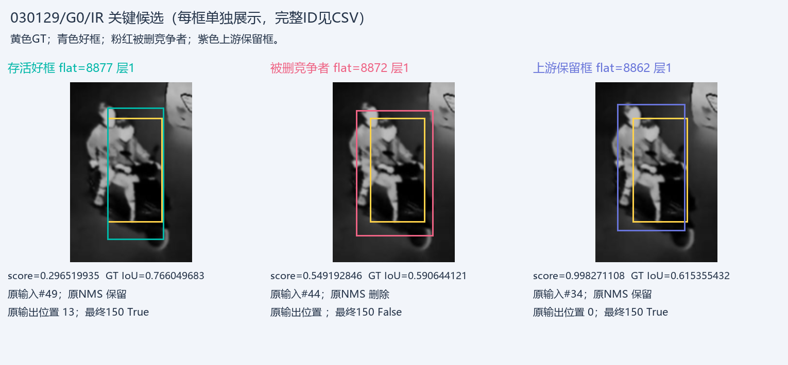
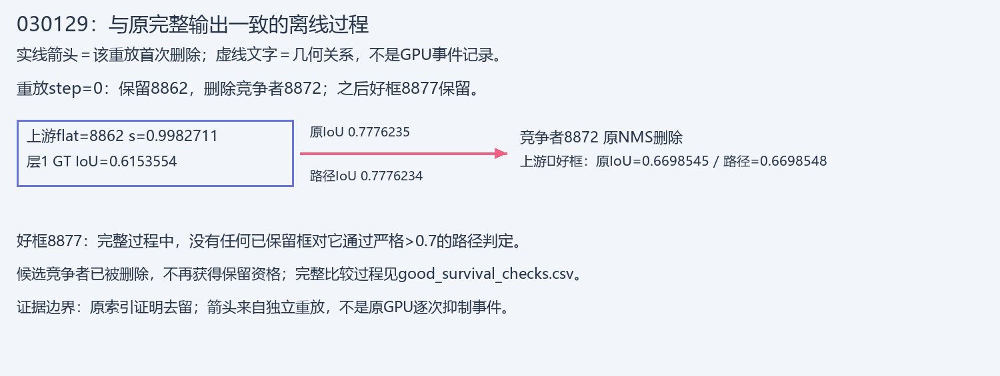
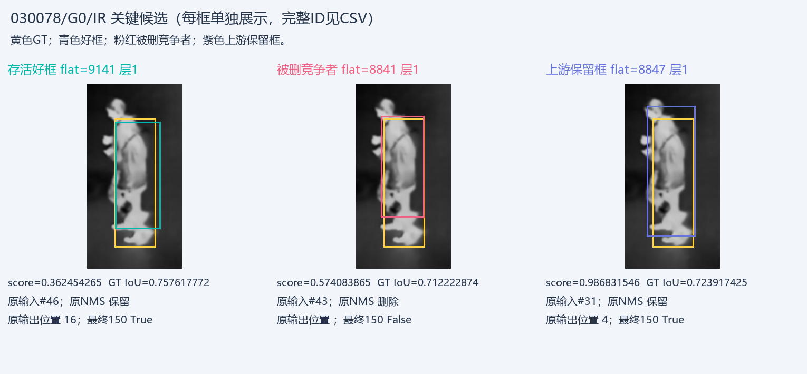
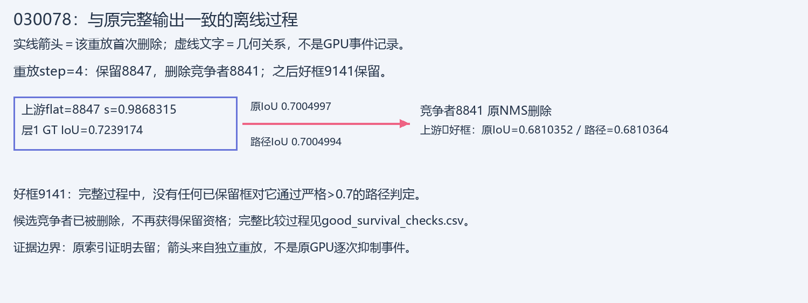

# Week10 Day02：两个IR案例的上游关系与离线重放

可以把NMS理解为：先从剩余候选中挑最高分框保留，再删除与它高度重叠的候选；被删除的框以后不会再轮到它删别人。Day01发现的两个直接竞争者虽然分数高于好框，但它们本身是否先被处理掉，T并没有表达。本轮用完整原输入重现这个过程，再与原全部输出核对。

下面的“首次删除者”只属于本次独立离线重放。原捕获只保存了完整输入和输出，没有保存GPU逐次抑制事件。完整输出匹配后才能称为“与原完整输出一致的离线重放解释”。

## 完整输出核验

|图片|全部输入|原输出|重放输出|完整序列|layer_nms字段|最终150|
|---|---:|---:|---:|---|---|---|
|030129|80|51|51|True|True|True|
|030078|65|36|36|True|True|True|

## 030129/G0/IR

完整输出核验：True。若为False，以下仅为未通过核验的重放观察，不可当作已核验解释。
在本次重放的第0步（步号从0开始），候选`full_val_stage_run01/IR/030129/8862`第一次删除`full_val_stage_run01/IR/030129/8872`。好框`full_val_stage_run01/IR/030129/8877`随后保留。

|角色|完整候选ID|分数|实际层|GT IoU|原NMS去留|原输出位置|
|---|---|---:|---|---:|---|---:|
|存活好框|full_val_stage_run01/IR/030129/8877|0.296519935|1|0.766049683|保留|13|
|被删竞争者|full_val_stage_run01/IR/030129/8872|0.549192846|1|0.590644121|删除||
|上游保留框|full_val_stage_run01/IR/030129/8862|0.998271108|1|0.615355432|保留|0|

|上游flat|与竞争者原IoU|与竞争者路径IoU|与好框原IoU|与好框路径IoU|重放首次删除者|
|---|---:|---:|---:|---:|---|
|8862|0.777623475|0.777623355|0.669854462|0.669854760|True|

好框被选中前，重放实际让13个已保留候选与它比较，其中最大的路径IoU为0.669854760；没有任何一次通过严格>0.7的删除判定。完整比较含其他层，逐行见good_survival_checks.csv。被删竞争者不再留在活动队列中，不能在后续步骤删除好框。
全部最终保留且同层高分、满足原坐标或路径删除几何条件的上游候选共有1个，已全部列出；不限制其GT IoU。列表描述可能几何关系，只有标为首次删除者的一项是该重放的首次归因。
本重放归因无歧义标记：True；同分重叠歧义：False；阈值/精度敏感候选对：0。

## 030078/G0/IR

完整输出核验：True。若为False，以下仅为未通过核验的重放观察，不可当作已核验解释。
在本次重放的第4步（步号从0开始），候选`full_val_stage_run01/IR/030078/8847`第一次删除`full_val_stage_run01/IR/030078/8841`。好框`full_val_stage_run01/IR/030078/9141`随后保留。

|角色|完整候选ID|分数|实际层|GT IoU|原NMS去留|原输出位置|
|---|---|---:|---|---:|---|---:|
|存活好框|full_val_stage_run01/IR/030078/9141|0.362454265|1|0.757617772|保留|16|
|被删竞争者|full_val_stage_run01/IR/030078/8841|0.574083865|1|0.712222874|删除||
|上游保留框|full_val_stage_run01/IR/030078/8847|0.986831546|1|0.723917425|保留|4|

|上游flat|与竞争者原IoU|与竞争者路径IoU|与好框原IoU|与好框路径IoU|重放首次删除者|
|---|---:|---:|---:|---:|---|
|8847|0.700499713|0.700499356|0.681035221|0.681036413|True|

好框被选中前，重放实际让16个已保留候选与它比较，其中最大的路径IoU为0.681036413；没有任何一次通过严格>0.7的删除判定。完整比较含其他层，逐行见good_survival_checks.csv。被删竞争者不再留在活动队列中，不能在后续步骤删除好框。
全部最终保留且同层高分、满足原坐标或路径删除几何条件的上游候选共有1个，已全部列出；不限制其GT IoU。列表描述可能几何关系，只有标为首次删除者的一项是该重放的首次归因。
本重放归因无歧义标记：True；同分重叠歧义：False；阈值/精度敏感候选对：0。

## 原实现依据、数值审计与限制

Day04保存的agnostic_capture.py记录原batched_nms调用的boxes、scores、levels和完整返回索引。Day03保存的nms_source_readonly.txt说明小输入走坐标偏移路径：max_coordinate+1乘层索引再加到每个坐标上，然后统一NMS。65/80个候选的boxes.numel为260/320，均低于保存的CPU/GPU分支阈值。
该Python源码快照来自Day03本地CPU环境，而不是原GPU二进制源码。原捕获环境与当前环境分别记录如下；不能据当前安装版本自动推断原内核。没有原编译CUDA内核源码/编译选项，不能声称逐步算术必然相同。主重放忠实实现保存Python路径的float32偏移及标准贪心语义，再用完整原索引序列验收。
原环境：{"hostname": "DESKTOP-BFIO0RA", "python": "3.14.6 (tags/v3.14.6:c63aec6, Jun 10 2026, 10:26:10) [MSC v.1944 64 bit (AMD64)]", "executable": "D:\\cv-server-env\\Scripts\\python.exe", "torch": "2.14.1+cu126", "torchvision": "0.29.1+cu126", "gpu": "NVIDIA GeForce RTX 3060 Laptop GPU", "platform": "Windows-10-10.0.19045-SP0"}
当前环境：{"python": "3.14.7 (tags/v3.14.7:823f032, Aug  5 2026, 10:51:32) [MSC v.1944 64 bit (AMD64)]", "torch": "2.14.1+cpu", "torchvision": "0.29.1+cpu", "device": "CPU"}
排序在看原输出前已固定：原分数降序，同分按输入位置；未挑选能匹配的排序。主函数仅接收框、分数、层和阈值，不读取GT、标签或原保留索引。重放完成后才读取原索引做序列核验。不调用现成nms/batched_nms。
完整输入所有候选对都审计同分、原坐标float32/float64、偏移坐标float32/float64、阈值附近及判定分歧。同分对0项，阈值或精度敏感对0项。1e-6只标记，主删除判定仍严格>float32(0.7)。完整表保留全部审计值，不用容差强求匹配。
原操作事实：捕获的候选身份、分数、坐标、层、原全部输出及最终150结果。重放归因：独立贪心过程中第一次删除者、删除步号、活动队列的变化。仍不确定：原GPU内部实际抑制事件/时序是否逐项等同这次重放，以及候选分数和坐标为何形成。即使全部输出相同，也不提升为直接捕获的GPU事件。
T只统计对指定GT不达标的竞争者，本轮上游关系没有这个限制；好框之间的关系仍在完整重放中参与，未被排除。Fusion仅引用Day01两例失败的背景，无Fusion重放。没有删除某候选后的反事实实验，没有新增研究指标，也没有RoI或最终检测分析。
图片复用原PairedLetterbox，完整XML GT精确匹配原640×640捕获；局部放大仅用于展示。未根据图像亮区或车灯判断原因。
本次主重放次数=2，完整输出核验次数=2，不是Day01的重放0次。历史文件前后SHA及来源见history_hashes.json、input_provenance.json；最终状态、实际命令、日志、环境、进程退出码见verification.json、run_metadata.json、run.log和同级*_process.json。
如果完整序列未匹配，case_verification.csv与output_comparison.csv保留所有差异；应补充原设备排序/内核数值证据，而不是改排序或放宽阈值。若核验通过，也只得到固定两例的离线过程解释，不能推广总体比例或融合根因。本步骤完成后停止。
