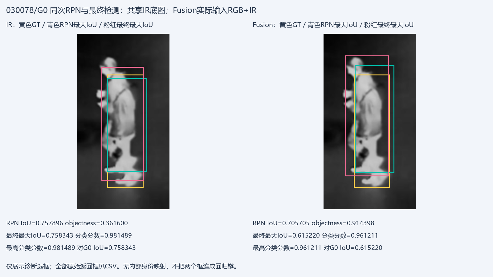
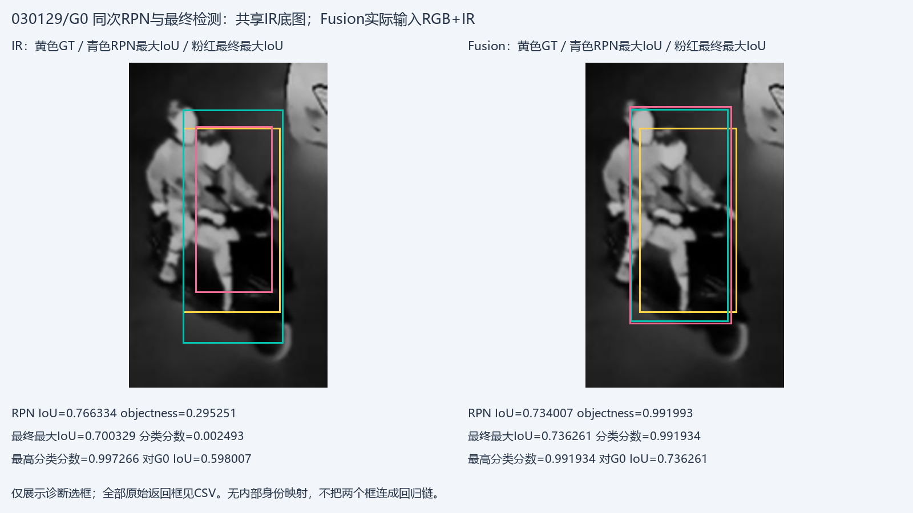

# Week10 Day03：RPN与最终检测终点对照

RPN提供候选，完整模型再返回带类别和分类分数的最终检测。这次只对同一次运行的两个终点检查：有没有对G0达到0.75的框。最大IoU只用于诊断选框，未参与模型筛选。

|图片|模型|历史RPN最大IoU|本次RPN最大IoU|最终正确类别最大IoU|该框分类分数|最高分类分数框的IoU|RPN/最终覆盖|
|---|---|---:|---:|---:|---:|---:|---|
|030078|IR|0.7576177716255188|0.7578962445259094|0.7583428025245667|0.9814887642860413|0.7583428025245667|True/True|
|030129|IR|0.7660496830940247|0.7663343548774719|0.7003291249275208|0.0024934702087193727|0.5980066061019897|True/False|
|030078|Fusion|0.7057521343231201|0.7057053446769714|0.6152200698852539|0.9612109661102295|0.6152200698852539|False/False|
|030129|Fusion|0.7339736819267273|0.7340067028999329|0.7362606525421143|0.9919335246086121|0.7362606525421143|False/False|

原始图片1280×1024，经Letterbox以0.5缩放，上下padding各64，输入640×640。内部transform实测640×640，输出坐标还原到传入的640×640 Letterbox输入，不是原始图片；无需再次缩放或去padding。完整GT与历史精确核对。person标签为1，模型输出类别正确集合按labels==1定义。
历史GPU与本次CPU分别记录；逐位置flat/顺序、坐标及分数差见historical_differences.csv。不设数值容差来强求复现。身份/顺序或覆盖不同的项目只能视为新CPU结果，不可拼接成历史NMS链的后续。
RPN objectness与最终分类分数含义不同。所有返回检测均保存，没有提高0.001阈值，也未因绘图隐藏而删除CSV中的低分结果。完整模型的RoI配置及RPN配置见model_checks.json。
端点最大IoU可来自不同候选，没有RoI内部身份追踪证据，不宣称某个RPN框回归成某个最终框，不能把现象归因为回归、分类阈值或最终NMS。这不是AP75，也不是正式一对一匹配TP。
下一步优先审阅出现RPN未覆盖而最终覆盖的项目；若没有这种组合，则优先检查最终最大IoU框与最高分框差异最大的固定项目。只作下一步建议，本轮不追加前向或阶段归因。

## 实际历史复现与下一步建议

四项RPN数量均与历史相同；030078两模型的flat序列一致，030129两模型序列不一致。下面给出逐位置差值，顺序不同时不能把同位置当作同候选；完整身份及坐标见原始捕获与差异CSV。

|模型|图片|历史/本次数量|flat集合相同|flat序列相同|最大逐位置坐标差|最大逐位置objectness差|
|---|---|---|---|---|---:|---:|
|IR|030078|36/36|True|True|0.03887939453125|0.0015743374824523926|
|IR|030129|51/51|True|False|50.125762939453125|0.0012714862823486328|
|Fusion|030078|67/67|True|True|0.032012939453125|0.0007734894752502441|
|Fusion|030129|64/64|True|False|32.5615234375|0.0006965398788452148|

四项覆盖状态与历史一致，但本次不是GPU逐位复现。特别是030129不能直接拼接Day02历史链。实际最值得下一步追踪的是030129/IR：本次RPN最大IoU=0.766334，最终最大IoU=0.700329且分类分数仅0.002493；最终最高分类分数0.997266对应GT IoU=0.598007。应先追踪同次RoI中达标候选的身份及其后续去向，本轮没有执行该追踪。

运行计数：两次checkpoint加载、两次strict状态加载、一次Fusion零张量BackboneWithFPN探测、四次validation完整模型前向。后续仅读取已保存捕获核验CSV，无额外图片前向。模型state、配置、hook和checkpoint已核对不变，输入SHA在离线交付检查中再次核对。
