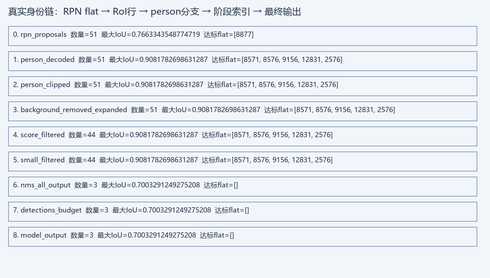
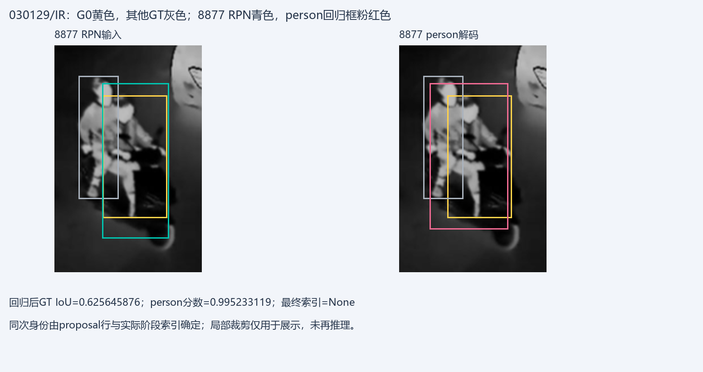

# Week10 Day04：8877的真实RoI身份与阶段追踪

本次精确复现Day03。8877先发生定位变化：RPN框对G0 IoU为0.766334355，person回归解码后降为0.625645876；这时身份仍在，分类分数为0.995233119，不能把这一步称为删框。它通过clip、去背景展开、分类分数过滤和小框过滤，随后不属于原类别NMS的完整保留集合，最终没有输出索引。最终100预算没有进一步删框。

对整个G0而言，情况不同于只盯8877：RPN只有8877达标；person解码产生另外5个达标分支（flat 8571、8576、9156、12831、2576），最大IoU达0.908178270。这5个分支均通过分数与小框过滤，到了类别NMS全部输出时才全部消失，最大IoU降至0.700329125。因此不能仅以8877回归变差解释G0最后失去覆盖，也不能把它归因于0.001分类阈值或最终100预算。

最终最贴合G0的框来自RPN flat 2571（RoI输入行23、输出索引2），分类分数0.002493470；最高分框来自flat 8862（RoI输入行0、输出索引0），分数0.997265697、GT IoU为0.598006606。第三个输出索引1来自flat 8546（RoI行7）。这是索引链确认的来源，不是几何猜测。

8877的person分支解码坐标为[287.0745544433594, 213.264404296875, 356.1933288574219, 342.19476318359375]，对G0 IoU=0.625645876，分类分数=0.995233119。其最终输出索引为None（null表示未进入）。必须区分定位变化和筛选删除，下面完整列出所有阶段。

最终最贴合G0的框来自flat=2571，输出索引2；最高分框来自flat=8862，输出索引0。身份来自真实行号和索引链，没有使用最近框匹配。

Day03逐位复现：True。若False，只解释本次新运行，不能声称这是Day03的内部过程；差异原样保留，无容差放宽、无重复前向。

|阶段|数量|最大GT IoU|达标flat|8877存在|8877 IoU|
|---|---:|---:|---|---|---:|
|rpn_proposals|51|0.7663343548774719|[8877]|True|0.7663343548774719|
|person_decoded|51|0.9081782698631287|[8571, 8576, 9156, 12831, 2576]|True|0.6256458759307861|
|person_clipped|51|0.9081782698631287|[8571, 8576, 9156, 12831, 2576]|True|0.6256458759307861|
|background_removed_expanded|51|0.9081782698631287|[8571, 8576, 9156, 12831, 2576]|True|0.6256458759307861|
|score_filtered|44|0.9081782698631287|[8571, 8576, 9156, 12831, 2576]|True|0.6256458759307861|
|small_filtered|44|0.9081782698631287|[8571, 8576, 9156, 12831, 2576]|True|0.6256458759307861|
|nms_all_output|3|0.7003291249275208|[]|False|None|
|detections_budget|3|0.7003291249275208|[]|False|None|
|model_output|3|0.7003291249275208|[]|False|None|

## 证据性质

实际捕获：原RPN返回、实际RoI输入、predictor原始logits与regression、原decode/softmax/clip结果、原小框过滤与类别NMS索引、实际postprocess返回与完整模型输出。原函数照常调用，返回对象不改变。
经核对的离线重建：去背景、按类别展开、严格scores>0.001的分数索引，以及NMS后前100切片。分数过滤结果与原remove_small_boxes输入逐位一致；小框索引接到原NMS输入，完整NMS索引接到实际postprocess与模型输出，均核对顺序、框、分数与label。背景分支按原实现去掉，不加argmax类别筛选。
RPN阈值0.05/0.7、预算150，与RoI阈值0.001/0.5、预算100、小框min_size=0.01分开。原始图像1280×1024，Letterbox后640×640，上下padding64，内部及最终均640×640。完整GT顺序保留，对G0不达标不等于背景。
本例仅在固定CPU运行中描述阶段变化；没有反事实干预，不证明模型根因，不推广为AP75或全验证集结论。若某框被NMS删除，原返回索引只能确认去留，不能单独命名实际抑制者。本轮没有独立NMS贪心重放。
checkpoint加载一次，strict加载一次，完整模型前向一次，其他探测0次，无Fusion、训练、test、服务器或依赖下载。状态/config/hook/checkpoint核验见model_checks.json；所有历史文件哈希见history_hashes.json。

