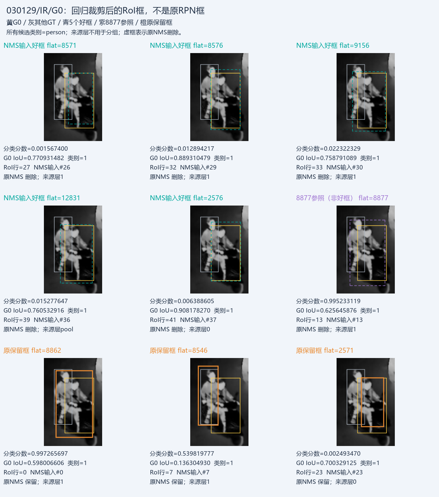
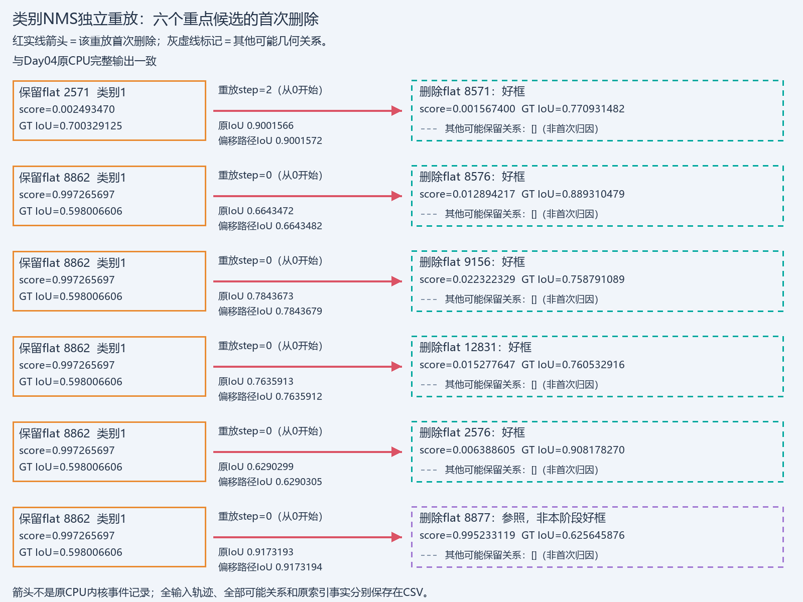

# Week10 Day05：030129/IR最终类别NMS的独立重放核查

本轮只读Day04保存的44个实际RoI类别NMS输入，独立生成全部过程后才对照原输出。以下步号从0开始，分数是person分类分数，不是RPN objectness；flat和来源FPN层仅用于身份说明。

完整核验通过，以下为与Day04原CPU完整输出一致的独立重放解释。
 
## 先回答固定问题

flat 8571在第2步由flat 2571首次删除；flat 8576在第0步由flat 8862首次删除；flat 9156在第0步由flat 8862首次删除；flat 12831在第0步由flat 8862首次删除；flat 2576在第0步由flat 8862首次删除。
5个好框的首次删除归因是否集中在同一个保留框：False。8877作为非好框参照，在第0步由flat 8862首次删除。它在此之前回归后对G0已不达0.75，不能混入5个本阶段好框。

这次解释的关键是：分类NMS按分类分数排列候选，不按它们与G0的IoU排列。与G0贴合更好的低分框可能被先选中的高分框排除。GT仅在过程结束后用于解释，未参与排序或删除。

## 六个重点候选及首次删除归因

|角色|flat|RoI行|NMS输入位置|类别|分类分数|G0 IoU|重放删除步|首次删除者flat|删除者分数|删除者G0 IoU|原坐标相互IoU|偏移路径相互IoU|原/重放一致|
|---|---:|---:|---:|---:|---:|---:|---:|---:|---:|---:|---:|---:|---|
|好框|8571|27|26|1|0.001567400|0.770931482|2|2571|0.0024934702087193727|0.7003291249275208|0.9001566171646118|0.9001572132110596|True|
|好框|8576|32|29|1|0.012894217|0.889310479|0|8862|0.9972656965255737|0.5980066061019897|0.6643471717834473|0.6643481850624084|True|
|好框|9156|33|30|1|0.022322329|0.758791089|0|8862|0.9972656965255737|0.5980066061019897|0.7843673229217529|0.7843679189682007|True|
|好框|12831|39|36|1|0.015277647|0.760532916|0|8862|0.9972656965255737|0.5980066061019897|0.7635912895202637|0.7635912299156189|True|
|好框|2576|41|37|1|0.006388605|0.908178270|0|8862|0.9972656965255737|0.5980066061019897|0.6290298700332642|0.6290305256843567|True|
|8877参照，非好框|8877|13|13|1|0.995233119|0.625645876|0|8862|0.9972656965255737|0.5980066061019897|0.9173192977905273|0.9173194169998169|True|

## 2576：定位最贴合，与排序最靠前不同

2576的person框对G0 IoU=0.908178270，是44个输入中最贴合G0的框；但分类分数仅0.006388605。该重放中先选中保留的flat 8862分类分数为0.997265697，对G0 IoU=0.598006606。二者类别均为person，偏移路径相互IoU=0.629030526>0.5，因此在这次重放中2576被删除。
这里的两个IoU不能混淆：一个比较候选与指定GT，另一个比较候选与候选。分类分数和定位贴合度也不是同一种量。对G0不达标不表示背景或假阳性，图中还有另一个person GT；本轮未进行正式一对一TP/FP匹配。

## 全部原保留框与六个候选的可能关系

retained_focus_all_pairs.csv包含原3个保留框×6个重点候选的全部18个配对，可能关系表不按预期删选；下表列同类别、原分类分数严格更高，且原坐标或实际偏移路径IoU>0.5的全部关系。两个条件单列，保留与主首次归因不同的关系。

|原保留flat|目标flat|原IoU|偏移路径IoU|满足原坐标条件|满足路径条件|该重放首次删除者|
|---|---|---:|---:|---|---|---|
|8862|8576|0.664347172|0.664348185|True|True|True|
|8862|9156|0.784367323|0.784367919|True|True|True|
|8862|12831|0.763591290|0.763591230|True|True|True|
|8862|2576|0.629029870|0.629030526|True|True|True|
|8862|8877|0.917319298|0.917319417|True|True|True|
|2571|8571|0.900156617|0.900157213|True|True|True|

## 完整轨迹与输出核验

|步号|选中flat|选中分类分数|本步新删除flat|
|---:|---:|---:|---|
|0|8862|0.9972656965255737|[12687, 2862, 8877, 2561, 8561, 2572, 12837, 12686, 2556, 8262, 2851, 8547, 8851, 3157, 2547, 12832, 8542, 2542, 9157, 9161, 8876, 12836, 12676, 3156, 2876, 8551, 2551, 9156, 12831, 8576, 8552, 2576, 2552]|
|1|8546|0.5398197770118713|[2546, 8246, 2246, 2541, 2545, 8241, 2241]|
|2|2571|0.0024934702087193727|[8571]|

完整核验结果：`{"original_count": 3, "replay_count": 3, "original_indices": [0, 7, 23], "replay_indices": [0, 7, 23], "full_index_sequence_equal": true, "identity_box_score_class_equal": true, "original_post_and_model_consistent": true, "replay_postprocess_exact": true, "replay_budget_and_model_exact": true}`。
先生成完整保留索引，再比较原索引序列、对应身份/框/分类分数/类别；同时逐位核对实际postprocess返回、原100预算切片和完整模型输出。每个输入恰好一次保留或删除决定，44项没有遗漏或重复。不是只比集合，也不是只核对6个重点框。

## 实现路径、数值审计与证据边界

当前torch/torchvision与Day04均为2.14.1+cpu / 0.29.1+cpu。已保存完整boxes.py快照与SHA，并核对Day04的RoI源码SHA。44×4=176个元素，非tracing，落入CPU小输入坐标偏移路径：类别标签乘(max_coordinate+1)后加到坐标上，再统一按分类分数贪心处理。全为类别1仍执行float32偏移。来源FPN层从未传入重放。
主删除严格IoU>0.5；排序预先固定为分类分数降序、同分输入位置升序。同分审计覆盖全部输入，未尝试第二种排序，未修改分数/阈值/容差。主函数只接收boxes、scores、labels和threshold，没有读取原答案或GT。
全部44个输入共946个无序候选对；同分0对，阈值/精度敏感0对。独立CPU tensor IoU对照验证原坐标和偏移坐标的float32标量结果，float64仅作诊断；1e-6仅作附近标记，不参与主删除条件。非零数值差原样保存在完整审计表，不能把“无判定歧义”写成“没有浮点变化”。
原记录事实：44个实际调用参数、原返回的3个完整索引及最终输出、原索引确认的候选去留、真实RoI行/flat/person映射。经核对的重建：分数过滤和小框索引组成的NMS输入身份链，与实际输入和Day04表逐项相符。独立重放解释：每次选中框、首次删除者、步号与活动集合；可能几何关系：全部原保留框与重点候选的同类别高分重叠条件。四者不混用。
即使完整输出匹配，也不是直接记录了原CPU内核逐次抑制事件。保存的Python实现调用编译内核，本轮没有内核内部事件跟踪；完整输出一致支持固定输入下的独立过程解释，不能据此证明模型形成这些分类分数/回归框的根因。未做删候选、改分数或改阈值反事实实验，不推广总体比例或AP75提升。
模型前向0次、checkpoint加载0次、模型创建/恢复0次。仅加载候选捕获1次（weights_only=True，CPU）；主独立重放1次、完整输出核验1次。额外计算为946对数值审计、float32偏移张量对照、原/偏移IoU矩阵与GT几何核验，没有第二次NMS重放。实际比较次数及各类核验行数见verification.json。
图像与框均在640×640含Letterbox padding坐标系，完整GT与原XML及原PairedLetterbox精确核对；裁剪仅展示。历史和输入SHA前后核验见history_hashes.json、input_provenance.json；实际命令、环境、日志与退出码见run_metadata.json、run.log及同级*_process.json/log。

本限定步骤完成后停止，供另一聊天审阅和教学。
