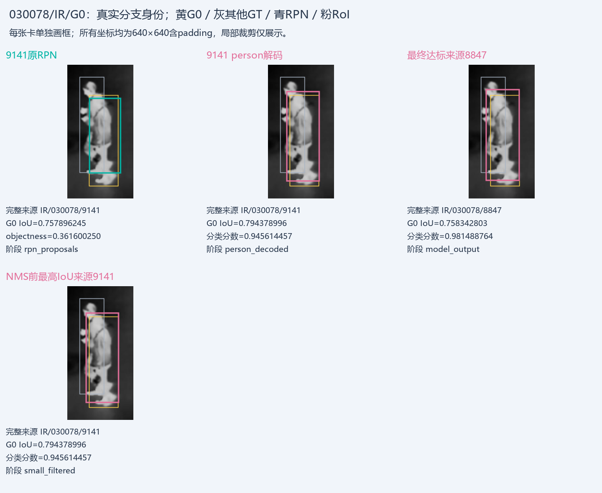
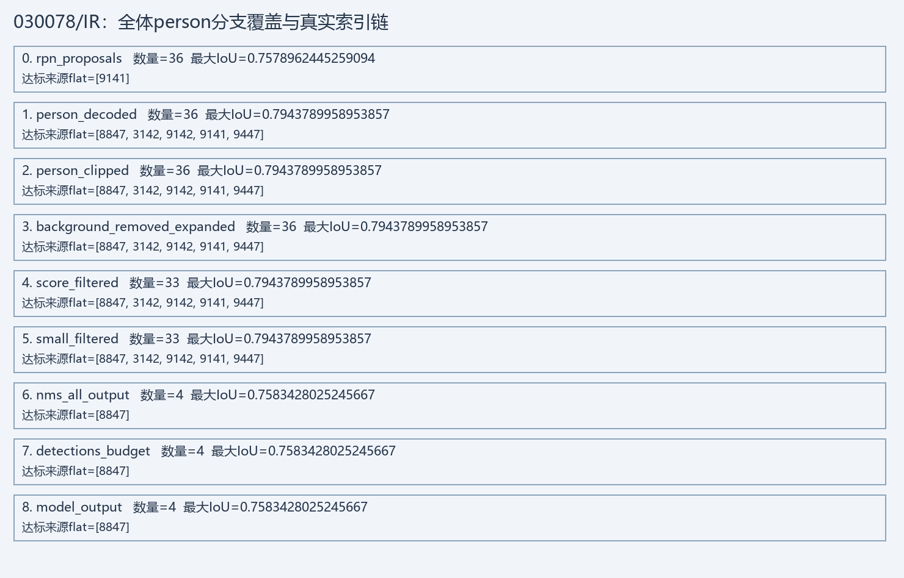
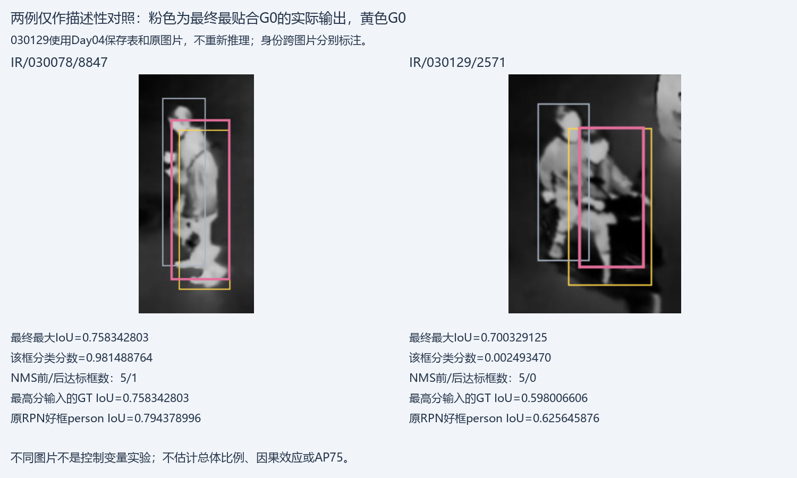

# Week10 Day06：030078/IR成功案例的RoI身份与两例对照

最终达标框的真实来源：success_case_trace_run01/IR/030078/8847/class1（RoI行4，输出索引0，IoU=0.758342803，分类分数=0.981488764）。来源由RPN flat、实际RoI输入行和各阶段索引直接串联，未按几何相似度猜测。
9141原RPN对G0 IoU=0.757896245、objectness=0.361600250；person解码后IoU=0.794378996、分类分数=0.945614457。最终是否仍存在：False；最终IoU=None；首次不再存在的阶段=nms_all_output（null/None表示一直存在）。定位下降与筛选删除分别看表，二者不混同。

Day03完整复现：True。只有True才可把本次捕获作为Day03的内部过程说明；False时仅解释本次新CPU运行，所有差异原样保留，不追加前向。

## 先分清两个结论

最终是否保住G0的0.75覆盖：True。NMS前最高IoU=0.7943789958953857，对应来源flat=[9141]；NMS是否保住至少一个最高IoU分支：False。达到0.75与保住最贴合的那个框是两件事。

## 全36个proposal的阶段覆盖

|阶段|候选数|最大G0 IoU|达标flat|
|---|---:|---:|---|
|rpn_proposals|36|0.7578962445259094|[9141]|
|person_decoded|36|0.7943789958953857|[8847, 3142, 9142, 9141, 9447]|
|person_clipped|36|0.7943789958953857|[8847, 3142, 9142, 9141, 9447]|
|background_removed_expanded|36|0.7943789958953857|[8847, 3142, 9142, 9141, 9447]|
|score_filtered|33|0.7943789958953857|[8847, 3142, 9142, 9141, 9447]|
|small_filtered|33|0.7943789958953857|[8847, 3142, 9142, 9141, 9447]|
|nms_all_output|4|0.7583428025245667|[8847]|
|detections_budget|4|0.7583428025245667|[8847]|
|model_output|4|0.7583428025245667|[8847]|

## 所有阶段曾达标的分支结局

|完整来源|RPN IoU|person解码IoU|分类分数|原NMS保留|最终输出索引|最终达标|首次缺失阶段|
|---|---:|---:|---:|---|---:|---|---|
|success_case_trace_run01/IR/030078/3142/class1|0.588988662|0.772023082|0.820755720|False|None|False|nms_all_output|
|success_case_trace_run01/IR/030078/8847/class1|0.723832965|0.758342803|0.981488764|True|0|True|None|
|success_case_trace_run01/IR/030078/9141/class1|0.757896245|0.794378996|0.945614457|False|None|False|nms_all_output|
|success_case_trace_run01/IR/030078/9142/class1|0.586164057|0.768538117|0.817990243|False|None|False|nms_all_output|
|success_case_trace_run01/IR/030078/9447/class1|0.579279959|0.772497892|0.310796916|False|None|False|nms_all_output|

NMS输入中最高分类分数候选为success_case_trace_run01/IR/030078/8847/class1，分数=0.981488764、G0 IoU=0.758342803；原NMS保留=True，最终输出索引=0。这条记录来自全部实际NMS输入，不是从最终输出倒推。

## 全部最终输出的真实来源

|索引|完整来源|原RPN IoU|person解码IoU|分类分数|最终IoU|
|---:|---|---:|---:|---:|---:|
|0|success_case_trace_run01/IR/030078/8847/class1|0.723832965|0.758342803|0.981488764|0.758342803|
|1|success_case_trace_run01/IR/030078/2531/class1|0.184712932|0.216137931|0.685090125|0.216137931|
|2|success_case_trace_run01/IR/030078/2530/class1|0.095517129|0.101976283|0.038359378|0.101976283|
|3|success_case_trace_run01/IR/030078/2505/class1|0.000000000|0.000000000|0.001790036|0.000000000|

## 两张图片的描述性对照

|核查字段|030078/IR（本次）|030129/IR（原保存表）|
|---|---|---|
|RPN最大IoU|0.7578962445259094|0.7663343548774719|
|RPN达标候选|['IR/030078/9141']|['IR/030129/8877']|
|person解码最大IoU|0.7943789958953857|0.9081782698631287|
|解码后达标数|5|5|
|NMS前达标数|5|5|
|NMS后达标数|1|0|
|NMS最高分类分数来源|IR/030078/8847|IR/030129/8862|
|该候选分类分数|0.9814887642860413|0.9972656965255737|
|该候选G0 IoU|0.7583428025245667|0.5980066061019897|
|该候选是否保留|True|True|
|最终最贴合来源|IR/030078/8847|IR/030129/2571|
|最终最贴合IoU|0.7583428025245667|0.7003291249275208|
|最终最贴合分类分数|0.9814887642860413|0.0024934702087193727|
|是否保住NMS前最高IoU分支|False|False|
|原RPN好框|IR/030078/9141|IR/030129/8877|
|原RPN好框解码后IoU|0.7943789958953857|0.6256458759307861|
|原RPN好框person分数|0.9456144571304321|0.9952331185340881|
|原RPN好框最终索引|None|None|

实际处理差异：030078在NMS前有5个达标分支，完整NMS后保留1个；030129在NMS前有5个，NMS后为0。两图原RPN好框的回归结果和最终达标分支的真实来源也分别列出，不能因为端点IoU接近就把两个端点当作同一个候选。
030129的8877回归后IoU降为0.625646、分类分数0.995233，原NMS删除；另外5个回归达标框也在最终类别NMS处丢失。其具体首次删除归因只引用Day05已有独立重放：8576、9156、12831、2576在step0由8862首次删除，8571在step2由2571首次删除；这是经过原完整输出匹配的重放解释，不是原内核事件记录。本轮未重新执行该重放。
不能概括为成功案例所有候选的分类与定位都更一致。应分别看实际候选：哪一个最高分框对G0达标、哪一个最高IoU框仍被删除、最终达标来自哪个分支。两张图不是控制变量实验，不能据此估计总体比例、因果效应或AP75提升。

## 事实、重建与未知

实际捕获事实：RPN实际输出、RoI实际输入、predictor logits与regression、原decode/softmax/clip结果、小框和类别NMS完整输入与索引、原postprocess及完整模型返回。所有返回值原样交回原调用，GT只用于分析。RPN与类别NMS是本次原模型前向中的两次原调用，额外独立贪心NMS重放为0。
经核对的离线重建：去背景/按类别展开、严格score>0.001的过滤索引与预算切片，分别与下一实际小框输入、实际NMS输入、实际postprocess返回逐项精确核对。没有新增argmax类别筛选。9141与所有最终达标分支的每一步完整状态见追踪CSV，全部proposal与背景/person分支未省略。
原NMS保留索引直接确认删除阶段和保留集合；本轮没有独立重放或内核逐次事件，所以不命名030078中被删分支的实际抑制者。尚不能解释模型为何对某个分支形成这样的回归量和分类分数，也不能仅凭两例推断融合或模型根因。成功仅指指定G0最终存在IoU≥0.75框，不代表整图或整个模型成功。
坐标：原图1280×1024，Letterbox缩放0.5为640×512，上下各64 padding；模型输入、内部transform及最终输出都是640×640画布，不重复去padding。完整GT保留，对G0不达标不等于背景。图中的局部裁剪仅展示，不重新推理。
实际执行counts、模型持久状态/checkpoint/config/hook检查、来源SHA、环境、命令、日志和退出码分别在verification.json、model_checks.json、input_provenance.json、run_metadata.json及run.log中。030129仅读取已有表格和图像，前向0次。核验失败时保留证据并标记，不追加前向。

本限定步骤完成后停止，供审阅与教学。
